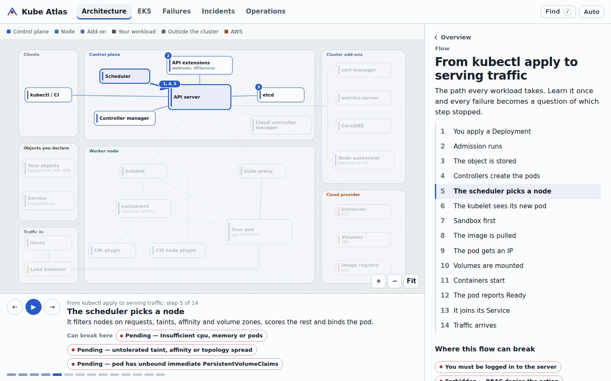
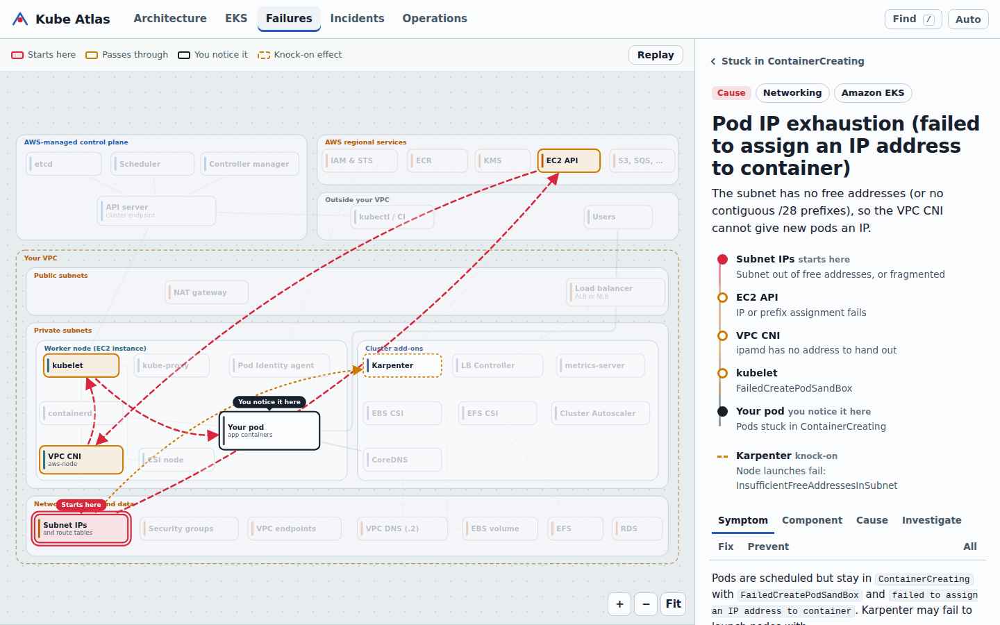
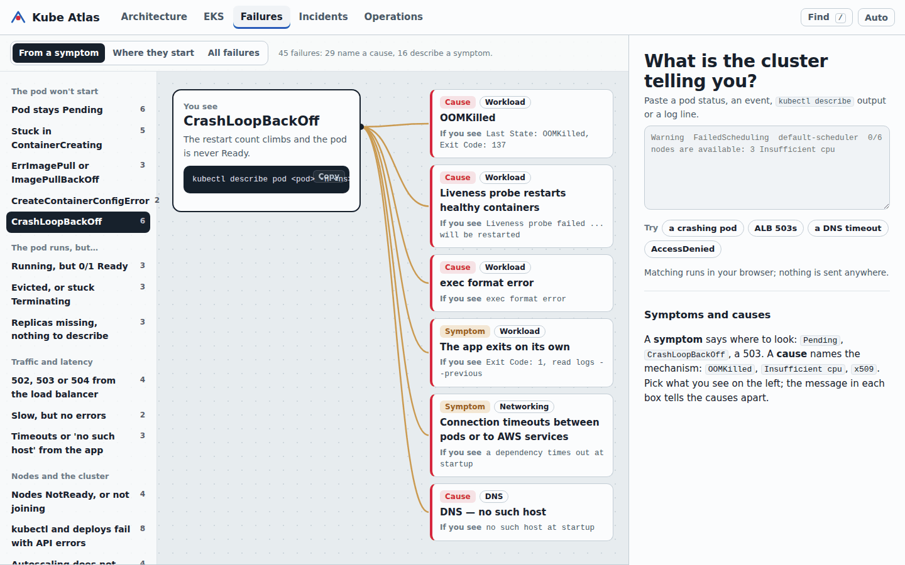
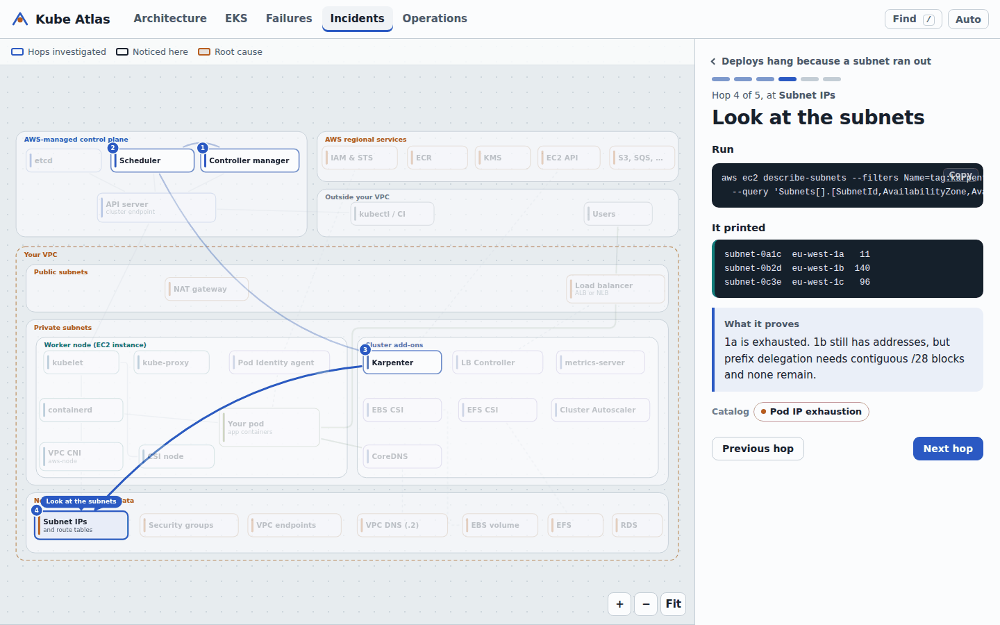
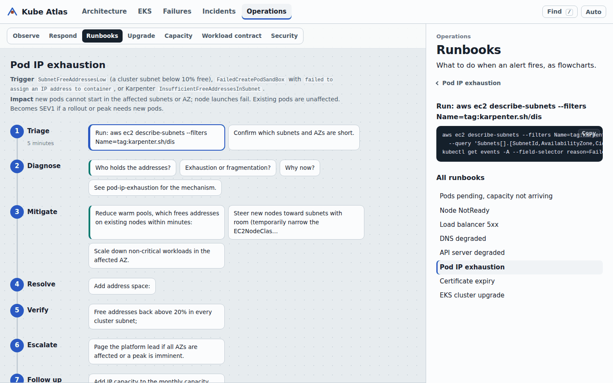
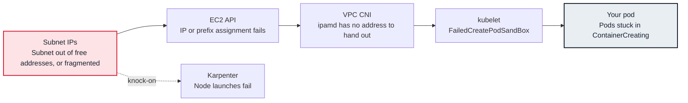
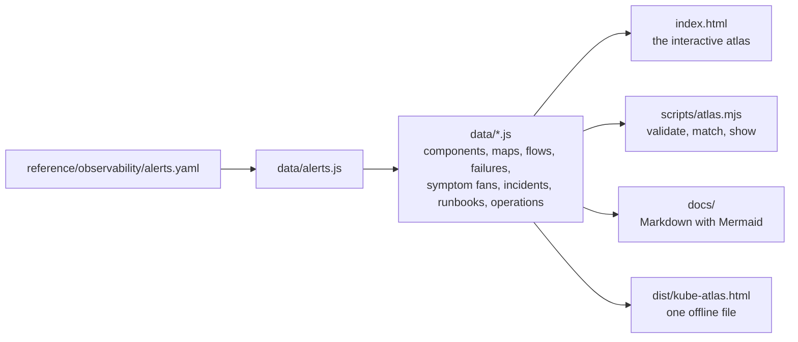

# Kube Atlas

**Kubernetes and Amazon EKS, drawn as a map you can click.** See what every component does and how they connect, play animated flows through the cluster, and watch each of 45 production failures travel from where it starts to where you notice it.



Open `index.html` in a browser. There is no build step, no server and no dependency, and nothing you paste leaves your machine.

## What's inside

| View | What you can do there |
|---|---|
| **Architecture** | Explore the cluster as a map of 24 components across the control plane, the node, add-ons and the cloud. Click any one to see how it works inside, what it calls, what calls it, and which failures start there. Play five flows: `kubectl apply` to serving traffic, a rolling update, a node dying, a traffic spike, and a request inside the cluster. |
| **EKS** | The managed control plane, your VPC and the AWS services around it, through six lenses: networking, identity, load balancing, storage, autoscaling and security. Eight flows (Ingress to ALB, claim to EBS volume, Pod Identity, pending pod to new node and more), decision tables, a production layout and a pod density calculator. |
| **Failures** | 45 failures, each with the six parts: symptom, affected component, root cause, investigation, resolution and prevention. Every one is animated on the map: red where it starts, amber where it passes through, a marker where you notice it, dashed knock-on effects. Start from what you see (17 symptom fans), from where failures begin (a heat map), or paste `kubectl` output. |
| **Incidents** | Four production investigations replayed hop by hop on the map: the command, what it printed, what it proved, and finally the causal chain, contributing factors and fixes. |
| **Operations** | Signals per layer and when to page, the investigation loop and the first fifteen minutes, eight runbooks drawn as flowcharts, the EKS upgrade sequence and version skew, a node capacity calculator, the production workload contract and the security layers. |

| | |
|---|---|
|  |  |
| A failure travels across the map from its cause to its symptom. | Start from what you see; the tell in each box separates the causes. |
|  |  |
| Incidents replay hop by hop, each with its command and finding. | Runbooks are flowcharts; every step opens its commands. |

## How a failure is drawn

Every failure records the path it takes through the system, so the same data drives the animation in the atlas and the diagram on its Markdown page. Pod IP exhaustion, for example:



Statuses such as `CrashLoopBackOff`, `Pending` or a 503 are **symptoms**: they tell you where to look. Messages such as `OOMKilled`, `Insufficient cpu` or `x509` name a **cause**. The catalog marks each entry as one or the other, and the matcher ranks causes above the symptoms they produce.

## Use it during an incident

- **Paste what the cluster printed.** In Failures, paste a status, an event, `kubectl describe` output or a log line; the best match opens with its path drawn on the map.
- **Share a link.** Every view, selection and step has its own address, for example `index.html#/failures/oomkilled?tab=investigate` or `index.html#/incidents/subnet-ran-out/4`.
- **Stay in the terminal.**

  ```sh
  kubectl describe pod orders-api-7d9f8-2kq5w -n shop | node scripts/atlas.mjs match
  node scripts/atlas.mjs show pod-ip-exhaustion
  ```

- **Work offline.** `npm run build` writes `dist/kube-atlas.html`, one file you can keep on a laptop or attach to a ticket. Remove the three font lines in `index.html` and the atlas makes no network requests at all.
- **Read it as Markdown.** [`docs/failures/`](docs/failures/README.md), [`docs/runbooks/`](docs/runbooks/README.md) and [`docs/incidents.md`](docs/incidents.md) are generated from the same data, with Mermaid diagrams GitHub renders.

## How it is built



The data files are the single source of truth. The browser loads them as plain scripts, which is why the atlas works from `file://` and on GitHub Pages without a build. `scripts/atlas.mjs` loads exactly the files `index.html` lists, in the same order, so the site, the docs and the command line cannot disagree. Validation checks every cross-reference, checks that every sample message matches its own entry first, and checks the map geometry: no station may overlap another and no connection may run through a station.

## Repository structure

```text
index.html                 the atlas: open it in a browser
assets/atlas.css           styles, light and dark themes
assets/js/core/            namespace, Markdown, catalog indexes, matcher, router
assets/js/diagram/         the SVG map renderer, the flow player, the propagation animator
assets/js/views/           Architecture, EKS, Failures, Incidents, Operations
data/                      the source of truth: components, maps, flows, failures, triage, incidents, runbooks, operations
docs/                      generated Markdown: failure pages, runbooks, incidents
labs/                      kind labs that reproduce failures on your laptop
reference/                 a production EKS platform: eksctl cluster, Karpenter, add-ons, storage, IAM, workloads, alerts
tools/                     read-only diagnostics: cluster snapshot, DNS check, EKS preflight
scripts/atlas.mjs          validate, generate docs, build one file, match, show
tests/                     unit tests and a browser smoke test
```

The examples follow Larder, a fictional grocery delivery company running `larder-prod` on EKS across three Availability Zones in `eu-west-1`, so the security group in an incident is the one in the reference configuration and the alert that pages you leads to the entry that explains it.

## Practise on your laptop

With Docker, `kind` and `kubectl`:

```sh
make kind-up                  # 1 control plane and 3 workers with zone labels, one tainted for batch
make lab LAB=oomkilled        # break the cluster the way the entry describes
kubectl describe pod -n lab-oomkilled -l app=catalog-cache | node scripts/atlas.mjs match
make lab-clean LAB=oomkilled
```

Each lab asks one question before giving the fix. See [`labs/`](labs/README.md).

## Development

Node 20 or later; nothing to install.

```sh
npm test                 # data integrity, matcher, layout, generated files, Markdown safety
npm run check            # validation, plus generated files are current (CI runs this)
npm run docs             # regenerate docs/ after editing data
npm run build            # dist/kube-atlas.html
npm run serve            # http://localhost:8000, if you prefer a server to file://
npm install --no-save playwright && npx playwright install chromium
npm run test:browser     # render every view and all 45 failures in Chromium
```

Pushes to `main` publish the atlas to GitHub Pages through `.github/workflows/pages.yml`.

## Contributing

Add a failure, a component, a flow or an incident by editing the data; [CONTRIBUTING.md](CONTRIBUTING.md) shows the shape of each and what validation expects. The most valuable contribution is a failure your own platform taught you about.

## Credits

Larder is fictional; account IDs, ARNs and resource IDs are examples. The interface uses Overpass, a typeface drawn from highway signage by Delve Withrington, under the SIL Open Font License, loaded from Google Fonts with system fonts as the fallback. Kubernetes is a trademark of The Linux Foundation. AWS, Amazon EKS and related names are trademarks of Amazon.com, Inc. or its affiliates. This project is not affiliated with either.
