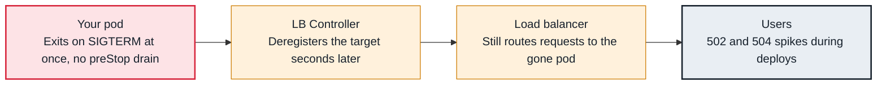

<!-- Generated from data/failures/load-balancing.js by `node scripts/atlas.mjs docs`. Edit the data, then regenerate. -->

# ALB 502 and 504 during deploys and scale-in

Old pods stop before the ALB stops sending them requests (or new pods get traffic too early), so every deploy and scale-in produces 502s and 504s.

| Kind | Layer | Scope | Interactive |
|---|---|---|---|
| Cause | Load balancing | Amazon EKS | [Open in the atlas](../../index.html#/failures/alb-5xx-during-deploys) |

## How it propagates



## Symptom

Short bursts of `502 Bad Gateway` (sometimes `504`) from the ALB line up with rollouts, HPA scale-in, or
Karpenter consolidation. Application logs show no errors for those requests, because the requests never
reached a healthy process.

## Affected component

The race between Kubernetes stopping a pod (**kubelet**, endpoints) and the **ALB** draining that target,
which the **AWS Load Balancer Controller** deregisters only after the endpoint change. The fix lives in
the **application's** shutdown behaviour and pod spec.

## Root cause

When a pod is deleted, two things start **at the same time**: the kubelet runs `preStop` and sends
SIGTERM, and the endpoint removal propagates to the controller, which deregisters the target from the
ALB, which then stops sending new requests. Deregistration takes seconds. If the process exits on
SIGTERM immediately, the ALB keeps sending requests to a closed port for those seconds: `502`.

The other classic 502: **keep-alive mismatch**. The ALB reuses idle connections for up to its idle
timeout (60 seconds by default). If the application closes idle connections sooner (Node.js defaults to
5 seconds), the ALB occasionally sends a request on a connection the backend just closed.

On rollouts, new pods can also be registered but not yet healthy in the target group while old ones are
already gone, unless pod readiness gates make Kubernetes wait for ALB health.

## Investigation

1. **Correlate 5xx with pod lifecycle events**

   ```sh
   aws cloudwatch get-metric-statistics --namespace AWS/ApplicationELB --metric-name HTTPCode_ELB_502_Count \
     --dimensions Name=LoadBalancer,Value=app/k8s-shop-storefro-1a2b3c/4d5e6f --start-time 2026-10-06T09:00:00Z \
     --end-time 2026-10-06T10:00:00Z --period 60 --statistics Sum
   kubectl get events -n shop --field-selector reason=Killing --sort-by=.lastTimestamp
   ```

   Look for: 5xx minutes that match `Killing` events and rollouts.

2. **Check the pod spec for graceful shutdown**

   ```sh
   kubectl get deploy storefront -n shop -o jsonpath='{.spec.template.spec.terminationGracePeriodSeconds}{"\n"}{.spec.template.spec.containers[0].lifecycle}{"\n"}'
   kubectl get ns shop --show-labels | grep pod-readiness-gate-inject
   ```

   Look for: No `preStop` delay, and no readiness gate injection label.

3. **Check the target group's deregistration delay and the app's keep-alive**

   ```sh
   aws elbv2 describe-target-group-attributes --target-group-arn <tg-arn> \
     --query "Attributes[?Key=='deregistration_delay.timeout_seconds']"
   ```

   Look for: A delay longer than the pod's grace period, or an application idle timeout shorter than the ALB's.

## Resolution

Keep the pod serving while the ALB drains it, then shut down gracefully:

```yaml
spec:
  terminationGracePeriodSeconds: 60
  containers:
    - name: web
      lifecycle:
        preStop:
          sleep: { seconds: 20 }     # longer than deregistration propagation
```

Handle SIGTERM by finishing in-flight requests before exiting. Set the application's keep-alive idle
timeout above the ALB idle timeout. Label the namespace with
`elbv2.k8s.aws/pod-readiness-gate-inject=enabled` so rollouts wait for new targets to be healthy, and set
`deregistration_delay.timeout_seconds` below the grace period.

## Prevention

- Make graceful shutdown (preStop delay, SIGTERM handling, keep-alive) part of the service template.
- Run a synthetic load test during a rollout in staging and fail it on any 5xx.
- Alert on ALB 5xx ratio per target group, not only on application error rates.

## Related

- [ALB targets unhealthy](alb-targets-unhealthy.md)
- [Readiness probe failing](readiness-probe-failing.md)
- [Rollout stuck](rollout-stuck.md)

## Runbooks

- [Load balancer 5xx](../runbooks/load-balancer-5xx.md)
