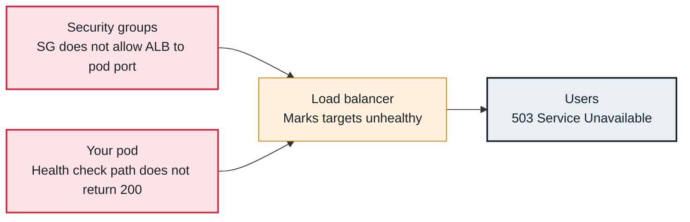

<!-- Generated from data/failures/load-balancing.js by `node scripts/atlas.mjs docs`. Edit the data, then regenerate. -->

# ALB targets unhealthy (503 or no healthy targets)

The ALB's health checks fail, so it has no healthy targets: wrong path or port, a security group blocks it, or the pods are not ready.

| Kind | Layer | Scope | Interactive |
|---|---|---|---|
| Symptom | Load balancing | Amazon EKS | [Open in the atlas](../../index.html#/failures/alb-targets-unhealthy) |

## How it propagates



## Symptom

The ALB returns `503 Service Temporarily Unavailable` (no healthy targets) or errors for a fraction of
requests. In the target group, targets are `unhealthy` with a reason code, while the pods look fine in
`kubectl`.

## Affected component

The **ALB** health checks targets registered by the **AWS Load Balancer Controller**. The health check
path, the **security groups** between the ALB and pods, or the **application's** health endpoint are
usually at fault.

## Root cause

Kubernetes readiness and ALB health are separate checks. A pod can be Ready while the ALB considers it
unhealthy:

- `Target.ResponseCodeMismatch`: the ALB health check path (default `/`) returns 404, 301 or 401 while
  the readiness probe uses `/ready`.
- `Target.Timeout`: the ALB cannot reach the pod. With `target-type: ip` the ALB connects directly to the
  pod IP; with security groups for pods, the pod's own security group must allow the ALB's security group.
  The controller manages backend rules automatically unless that is disabled.
- `Target.NotRegistered` or an empty target group: the Service has no ready endpoints, or a
  `TargetGroupBinding` points to the wrong Service or port.
- All targets unhealthy: the ALB fails open and routes to all of them, so errors can look partial.

## Investigation

1. **Read target health reasons**

   ```sh
   kubectl get targetgroupbindings -n shop -o wide
   aws elbv2 describe-target-health --target-group-arn <tg-arn> \
     --query 'TargetHealthDescriptions[].[Target.Id,Target.Port,TargetHealth.State,TargetHealth.Reason,TargetHealth.Description]' --output table
   ```

   Look for: The reason code; it chooses the next step.

2. **Compare the ALB health check with the readiness probe**

   ```sh
   aws elbv2 describe-target-groups --target-group-arns <tg-arn> \
     --query 'TargetGroups[].[HealthCheckPath,HealthCheckPort,Matcher.HttpCode,HealthCheckTimeoutSeconds]'
   kubectl get deploy storefront -n shop -o jsonpath='{.spec.template.spec.containers[0].readinessProbe.httpGet}'
   ```

   Look for: Different paths or ports.

3. **Check the network path from the ALB to pods**

   ```sh
   kubectl get securitygrouppolicies -n shop
   aws ec2 describe-security-groups --group-ids <pod-or-node-sg> --query 'SecurityGroups[].IpPermissions'
   ```

   Look for: No inbound rule from the ALB's security group on the target port.

## Resolution

Align the ALB health check with the readiness endpoint:

```yaml
metadata:
  annotations:
    alb.ingress.kubernetes.io/healthcheck-path: /ready
    alb.ingress.kubernetes.io/success-codes: "200"
```

Allow the ALB security group to reach the target port on pods or nodes (leave the controller's
backend security group management on), and fix the Service or endpoints if the target group is empty.

## Prevention

- Set the health check path in the Ingress template for every service; never rely on `/`.
- Alert on `UnHealthyHostCount > 0` per target group and on `HealthyHostCount` reaching zero.

## Related

- [Readiness probe failing](readiness-probe-failing.md)
- [Service has no endpoints](service-no-endpoints.md)
- [ALB 502 and 504 during deploys and scale-in](alb-5xx-during-deploys.md)
- [Connection timeouts between pods or to AWS services](connection-timeouts.md)

## Runbooks

- [Load balancer 5xx](../runbooks/load-balancer-5xx.md)
