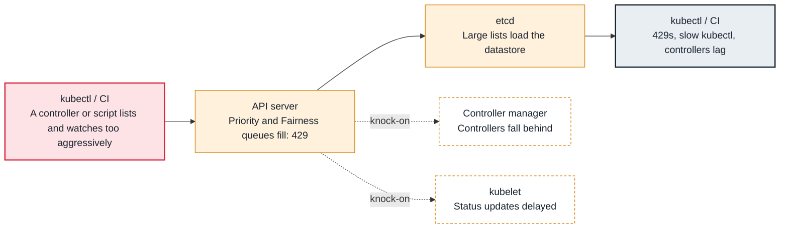

<!-- Generated from data/failures/control-plane.js by `node scripts/atlas.mjs docs`. Edit the data, then regenerate. -->

# API server throttling (429 Too Many Requests) and slow API

A client floods the API server, and API Priority and Fairness starts rejecting requests with 429 Too Many Requests.

| Kind | Layer | Scope | Interactive |
|---|---|---|---|
| Cause | Control plane | Any Kubernetes cluster | [Open in the atlas](../../index.html#/failures/api-throttling) |

## How it propagates



## Symptom

`kubectl` is slow or returns `429 TooManyRequests`; controllers (Argo CD, operators, autoscalers) lag
and log throttling; deploys take minutes to apply. Workloads already running are unaffected.

## Affected component

**API Priority and Fairness** in the **API server** queues and rejects requests per priority level to
protect itself and **etcd**. Client libraries also throttle themselves (`client-side throttling`). The
load almost always comes from a misbehaving **client** or a slow **admission webhook**.

## Root cause

Every request is classified by FlowSchemas into a priority level with a share of the API server's
concurrency. When a level's queues fill, its requests get 429 with `Retry-After`. Typical sources:

- a controller doing full `LIST` calls of large collections (all pods, all secrets) in a loop instead of
  using informers and watches;
- many `kubectl` scripts or CI jobs polling;
- a DaemonSet whose pods each list cluster-wide objects at startup, multiplied by node count;
- slow admission webhooks holding request slots;
- huge objects or collections (thousands of ConfigMaps from Helm history, events) making each list expensive.

`Waited for ... due to client-side throttling` is the client's own rate limiter (QPS and burst), not
the server: it means that client is chatty.

## Investigation

1. **Find which priority levels reject and queue**

   ```sh
   kubectl get --raw /metrics | grep -E '^apiserver_flowcontrol_(rejected_requests_total|current_inqueue_requests)' | sort -t' ' -k2 -nr | head
   kubectl get flowschemas,prioritylevelconfigurations
   ```

   Look for: The `priority_level` and `flow_schema` with rejections.

2. **Find the noisy clients**

   ```sh
   aws logs start-query --log-group-name /aws/eks/larder-prod/cluster --start-time $(date -d '-1 hour' +%s) --end-time $(date +%s) \
     --query-string 'filter @logStream like "kube-apiserver-audit" | stats count(*) as calls by user.username, userAgent, verb | sort calls desc | limit 20'
   ```

   Look for: One user agent or service account with orders of magnitude more calls, especially `list` verbs.

3. **Check webhook latency and object counts**

   ```sh
   kubectl get --raw /metrics | grep -E 'apiserver_admission_webhook_admission_duration_seconds_sum|apiserver_storage_objects' | sort -t' ' -k2 -nr | head -20
   ```

   Look for: Slow webhooks, or resource types with very large counts.

## Resolution

Fix or throttle the noisy client (use informers, add a resync interval, lower its QPS), clean up object
bloat (Helm `--history-max`, completed Jobs with `ttlSecondsAfterFinished`), and fix slow webhooks. If
a legitimate high-volume controller is starved, give it a dedicated FlowSchema and priority level rather
than raising everyone's limits.

## Prevention

- Alert on `apiserver_flowcontrol_rejected_requests_total` rate above zero for 10 minutes, and on API latency SLOs.
- Review new controllers and operators for list/watch behaviour before installing them cluster-wide.
- Keep object counts bounded: Helm history limits, Job TTLs, event retention.

Alerts that lead here: `KubeAPIPriorityAndFairnessRejecting` (ticket).

## Related

- [failed calling webhook](webhook-unavailable.md)
- [etcd database space exceeded or request too large](etcd-space-exceeded.md)
- [APIService unavailable (metrics.k8s.io and others), namespaces stuck Terminating](apiservice-unavailable.md)

## Runbooks

- [API server degraded](../runbooks/api-server-degraded.md)
