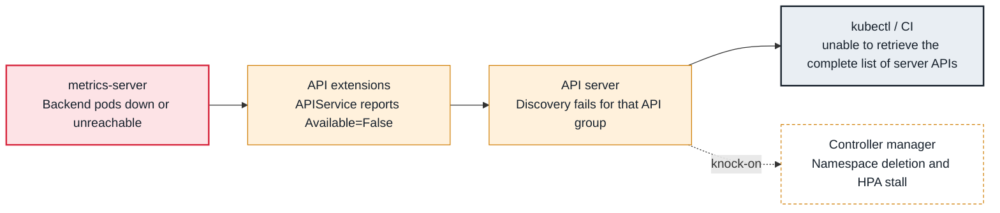

<!-- Generated from data/failures/control-plane.js by `node scripts/atlas.mjs docs`. Edit the data, then regenerate. -->

# APIService unavailable (metrics.k8s.io and others), namespaces stuck Terminating

An aggregated API such as metrics.k8s.io is registered but its backend is down, which breaks discovery for clients and controllers.

| Kind | Layer | Scope | Interactive |
|---|---|---|---|
| Cause | Control plane | Any Kubernetes cluster | [Open in the atlas](../../index.html#/failures/apiservice-unavailable) |

## How it propagates



## Symptom

`kubectl` commands print warnings about `unable to retrieve the complete list of server APIs`; `kubectl
top` fails; HPAs show `<unknown>`; a namespace stays in `Terminating` for days; some controllers that
discover all API groups (garbage collector, Helm, Argo CD) misbehave.

## Affected component

The **aggregation layer** of the **API server** proxies an API group to an in-cluster Service (an
APIService). When that backend (often **metrics-server**) is down or unreachable, discovery for the
group fails, and anything that needs complete discovery is affected.

## Root cause

An APIService registers a group (for example `v1beta1.metrics.k8s.io`) served by a Service in the
cluster. The API server checks it; if the backend is unavailable, the APIService becomes
`Available=False` with `MissingEndpoints` or `FailedDiscoveryCheck`.

Namespace deletion needs to enumerate every resource type to delete contents; if discovery for any group
fails, the namespace controller cannot be sure the namespace is empty, so it waits forever with
`NamespaceDeletionDiscoveryFailure`. One broken metrics add-on can therefore block every namespace deletion
in the cluster.

Causes: the backend pods are down, the Service has no endpoints, the API server cannot reach the pods (on
EKS, security groups between the control plane ENIs and nodes on the backend's port), or an add-on was
uninstalled and left its APIService behind.

## Investigation

1. **Find unavailable APIServices**

   ```sh
   kubectl get apiservices | grep -v True
   kubectl describe apiservice v1beta1.metrics.k8s.io | sed -n '/Status/,$p'
   ```

   Look for: `False` with `MissingEndpoints`, `FailedDiscoveryCheck` or `ServiceNotFound`.

2. **Check the backend**

   ```sh
   kubectl get pods,endpointslices -n kube-system -l k8s-app=metrics-server
   kubectl logs -n kube-system deploy/metrics-server --tail=50
   ```

   Look for: Pods down, or errors scraping kubelets (`x509` or timeouts to port 10250).

3. **For a stuck namespace, read its conditions**

   ```sh
   kubectl get ns old-feature -o jsonpath='{range .status.conditions[*]}{.type}{"="}{.status}{" "}{.message}{"\n"}{end}'
   ```

   Look for: `NamespaceDeletionDiscoveryFailure` naming the group, or remaining resources with finalizers.

## Resolution

Restore the backend (fix metrics-server, open the security group port from the cluster security group to
the nodes on its secure port), or, if the add-on was intentionally removed, delete the orphaned APIService:

```sh
kubectl delete apiservice v1beta1.metrics.k8s.io
```

Stuck namespaces finish deleting on their own once discovery works again.

## Prevention

- Uninstall add-ons with their charts or add-on APIs, never by deleting only their Deployments.
- Run aggregated API servers with two replicas and a PDB.
- Alert on `aggregator_unavailable_apiservice` greater than zero.

Alerts that lead here: `AggregatedAPIUnavailable` (ticket).

## Related

- [HPA shows <unknown> and does not scale](hpa-unknown-metrics.md)
- [Pod stuck in Terminating](pod-stuck-terminating.md)
- [failed calling webhook](webhook-unavailable.md)

## Runbooks

- [API server degraded](../runbooks/api-server-degraded.md)
