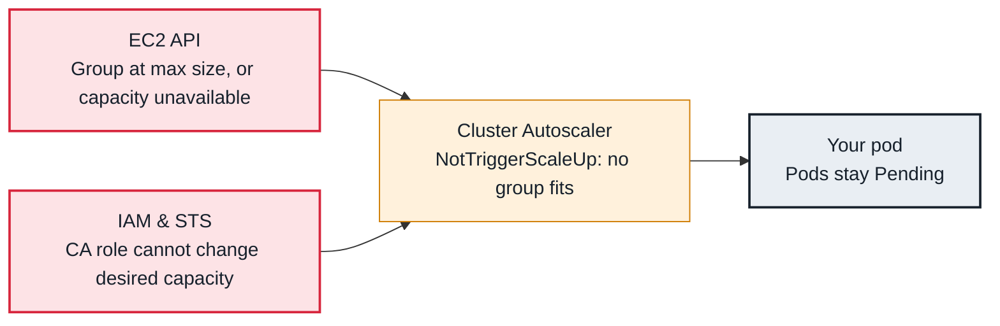

<!-- Generated from data/failures/autoscaling.js by `node scripts/atlas.mjs docs`. Edit the data, then regenerate. -->

# Cluster Autoscaler does not scale up

Pods are Pending but Cluster Autoscaler grows no node group: maximum size, node templates that do not fit, or IAM.

| Kind | Layer | Scope | Interactive |
|---|---|---|---|
| Symptom | Autoscaling | Amazon EKS | [Open in the atlas](../../index.html#/failures/cluster-autoscaler-no-scale-up) |

## How it propagates



## Symptom

Pods stay `Pending` with `Insufficient` resources, and no nodes are added. The pod's events show
`NotTriggerScaleUp` from `cluster-autoscaler`, or nothing from it at all.

## Affected component

**Cluster Autoscaler** simulates scheduling against node group templates and resizes **EC2 Auto Scaling
groups**. It needs to discover the groups, believe a new node would fit the pod, be allowed to grow
them, and have EC2 capacity.

## Root cause

Cluster Autoscaler only scales node groups it knows, and only if a node from that group would make the
pod schedulable:

- **Discovery:** ASGs lack the tags `k8s.io/cluster-autoscaler/enabled` and
  `k8s.io/cluster-autoscaler/<cluster>`, or the autoscaler's `--node-group-auto-discovery` names another
  cluster.
- **Fit:** the template node lacks the labels, taints tolerations or zone the pod needs. A group scaled
  to zero has no real node to copy from, so labels and taints must be declared as ASG tags
  (`k8s.io/cluster-autoscaler/node-template/label/...`).
- **Limits:** `max node group size reached`.
- **Permissions and capacity:** IAM denies `autoscaling:SetDesiredCapacity`, or EC2 cannot launch
  (insufficient capacity for the instance type, vCPU quota). The ASG's activity history shows it.
- **Not running:** the autoscaler itself is crash looping or on a node that disappeared.

## Investigation

1. **Read the autoscaler's events on the pod**

   ```sh
   kubectl get events -n shop --field-selector involvedObject.name=<pod> | grep -i scale
   ```

   Look for: The per-group reasons after `pod didn't trigger scale-up`.

2. **Read its status and logs**

   ```sh
   kubectl get configmap cluster-autoscaler-status -n kube-system -o jsonpath='{.data.status}'
   kubectl logs -n kube-system deploy/cluster-autoscaler --tail=200 | grep -i -E "scale|error|failed"
   ```

   Look for: Discovered groups and their health, backoff after failed scale-ups, IAM errors.

3. **Check the Auto Scaling group from AWS**

   ```sh
   aws autoscaling describe-auto-scaling-groups --filters Name=tag-key,Values=k8s.io/cluster-autoscaler/larder-prod \
     --query 'AutoScalingGroups[].[AutoScalingGroupName,MinSize,MaxSize,DesiredCapacity]' --output table
   aws autoscaling describe-scaling-activities --auto-scaling-group-name <asg> --max-items 5
   ```

   Look for: Groups at max, missing groups, or `InsufficientInstanceCapacity` and quota failures.

## Resolution

Tag the groups for discovery, add node-template tags for labels and taints on groups that scale from
zero, raise maximum sizes, fix IAM, or diversify instance types (mixed instances policy) to escape
capacity shortages. Use one node group per AZ for zonal workloads with `--balance-similar-node-groups`.

## Prevention

- Alert on pods Pending for more than 10 minutes and on `cluster_autoscaler_unschedulable_pods_count`.
- Keep node groups' maximums with headroom and review them in capacity planning.
- Use several instance types per group so one type's capacity shortage does not block scaling.

## Related

- [Pending — Insufficient cpu, memory or pods](pending-insufficient-resources.md)
- [Karpenter does not launch nodes](karpenter-not-provisioning.md)
- [volume node affinity conflict](volume-node-affinity-conflict.md)

## Runbooks

- [Pods pending, capacity not arriving](../runbooks/pending-pods-capacity.md)
