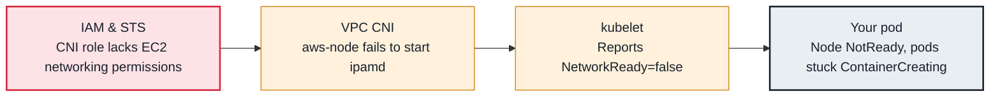

<!-- Generated from data/failures/node.js by `node scripts/atlas.mjs docs`. Edit the data, then regenerate. -->

# Network plugin not ready (cni plugin not initialized)

The VPC CNI (aws-node) is not running or cannot call EC2, so the node cannot give pods network interfaces.

| Kind | Layer | Scope | Interactive |
|---|---|---|---|
| Cause | Node | Amazon EKS | [Open in the atlas](../../index.html#/failures/cni-not-ready) |

## How it propagates



## Symptom

A new node stays `NotReady` with `NetworkPluginNotReady`. Pods scheduled to it stick in
`ContainerCreating`. On EKS the `aws-node` pod on that node is crashing, not ready, or missing.

## Affected component

The **kubelet** reports the node not ready because the **CNI** has not written its configuration. On EKS
the CNI is the `aws-node` DaemonSet (Amazon VPC CNI), which needs **IAM** permissions to manage ENIs.

## Root cause

The kubelet considers the network ready once a CNI configuration exists in `/etc/cni/net.d`. The VPC CNI
writes it when its `aws-node` pod starts successfully. It does not when:

- `aws-node` cannot call EC2 (`ec2:AssignPrivateIpAddresses`, `ec2:CreateNetworkInterface`...): its
  IRSA role or Pod Identity association is missing or wrong, or `AmazonEKS_CNI_Policy` was removed from
  the node role without giving it to the service account;
- its image cannot be pulled (private subnet without ECR endpoints or NAT);
- the add-on version is incompatible with the cluster version, or a custom configuration (custom
  networking `ENIConfig`, prefix delegation) is invalid for that node;
- the node's subnet has no free addresses at all.

## Investigation

1. **Find the aws-node pod on the affected node**

   ```sh
   kubectl get pods -n kube-system -l k8s-app=aws-node -o wide --field-selector spec.nodeName=<node-name>
   kubectl describe pod -n kube-system <aws-node-pod> | sed -n '/Events/,$p'
   ```

   Look for: Image pull errors, readiness failures, crash loops.

2. **Read its logs**

   ```sh
   kubectl logs -n kube-system <aws-node-pod> -c aws-node --tail=100
   # on the node: /var/log/aws-routed-eni/ipamd.log and plugin.log
   ```

   Look for: `AccessDenied`/`UnauthorizedOperation` (IAM), `InsufficientFreeAddressesInSubnet`, or ENIConfig errors.

3. **Check how aws-node gets AWS credentials**

   ```sh
   kubectl get sa aws-node -n kube-system -o jsonpath='{.metadata.annotations}'; echo
   aws eks list-pod-identity-associations --cluster-name larder-prod --namespace kube-system
   aws eks describe-addon --cluster-name larder-prod --addon-name vpc-cni --query 'addon.[addonVersion,status,serviceAccountRoleArn]'
   ```

   Look for: No role annotation, no association and no CNI policy on the node role.

## Resolution

Give the VPC CNI its permissions (an IRSA role or Pod Identity association with `AmazonEKS_CNI_Policy`),
update the add-on to a version supported for your cluster version, and fix image pull paths. Once
`aws-node` is ready, the node becomes Ready on its own.

## Prevention

- Manage the VPC CNI as an EKS add-on with its IAM role in the same code.
- Check add-on versions against the cluster version before every upgrade.
- Alert on DaemonSets with unavailable pods (`kube_daemonset_status_number_unavailable > 0`).

Alerts that lead here: `KubeDaemonSetUnavailable` (ticket).

## Related

- [Node NotReady](node-not-ready.md)
- [Pod IP exhaustion](pod-ip-exhaustion.md)
- [EKS nodes fail to join the cluster](eks-node-join-failure.md)

## Runbooks

- [Node NotReady](../runbooks/node-not-ready.md)
