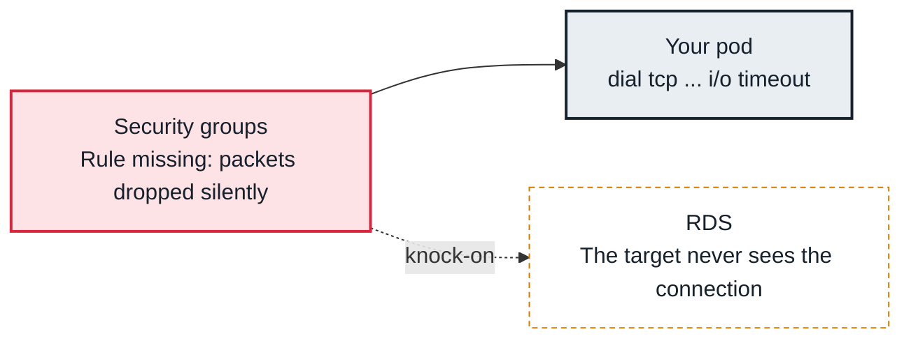

<!-- Generated from data/failures/networking.js by `node scripts/atlas.mjs docs`. Edit the data, then regenerate. -->

# Connection timeouts between pods or to AWS services

Packets are silently dropped on the way: a security group, NACL, route or NetworkPolicy blocks the path, so the client waits until it times out.

| Kind | Layer | Scope | Interactive |
|---|---|---|---|
| Symptom | Networking | Amazon EKS | [Open in the atlas](../../index.html#/failures/connection-timeouts) |

## How it propagates



## Symptom

Requests hang and then fail with `i/o timeout`, `connection timed out` or `ETIMEDOUT`, not with
`connection refused`. Often only some pods are affected (those on new nodes, in one AZ, or with their own
security groups), and only some destinations.

## Affected component

Something on the path silently drops packets: a **NetworkPolicy** enforced by the **CNI**, a **security
group** on the node, the pod's own ENI or the destination (RDS, ElastiCache), a network ACL, or a
missing route in the **VPC**.

## Root cause

A **refusal** is an answer: the packet arrived and nothing listened. A **timeout** is silence: the packet
or its reply was dropped. On EKS the droppers are:

- **NetworkPolicy** (the VPC CNI enforces it with eBPF when enabled): a default-deny policy without an
  allow rule, or an allow rule whose labels do not match. Egress policies that forget DNS (UDP and TCP
  53 to CoreDNS) make every lookup time out first.
- **Security groups for pods:** pods with their own branch ENI use their security group, not the node's,
  so a database security group that allows the node security group does not allow those pods.
- **Destination security groups:** RDS or ElastiCache allowing only the old node security group, so pods
  on Karpenter nodes with a different security group cannot connect.
- **NACLs and routes:** a subnet with a restrictive NACL (forgetting ephemeral return ports), or no route
  to a peered VPC or Transit Gateway.

## Investigation

1. **Establish who can and cannot connect**

   ```sh
   kubectl debug -it <pod> -n shop --image=nicolaka/netshoot --target=api -- nc -vz -w 3 10.20.71.33 5432
   kubectl get pods -n shop -l app=orders-api -o wide
   ```

   Look for: Failures that follow nodes, node pools, AZs or pod security groups.

2. **Check NetworkPolicies in source and destination namespaces**

   ```sh
   kubectl get networkpolicy -n shop
   kubectl get networkpolicy -n payments -o yaml
   ```

   Look for: A default deny without a matching allow, missing DNS egress, mismatched labels or namespaceSelectors.

3. **Check the security groups actually in play**

   ```sh
   kubectl get securitygrouppolicies -A
   aws ec2 describe-instances --instance-ids <node-instance-id> --query 'Reservations[].Instances[].SecurityGroups'
   aws ec2 describe-security-groups --group-ids <db-sg> --query 'SecurityGroups[].IpPermissions'
   ```

   Look for: A destination rule referencing a security group the failing pods do not carry.

4. **Let AWS tell you where packets drop**

   ```sh
   aws ec2 create-network-insights-path --source <pod-or-node-eni> --destination <db-eni> --protocol tcp --destination-port 5432
   # then start-network-insights-analysis; or query VPC Flow Logs for action = REJECT
   ```

   Look for: The component Reachability Analyzer names as blocking, or `REJECT` records in flow logs.

## Resolution

Add the missing allow: a NetworkPolicy rule (including DNS egress), a security group rule referencing
the security group the pods actually use (for example the cluster or Karpenter node security group, or
the pod security group), a NACL rule for ephemeral ports, or a route. Prefer rules that reference
security groups over CIDRs so new nodes inherit access.

## Prevention

- Give every node pool the same baseline security groups, and grant databases access by security group, not by subnet.
- Test NetworkPolicies in CI with a connectivity matrix, and always include DNS egress in default-deny templates.
- Enable VPC Flow Logs for cluster subnets so rejects can be queried during incidents.

## Related

- [Readiness probe failing](readiness-probe-failing.md)
- [DNS timeouts and intermittent resolution failures](dns-timeouts.md)
- [Service has no endpoints](service-no-endpoints.md)
- [failed calling webhook](webhook-unavailable.md)

## Runbooks

- [DNS degraded](../runbooks/dns-degraded.md)

## Reproduce it locally

```sh
make kind-up
make lab LAB=connection-timeouts
make lab-clean LAB=connection-timeouts
```

The lab is [labs/connection-timeouts.yaml](../../labs/connection-timeouts.yaml).
