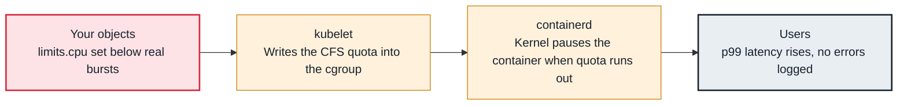

<!-- Generated from data/failures/workload.js by `node scripts/atlas.mjs docs`. Edit the data, then regenerate. -->

# CPU throttling (latency without errors)

The container hits its CPU limit and the kernel pauses it for the rest of each 100 ms period: latency without errors.

| Kind | Layer | Scope | Interactive |
|---|---|---|---|
| Cause | Workload | Any Kubernetes cluster | [Open in the atlas](../../index.html#/failures/cpu-throttling) |

## How it propagates



## Symptom

Latency rises, especially p99, while average CPU usage looks comfortably below the limit. Timeouts and
liveness failures appear under load. Nothing in events or logs says "error".

## Affected component

The **kernel's CFS bandwidth control**, configured by the **kubelet** and **runtime** from
`resources.limits.cpu`, pauses the **application** when it uses its quota within a period.

## Root cause

A CPU limit becomes a quota per 100 ms period: `limits.cpu: 1` allows 100 ms of CPU time per 100 ms,
across all threads. A multi-threaded process can burn that quota in the first 25 ms on four cores and is
then frozen for the remaining 75 ms, even if the node is idle. Averages over a minute hide it completely.

Runtimes that size thread pools from the host's core count (garbage collectors, worker pools) make it
worse: they run many threads against a small quota.

## Investigation

1. **Measure the throttled share of periods**

   ```sh
   # PromQL: fraction of 100 ms periods in which the container was throttled
   # sum by (pod, container) (rate(container_cpu_cfs_throttled_periods_total{namespace="shop"}[5m]))
   #   / sum by (pod, container) (rate(container_cpu_cfs_periods_total{namespace="shop"}[5m]))
   ```

   Look for: Sustained values above about 0.25 on latency-sensitive services.

2. **Compare limits with requests and real usage**

   ```sh
   kubectl get deploy orders-api -n shop -o jsonpath='{.spec.template.spec.containers[0].resources}'
   kubectl top pod -n shop -l app=orders-api --containers
   ```

   Look for: A limit close to the request, on a service with bursty, parallel work.

## Resolution

For latency-sensitive services, set a CPU **request** sized to real usage and either remove the CPU
limit (the request still guarantees a share under contention) or set it well above the request. Keep
memory limits: memory is not compressible, CPU is. Size runtime thread pools to the request
(`-XX:ActiveProcessorCount`, `GOMAXPROCS` via automaxprocs).

## Prevention

- Make "CPU requests always, CPU limits only where you need hard isolation" a written policy.
- Alert on throttling ratio above 0.25 for 15 minutes on tier-1 services.
- Use LimitRange defaults that set requests but not CPU limits.

Alerts that lead here: `KubeCPUThrottlingHigh` (ticket).

## Related

- [Liveness probe restarts healthy containers](liveness-probe-restarts.md)
- [OOMKilled](oomkilled.md)
- [HPA shows <unknown> and does not scale](hpa-unknown-metrics.md)
