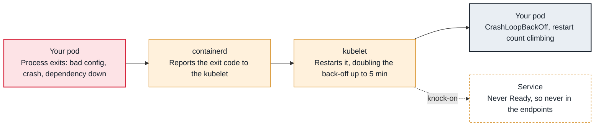

<!-- Generated from data/failures/workload.js by `node scripts/atlas.mjs docs`. Edit the data, then regenerate. -->

# CrashLoopBackOff

The kubelet keeps restarting a container that keeps exiting. The status is its waiting state between restarts, never the cause.

| Kind | Layer | Scope | Interactive |
|---|---|---|---|
| Symptom | Workload | Any Kubernetes cluster | [Open in the atlas](../../index.html#/failures/crashloopbackoff) |

## How it propagates



## Symptom

The pod shows `CrashLoopBackOff` and a climbing restart count. It is never Ready, so it receives no
Service traffic. Between restarts the status may flicker to `Running` or `Error` for a few seconds.

## Affected component

Reported by the **kubelet**, which restarts the container and backs off. The failure almost always
lives in the **application** or what it depends on: its command, configuration, a dependency it
cannot reach, a probe that kills it, or a limit it exceeds.

## Root cause

`CrashLoopBackOff` is not an error. It is the kubelet's *waiting state* between restarts of a container
that keeps exiting. With `restartPolicy: Always`, the kubelet restarts the container and waits 10s,
20s, 40s and so on, capped at five minutes; the delay resets after the container runs for ten minutes.

The question is always *why the container exits*. The usual answers, by exit code:

| Exit code | Meaning | Typical cause |
|---|---|---|
| 1, 2 | the process reported an error | bad configuration, missing environment variable, failed migration, dependency down at startup |
| 126, 127 | not executable / not found | wrong `command`, missing binary, wrong image |
| 137 | SIGKILL | memory limit (`OOMKilled`), or the kubelet killed it after a failed liveness probe |
| 139 | SIGSEGV | native crash |
| 143 | SIGTERM | the kubelet stopped it (liveness probe) and it exited cleanly |
| 0 | exited successfully | a long-running workload whose process finishes (a script, not a server) |

## Investigation

1. **Read the exit code and reason of the last termination**

   ```sh
   kubectl describe pod orders-api-6f7c9d8b5-x2xlq -n shop
   kubectl get pod orders-api-6f7c9d8b5-x2xlq -n shop \
     -o jsonpath='{range .status.containerStatuses[*]}{.name}{"\t"}{.lastState.terminated.reason}{"\t"}{.lastState.terminated.exitCode}{"\n"}{end}'
   ```

   Look for: `Last State: Terminated` with `Reason` and `Exit Code`. `OOMKilled` sends you to the OOMKilled entry; `Error` with code 1 means read the logs.

2. **Read the logs of the previous, crashed container**

   ```sh
   kubectl logs orders-api-6f7c9d8b5-x2xlq -n shop -c api --previous --tail=100
   ```

   Look for: The last lines before exit. `kubectl logs` without `--previous` shows the new attempt, which has usually logged nothing yet.

3. **Check the events for probe kills and config errors**

   ```sh
   kubectl get events -n shop --field-selector involvedObject.name=orders-api-6f7c9d8b5-x2xlq --sort-by=.lastTimestamp
   ```

   Look for: `Liveness probe failed ... will be restarted` means the kubelet is killing a live process (see liveness-probe-restarts).

4. **Compare with the last version that worked**

   ```sh
   kubectl rollout history deployment/orders-api -n shop
   kubectl diff -f reference/apps/orders-api.yaml
   ```

   Look for: A new image, changed environment, ConfigMap or Secret. A crash that began at a deploy is a change, not an incident in the platform.

5. **Reproduce interactively if logs are empty**

   ```sh
   kubectl debug orders-api-6f7c9d8b5-x2xlq -n shop -it --copy-to=orders-api-debug \
     --container=api -- sh
   ```

   Look for: Run the entrypoint by hand inside the copy to see the error the process prints before it dies.

## Resolution

Fix the cause the exit code and logs point to, then let the Deployment roll forward, or roll back
while you fix it:

```sh
kubectl rollout undo deployment/orders-api -n shop
```

If the process needs a dependency at startup, make it retry with backoff instead of exiting, and use a
`startupProbe` for slow starts rather than a long `initialDelaySeconds` on the liveness probe.

## Prevention

- Run new versions in staging with production-like configuration; most crash loops are configuration that only exists in one environment.
- Make startup tolerant of slow dependencies (retry with backoff) and log the reason before exiting non-zero.
- Alert on `kube_pod_container_status_waiting_reason{reason="CrashLoopBackOff"}` for more than 10 minutes, not on single restarts.
- Use rolling updates with `maxUnavailable: 0` and readiness probes, so a crashing version never replaces healthy pods.

Alerts that lead here: `KubePodCrashLooping` (ticket).

## Related

- [OOMKilled](oomkilled.md)
- [Liveness probe restarts healthy containers](liveness-probe-restarts.md)
- [exec format error](exec-format-error.md)
- [CreateContainerConfigError](createcontainerconfigerror.md)
- [Rollout stuck](rollout-stuck.md)

## Reproduce it locally

```sh
make kind-up
make lab LAB=crashloopbackoff
make lab-clean LAB=crashloopbackoff
```

The lab is [labs/crashloopbackoff.yaml](../../labs/crashloopbackoff.yaml).
