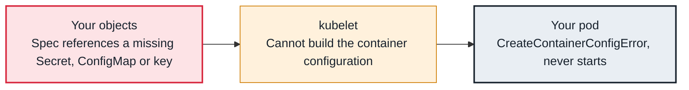

<!-- Generated from data/failures/workload.js by `node scripts/atlas.mjs docs`. Edit the data, then regenerate. -->

# CreateContainerConfigError

The pod references a ConfigMap, Secret or key that does not exist in its namespace, so the container cannot be configured.

| Kind | Layer | Scope | Interactive |
|---|---|---|---|
| Cause | Workload | Any Kubernetes cluster | [Open in the atlas](../../index.html#/failures/createcontainerconfigerror) |

## How it propagates



## Symptom

The pod is scheduled and its image is pulled, but the container is never created. Status is
`CreateContainerConfigError` with zero restarts, and the event names a missing Secret, ConfigMap or key,
or a security context conflict.

## Affected component

The **kubelet** builds the container's configuration (environment, mounts, security context) before
asking the runtime to create it. The cause is in the **workload's** references: an object that does not
exist in this namespace, a key that is not in it, or a security setting the image contradicts.

## Root cause

The kubelet resolves `env.valueFrom`, `envFrom` and the security context when it creates the container.
It cannot proceed if:

- a referenced Secret or ConfigMap does not exist **in the pod's namespace** (they are namespaced; one in
  `default` does not count);
- a referenced key is missing from it (often a renamed key, or a Secret created by an operator that has
  not reconciled yet);
- `runAsNonRoot: true` is set and the image's user is root (UID 0) with no `runAsUser` override.

Volume-mounted Secrets and ConfigMaps fail differently: the pod stays in `ContainerCreating` with a
`FailedMount` event instead.

## Investigation

1. **Read the event that names the missing object**

   ```sh
   kubectl describe pod orders-api-58d9b7c6f4-tt2nv -n shop | sed -n '/Events/,$p'
   ```

   Look for: `secret "x" not found`, `couldn't find key K in Secret ns/x`, or `runAsNonRoot`.

2. **Check the object exists in the right namespace with the right keys**

   ```sh
   kubectl get secret orders-db -n shop -o jsonpath='{.data}' | jq 'keys'
   kubectl get secret -A --field-selector metadata.name=orders-db
   ```

   Look for: The Secret in another namespace, or keys named differently from the reference.

3. **If the Secret is synced from AWS, check the syncer**

   ```sh
   kubectl get externalsecret -n shop
   kubectl describe externalsecret orders-db -n shop
   ```

   Look for: `SecretSyncedError` caused by IAM permissions or a wrong Secrets Manager path.

4. **For runAsNonRoot, check the image user**

   ```sh
   docker inspect --format '{{.Config.User}}' 111122223333.dkr.ecr.eu-west-1.amazonaws.com/orders-api:1.4.2
   ```

   Look for: An empty user (root). Set `runAsUser` or rebuild the image with a numeric non-root `USER`.

## Resolution

Create or fix the referenced object in the pod's namespace, or correct the key name. The kubelet retries
on its own; no pod restart is needed once the object exists. For security context conflicts, set a
numeric `runAsUser` in the pod spec or, better, a numeric `USER` in the image.

Mark references that are genuinely optional with `optional: true` so the container can start without them.

## Prevention

- Deploy configuration and the workload that needs it in the same release (one Helm chart or Kustomize base), with configuration first.
- Validate manifests in CI against the namespace's expected Secrets and keys.
- Build images with a numeric non-root `USER` so `runAsNonRoot` never conflicts.
- Alert on `kube_pod_container_status_waiting_reason{reason="CreateContainerConfigError"}` for more than 5 minutes.

Alerts that lead here: `KubeContainerConfigError` (ticket).

## Related

- [CrashLoopBackOff](crashloopbackoff.md)
- [AccessDenied from a pod calling AWS](pod-aws-access-denied.md)

## Reproduce it locally

```sh
make kind-up
make lab LAB=createcontainerconfigerror
make lab-clean LAB=createcontainerconfigerror
```

The lab is [labs/createcontainerconfigerror.yaml](../../labs/createcontainerconfigerror.yaml).
