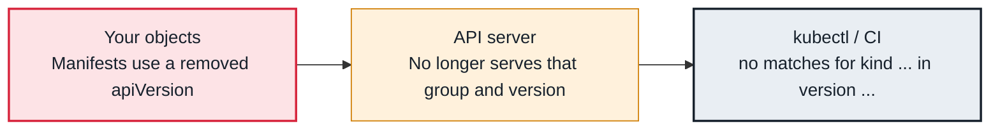

<!-- Generated from data/failures/control-plane.js by `node scripts/atlas.mjs docs`. Edit the data, then regenerate. -->

# no matches for kind ... in version ... (API removed after upgrade)

After an upgrade, manifests still use an API version the cluster no longer serves.

| Kind | Layer | Scope | Interactive |
|---|---|---|---|
| Cause | Control plane | Any Kubernetes cluster | [Open in the atlas](../../index.html#/failures/deprecated-api-removed) |

## How it propagates



## Symptom

After a cluster upgrade, applying manifests or upgrading Helm releases fails with `no matches for kind
X in version Y`. Existing objects keep working; only writes from old manifests fail. GitOps tools show
sync errors.

## Affected component

The **API server** no longer serves that API version. The stale version lives in your manifests, Helm
charts, Helm release history, or **client** tooling.

## Root cause

Kubernetes removes beta API versions some releases after their replacement goes GA. Objects stored in
etcd are migrated automatically, so they keep running, but any request that names the removed version
fails. Helm is a special trap: it stores the previous release's manifest, and an upgrade fails if that
stored manifest uses a removed version, even when the new chart is fixed.

## Investigation

1. **Find deprecated API usage before and after upgrading**

   ```sh
   aws eks list-insights --cluster-name larder-prod --filter categories=UPGRADE_READINESS
   kubectl get --raw /metrics | grep apiserver_requested_deprecated_apis
   ```

   Look for: Insights in `ERROR` or `WARNING` state, and the clients still calling deprecated versions.

2. **Scan manifests and charts**

   ```sh
   pluto detect-files -d apps/ --target-versions k8s=v1.35.0
   pluto detect-helm --target-versions k8s=v1.35.0
   ```

   Look for: Files and releases using removed versions.

## Resolution

Update manifests and charts to the current versions (for example `policy/v1` for PodDisruptionBudget,
`autoscaling/v2` for HPA) and re-apply. For Helm releases whose stored manifest blocks upgrades, rewrite
the release history with the `helm-mapkubeapis` plugin, then upgrade.

## Prevention

- Treat EKS upgrade insights as a gate: no control plane upgrade while any insight is in error.
- Run `pluto` or `kubent` in CI against the next Kubernetes version.
- Upgrade one minor version at a time, staging first, as described in the upgrade runbook.

## Related

- [API server throttling (429 Too Many Requests) and slow API](api-throttling.md)

## Runbooks

- [EKS cluster upgrade](../runbooks/cluster-upgrade.md)
