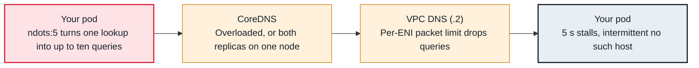

<!-- Generated from data/failures/dns.js by `node scripts/atlas.mjs docs`. Edit the data, then regenerate. -->

# DNS timeouts and intermittent resolution failures

DNS queries are dropped or slow: CoreDNS is overloaded, ndots:5 multiplies queries, or a node exceeds its per-ENI packet limit to the VPC resolver.

| Kind | Layer | Scope | Interactive |
|---|---|---|---|
| Cause | DNS | Amazon EKS | [Open in the atlas](../../index.html#/failures/dns-timeouts) |

## How it propagates



## Symptom

Requests are intermittently slow by about five seconds, or fail with DNS `i/o timeout` and `SERVFAIL`.
Failures cluster at traffic peaks, affect many services at once, and look random from any single pod.

## Affected component

The path from the pod through **CoreDNS** to the **VPC resolver**: CoreDNS capacity, the
**EC2 network allowances** on CoreDNS nodes, conntrack on nodes (**kube-proxy**), and the
**application**'s query volume.

## Root cause

Several mechanisms produce the same symptom:

- **Query amplification (`ndots: 5`):** pods resolve any name with fewer than five dots by trying each
  search domain first. A lookup of `api.stripe.com` becomes up to five lookups, each for A and AAAA,
  most of them `NXDOMAIN`. Traffic to CoreDNS and the VPC resolver grows several-fold.
- **The VPC resolver's per-ENI limit:** each ENI may send 1024 packets per second to link-local
  services, including the Amazon DNS resolver. CoreDNS pods on one node share that node's ENIs; beyond
  the limit, packets are dropped. The counter `linklocal_allowance_exceeded` in `ethtool -S` on the
  node proves it.
- **Too few CoreDNS replicas** for the cluster's size and query rate, or CoreDNS throttled by its CPU
  limit.
- **conntrack races on UDP:** parallel A and AAAA queries from the same socket can collide in the
  kernel's NAT table and one is dropped, which costs a five-second resolver retry.

## Investigation

1. **Check CoreDNS health, errors and latency**

   ```sh
   kubectl get deploy coredns -n kube-system; kubectl top pods -n kube-system -l k8s-app=kube-dns
   kubectl logs -n kube-system -l k8s-app=kube-dns --tail=200 | grep -E "ERROR|timeout"
   # PromQL: histogram_quantile(0.99, sum by (le) (rate(coredns_dns_request_duration_seconds_bucket[5m])))
   ```

   Look for: Upstream timeouts in CoreDNS logs (the VPC resolver side) versus CoreDNS itself saturated or throttled.

2. **Check the link-local allowance on CoreDNS nodes**

   ```sh
   kubectl get pods -n kube-system -l k8s-app=kube-dns -o wide
   kubectl debug node/<coredns-node> -it --image=nicolaka/netshoot -- ethtool -S eth0 | grep -E "allowance_exceeded"
   ```

   Look for: A non-zero and growing `linklocal_allowance_exceeded`.

3. **Measure amplification**

   ```sh
   kubectl exec deploy/orders-api -n shop -- cat /etc/resolv.conf
   # PromQL: sum by (rcode) (rate(coredns_dns_responses_total[5m]))
   ```

   Look for: `ndots:5`, and NXDOMAIN rates several times higher than NOERROR.

## Resolution

- Scale CoreDNS (enable the EKS add-on's autoscaling, or more replicas) and spread replicas across nodes.
- Deploy NodeLocal DNSCache so each node caches answers and CoreDNS traffic drops sharply; it also uses
  TCP upstream, which avoids the conntrack race.
- Cut amplification: use fully qualified names with a trailing dot for external hosts, or set
  `dnsConfig.options: [{name: ndots, value: "2"}]` on workloads that call external APIs.
- Remove CPU limits from CoreDNS, or raise them well above the request.

## Prevention

- Alert on CoreDNS p99 latency above 100 ms and on SERVFAIL rate; export `ethtool` allowance counters from nodes.
- Size CoreDNS with the cluster (autoscaling), keep replicas spread with topology constraints, and protect it with a PDB.
- Make NodeLocal DNSCache part of the cluster baseline for large clusters.

## Related

- [DNS — no such host](dns-nxdomain.md)
- [Connection timeouts between pods or to AWS services](connection-timeouts.md)
- [CPU throttling](cpu-throttling.md)

## Runbooks

- [DNS degraded](../runbooks/dns-degraded.md)
