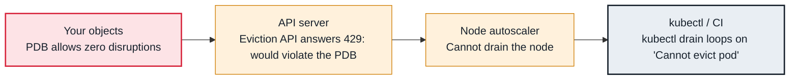

<!-- Generated from data/failures/autoscaling.js by `node scripts/atlas.mjs docs`. Edit the data, then regenerate. -->

# Node drain blocked by a PodDisruptionBudget

A PodDisruptionBudget allows zero disruptions, so drains for upgrades and consolidation wait forever.

| Kind | Layer | Scope | Interactive |
|---|---|---|---|
| Cause | Autoscaling | Any Kubernetes cluster | [Open in the atlas](../../index.html#/failures/drain-blocked-by-pdb) |

## How it propagates



## Symptom

`kubectl drain` loops on `Cannot evict pod as it would violate the pod's disruption budget`. A managed
node group upgrade fails with `PodEvictionFailure`; Karpenter nodes past their expiry linger;
consolidation never removes an idle node.

## Affected component

The **Eviction API** in the API server enforces **PodDisruptionBudgets**. Drains by humans, **managed
node groups**, **Karpenter** and **Cluster Autoscaler** all go through it.

## Root cause

A PDB says how many pods matching a selector may be voluntarily disrupted at once. Eviction is refused
when it would break that promise. Drains get stuck permanently when the promise can never be kept:

- `minAvailable` equal to the replica count (or `maxUnavailable: 0`): nothing may ever be evicted;
- a single-replica Deployment with `minAvailable: 1`;
- pods already unhealthy, so `currentHealthy` is at the minimum and no eviction is allowed (unless
  `unhealthyPodEvictionPolicy: AlwaysAllow` is set);
- the replacement pod cannot schedule (no capacity), so the budget never recovers.

## Investigation

1. **Find the PDBs that allow no disruptions**

   ```sh
   kubectl get pdb -A
   kubectl get pdb -A -o jsonpath='{range .items[?(@.status.disruptionsAllowed==0)]}{.metadata.namespace}/{.metadata.name}{"\n"}{end}'
   ```

   Look for: `ALLOWED DISRUPTIONS 0`, and why: replicas equal to `minAvailable`, or unhealthy pods.

2. **Check the pods behind the budget**

   ```sh
   kubectl describe pdb orders-api -n shop
   kubectl get pods -n shop -l app=orders-api -o wide
   ```

   Look for: Unready pods, or replacements Pending elsewhere.

3. **For EKS managed node groups, read the update status**

   ```sh
   aws eks list-updates --cluster-name larder-prod --nodegroup-name system
   aws eks describe-update --cluster-name larder-prod --nodegroup-name system --update-id <id>
   ```

   Look for: `PodEvictionFailure` and the pods named.

## Resolution

Make the budget satisfiable: use `maxUnavailable: 1` (or a percentage), run at least two replicas for
anything with a PDB, and set `unhealthyPodEvictionPolicy: AlwaysAllow` so broken pods do not block
maintenance. Ensure replacements can schedule before draining. Force (`--disable-eviction`, or the
managed node group `--force` update) only with the owner's agreement: it bypasses the protection.

## Prevention

- Lint PDBs in CI: reject budgets that allow zero disruptions at the declared replica count.
- Alert on PDBs with `disruptionsAllowed == 0` for more than an hour.
- Run maintenance in windows with capacity headroom.

Alerts that lead here: `KubePDBBlockingDisruption` (ticket).

## Related

- [Pending — Insufficient cpu, memory or pods](pending-insufficient-resources.md)
- [Pod stuck in Terminating](pod-stuck-terminating.md)
- [Karpenter does not launch nodes](karpenter-not-provisioning.md)

## Runbooks

- [EKS cluster upgrade](../runbooks/cluster-upgrade.md)

## Reproduce it locally

```sh
make kind-up
make lab LAB=drain-blocked-by-pdb
make lab-clean LAB=drain-blocked-by-pdb
```

The lab is [labs/drain-blocked-by-pdb.yaml](../../labs/drain-blocked-by-pdb.yaml).
