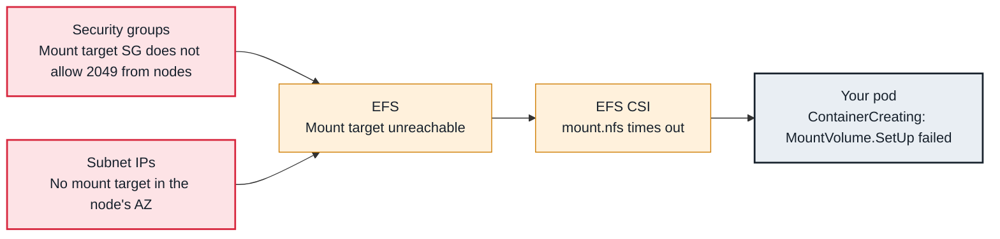

<!-- Generated from data/failures/storage.js by `node scripts/atlas.mjs docs`. Edit the data, then regenerate. -->

# EFS mount timeout

The node cannot reach an EFS mount target on NFS port 2049, so the mount times out and the pod never starts.

| Kind | Layer | Scope | Interactive |
|---|---|---|---|
| Cause | Storage | Amazon EKS | [Open in the atlas](../../index.html#/failures/efs-mount-timeout) |

## How it propagates



## Symptom

Pods mounting an EFS volume stay in `ContainerCreating` with `FailedMount` and `mount.nfs4: Connection
timed out` or `Failed to resolve "fs-...efs..."`. Often only pods in one AZ are affected.

## Affected component

The **EFS CSI node plugin** mounts over NFS (TCP 2049) to the **mount target** in the node's AZ. The
cause is almost always the **security group** on the mount target, a missing mount target, or **VPC**
DNS.

## Root cause

EFS is regional, but clients reach it through one mount target per AZ, each with its own security
group. A mount needs:

- a mount target in the **node's AZ** (otherwise the regional DNS name does not resolve to an address
  in that AZ: `Failed to resolve`);
- the mount target's security group allowing **TCP 2049** from the nodes' (or pods') security groups;
- VPC DNS resolution and hostnames enabled;
- for access points with IAM authorization, a file system policy that allows the driver's role.

## Investigation

1. **Map failing pods to AZs**

   ```sh
   kubectl get pods -n catalog -o wide
   aws efs describe-mount-targets --file-system-id fs-0a1b2c3d --query 'MountTargets[].[AvailabilityZoneName,SubnetId,LifeCycleState,MountTargetId]'
   ```

   Look for: Failing pods in an AZ without an `available` mount target.

2. **Check the mount target security groups**

   ```sh
   aws efs describe-mount-target-security-groups --mount-target-id <fsmt-id>
   aws ec2 describe-security-groups --group-ids <efs-sg> --query 'SecurityGroups[].IpPermissions'
   ```

   Look for: No inbound TCP 2049 from the node security group.

3. **Read the node plugin logs**

   ```sh
   kubectl logs -n kube-system -l app=efs-csi-node -c efs-plugin --prefix --tail=50
   ```

   Look for: Timeouts, DNS failures, or `access denied by server` (file system policy).

## Resolution

Create a mount target in every AZ the cluster uses, allow TCP 2049 from the node security group (or the
cluster security group) on the mount targets' security group, and enable VPC DNS hostnames. Mounts retry
automatically once the path works.

## Prevention

- Provision EFS mount targets for every cluster subnet AZ in the same code as the file system.
- Reference security groups, not CIDRs, in the EFS security group so new node pools are covered.

## Related

- [Connection timeouts between pods or to AWS services](connection-timeouts.md)
- [PVC Pending — volume not provisioned](pvc-pending-provisioning.md)
- [Pod stuck in Terminating](pod-stuck-terminating.md)
