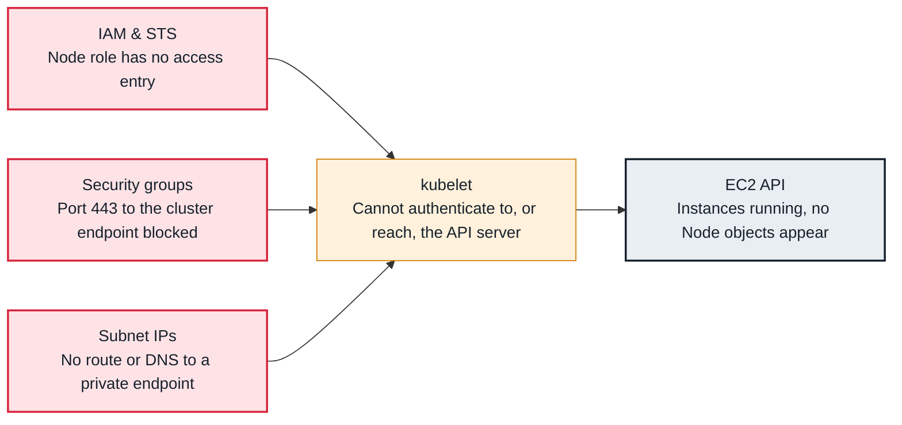

<!-- Generated from data/failures/node.js by `node scripts/atlas.mjs docs`. Edit the data, then regenerate. -->

# EKS nodes fail to join the cluster

Instances launch but never register as nodes: their identity, their network path to the cluster endpoint, or their bootstrap configuration is wrong.

| Kind | Layer | Scope | Interactive |
|---|---|---|---|
| Symptom | Node | Amazon EKS | [Open in the atlas](../../index.html#/failures/eks-node-join-failure) |

## How it propagates



## Symptom

EC2 instances launch and run, but never appear in `kubectl get nodes`. A managed node group goes to
`CREATE_FAILED` or `DEGRADED` with `NodeCreationFailure`; Karpenter NodeClaims stay not `Registered` and
are eventually deleted; pods stay Pending despite new instances.

## Affected component

The **kubelet** cannot register with the **API server**. The cause is identity (**IAM** role not
authorized in the cluster), connectivity (**security groups**, routes, endpoint access, DNS), or the
node's bootstrap configuration.

## Root cause

To join, a node must: reach the cluster endpoint on 443; authenticate with a token derived from its IAM
role; be authorized as a node; and start its kubelet with the right cluster name, endpoint and CA.

- **Not authorized:** the node role has no access entry of type `EC2_LINUX` (or `EC2_WINDOWS`), or in
  `CONFIG_MAP` mode no `aws-auth` mapping to `system:bootstrappers` and `system:nodes`. Logs say
  `Unauthorized`. This often happens with a new Karpenter node role that was never registered.
- **No path:** the private endpoint is enabled with public access off, and the VPC lacks DNS hostnames
  or resolution, or the node security group cannot reach the cluster security group on 443.
- **Bootstrap:** wrong cluster name or endpoint in user data (AL2023 uses `nodeadm` with a `NodeConfig`),
  an AMI for the wrong Kubernetes version, or user data that fails before the kubelet starts.
- **Image pulls at boot:** in private subnets without NAT or endpoints, add-on images such as the VPC CNI
  cannot be pulled, so the node registers but never becomes Ready.

## Investigation

1. **Read the node group or NodeClaim health**

   ```sh
   aws eks describe-nodegroup --cluster-name larder-prod --nodegroup-name system --query 'nodegroup.health'
   kubectl get nodeclaims -o wide
   kubectl describe nodeclaim <name> | sed -n '/Conditions/,$p'
   ```

   Look for: `NodeCreationFailure` with instance ids; NodeClaims `Launched` but not `Registered`.

2. **Check the node role is authorized**

   ```sh
   aws eks list-access-entries --cluster-name larder-prod
   aws eks describe-access-entry --cluster-name larder-prod \
     --principal-arn arn:aws:iam::111122223333:role/KarpenterNodeRole-larder-prod
   kubectl get configmap aws-auth -n kube-system -o yaml   # CONFIG_MAP or API_AND_CONFIG_MAP mode
   ```

   Look for: No entry for the role, or an entry of type `STANDARD` instead of `EC2_LINUX`.

3. **Read the bootstrap and kubelet logs on an instance**

   ```sh
   aws ssm start-session --target i-0abc123def4567890
   sudo journalctl -u nodeadm-config -u nodeadm-run -u kubelet --no-pager | tail -100
   ```

   Look for: `Unauthorized`, `x509`, `dial tcp ...:443: i/o timeout`, or a NodeConfig parse error.

4. **Check the network path and DNS**

   ```sh
   aws eks describe-cluster --name larder-prod --query 'cluster.resourcesVpcConfig'
   aws ec2 describe-vpc-attribute --vpc-id <vpc-id> --attribute enableDnsHostnames
   ```

   Look for: `endpointPublicAccess: false` with DNS hostnames disabled, or security groups that do not allow 443 from nodes.

## Resolution

Create the missing access entry for the node role:

```sh
aws eks create-access-entry --cluster-name larder-prod \
  --principal-arn arn:aws:iam::111122223333:role/KarpenterNodeRole-larder-prod --type EC2_LINUX
```

Then fix connectivity (enable VPC DNS hostnames and resolution, allow 443 from the node security group to
the cluster security group) or the bootstrap configuration, and replace the failed instances.

## Prevention

- Create node roles and their access entries in the same infrastructure-as-code change.
- Use the API authentication mode and manage access entries as code; avoid hand-edited `aws-auth`.
- Run a canary node through any change to AMIs, user data, subnets or security groups.

## Related

- [Node NotReady](node-not-ready.md)
- [Network plugin not ready](cni-not-ready.md)
- [You must be logged in to the server](kubectl-unauthorized.md)
- [Karpenter does not launch nodes](karpenter-not-provisioning.md)

## Runbooks

- [Pods pending, capacity not arriving](../runbooks/pending-pods-capacity.md)
- [Node NotReady](../runbooks/node-not-ready.md)
- [EKS cluster upgrade](../runbooks/cluster-upgrade.md)
