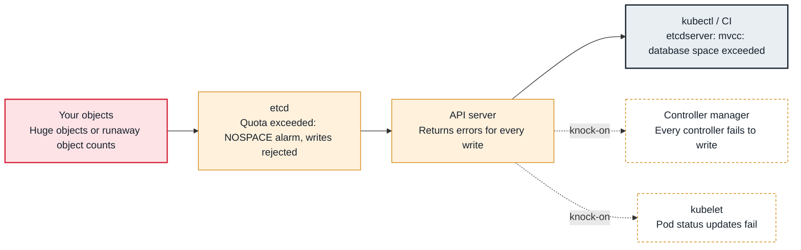

<!-- Generated from data/failures/control-plane.js by `node scripts/atlas.mjs docs`. Edit the data, then regenerate. -->

# etcd database space exceeded or request too large

etcd reached its storage quota, or one object exceeded the size limit, so writes fail across the cluster.

| Kind | Layer | Scope | Interactive |
|---|---|---|---|
| Cause | Control plane | Any Kubernetes cluster | [Open in the atlas](../../index.html#/failures/etcd-space-exceeded) |

## How it propagates



## Symptom

Writes to the cluster fail with `etcdserver: mvcc: database space exceeded` while reads still work; or a
single object fails to save with `request is too large`. In degraded clusters, `etcdserver: request
timed out` and `leader changed` appear intermittently.

## Affected component

**etcd**, through the **API server**. On EKS etcd is managed and you cannot reach it, but you control
the objects that fill it; on self-managed clusters, you own etcd too.

## Root cause

etcd keeps every revision of every key until compaction, and its file only shrinks after
defragmentation. When the database reaches its quota (2 GiB by default upstream, configurable to about
8 GiB), etcd raises a `NOSPACE` alarm and rejects writes. A single request is limited to about 1.5 MiB,
so very large ConfigMaps, Secrets or CRs fail individually.

Growth usually comes from object churn or bloat: thousands of Helm release Secrets, events, completed
Jobs and pods, CRDs with huge status, or a controller that updates objects in a tight loop (each update
is a new revision). Timeouts and leader changes point to slow disks or overloaded members.

## Investigation

1. **Find what consumes storage (works on EKS)**

   ```sh
   kubectl get --raw /metrics | grep -E '^apiserver_storage_(objects|size_bytes)' | sort -t' ' -k2 -nr | head -20
   kubectl get secrets -A -l owner=helm --no-headers | wc -l
   ```

   Look for: Resource types with very large counts, and the reported database size.

2. **On self-managed clusters, check etcd directly**

   ```sh
   ETCDCTL_API=3 etcdctl --endpoints=$ENDPOINTS endpoint status --write-out=table
   ETCDCTL_API=3 etcdctl --endpoints=$ENDPOINTS alarm list
   ```

   Look for: `DB SIZE` near the quota and a `NOSPACE` alarm.

## Resolution

Delete the bloat (old Helm release history, completed Jobs, stale CRs). On self-managed etcd, then
compact, defragment one member at a time, and disarm the alarm:

```sh
rev=$(etcdctl endpoint status --write-out=json | jq '.[0].Status.header.revision')
etcdctl compact "$rev" && etcdctl defrag --endpoints=$MEMBER && etcdctl alarm disarm
```

Keep objects small: store large payloads in S3 and reference them.

## Prevention

- Set Helm `--history-max`, `ttlSecondsAfterFinished` on Jobs, and limits on CR status size.
- Alert on `apiserver_storage_size_bytes` at 70% of the quota and on rapid growth of `apiserver_storage_objects`.
- On self-managed clusters, schedule defragmentation and take etcd snapshots before every change.

Alerts that lead here: `EtcdStorageGrowing` (ticket).

## Related

- [API server throttling (429 Too Many Requests) and slow API](api-throttling.md)
- [no matches for kind ... in version ...](deprecated-api-removed.md)

## Runbooks

- [API server degraded](../runbooks/api-server-degraded.md)
