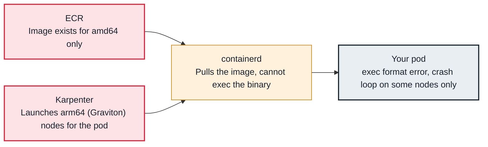

<!-- Generated from data/failures/workload.js by `node scripts/atlas.mjs docs`. Edit the data, then regenerate. -->

# exec format error (image built for another CPU architecture)

The image was built for one CPU architecture and the node runs another, so the entrypoint cannot execute.

| Kind | Layer | Scope | Interactive |
|---|---|---|---|
| Cause | Workload | Amazon EKS | [Open in the atlas](../../index.html#/failures/exec-format-error) |

## How it propagates



## Symptom

New pods crash immediately and loop in `CrashLoopBackOff`; the previous container's log has a single
line: `exec <binary>: exec format error`. Typically only *some* replicas fail: the ones scheduled onto
nodes of the other architecture. A variant fails earlier with `no match for platform in manifest` during
the pull.

## Affected component

The **container runtime** cannot execute the binary. The cause is the **image** (built for one
architecture) meeting a node of another, usually because **Karpenter** or a node group now offers
Graviton (`arm64`) instances alongside `amd64`.

## Root cause

An image contains binaries compiled for one CPU architecture. A multi-architecture image is an index that
points to one manifest per platform, and the runtime pulls the one matching the node. A single-platform
image has no such choice: the runtime pulls it and the kernel refuses to execute an `amd64` binary on an
`arm64` node, or the reverse.

On EKS this appears after a cost change: a NodePool whose requirements allow `kubernetes.io/arch: In
[amd64, arm64]` will happily launch Graviton nodes, and every workload whose image is `amd64`-only
crashes there.

## Investigation

1. **Correlate failing pods with node architecture**

   ```sh
   kubectl get pods -n shop -l app=orders-api -o wide
   kubectl get nodes -L kubernetes.io/arch,karpenter.sh/nodepool,node.kubernetes.io/instance-type
   ```

   Look for: Failing pods all on `arm64` nodes (or all on `amd64`), healthy ones on the other.

2. **Inspect the platforms the image actually provides**

   ```sh
   docker buildx imagetools inspect 111122223333.dkr.ecr.eu-west-1.amazonaws.com/orders-api:1.4.2
   # or: crane manifest <image> | jq '.manifests[].platform'
   ```

   Look for: A single platform, or an index without the node's architecture.

3. **Check what the NodePool allows**

   ```sh
   kubectl get nodepool general -o jsonpath='{.spec.template.spec.requirements}' | jq
   ```

   Look for: `kubernetes.io/arch` with both values, or no arch requirement at all.

## Resolution

Build and push a multi-architecture image, which is the durable fix:

```sh
docker buildx build --platform linux/amd64,linux/arm64 \
  -t 111122223333.dkr.ecr.eu-west-1.amazonaws.com/orders-api:1.4.3 --push .
```

Until then, pin the workload to the architecture its image supports:

```yaml
nodeSelector:
  kubernetes.io/arch: amd64
```

## Prevention

- Build every image for `linux/amd64` and `linux/arm64` in CI and fail the pipeline if the pushed index lacks either.
- Add an admission policy that requires a `kubernetes.io/arch` node selector for images known to be single-architecture.
- Introduce new architectures through a separate NodePool with a taint, and move workloads deliberately.

## Related

- [CrashLoopBackOff](crashloopbackoff.md)
- [Karpenter does not launch nodes](karpenter-not-provisioning.md)
- [ImagePullBackOff / ErrImagePull](imagepullbackoff.md)
