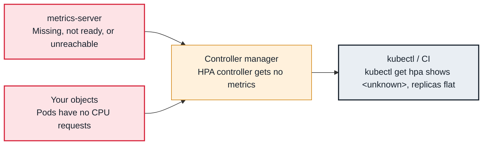

<!-- Generated from data/failures/autoscaling.js by `node scripts/atlas.mjs docs`. Edit the data, then regenerate. -->

# HPA shows <unknown> and does not scale

The HPA cannot read metrics, because metrics-server is missing or unreachable or the pods have no requests, so it cannot scale.

| Kind | Layer | Scope | Interactive |
|---|---|---|---|
| Cause | Autoscaling | Any Kubernetes cluster | [Open in the atlas](../../index.html#/failures/hpa-unknown-metrics) |

## How it propagates



## Symptom

`kubectl get hpa` shows `<unknown>` as the current value; the Deployment stays at its current replica
count during load. Events on the HPA show `FailedGetResourceMetric` or `FailedComputeMetricsReplicas`.

## Affected component

The **HPA controller** (in the controller manager) reads the resource metrics API served by
**metrics-server**, or custom and external metrics from an adapter. The cause is the metrics pipeline,
or **pods without requests** for the metric used.

## Root cause

CPU and memory utilization targets are percentages **of requests**. The HPA needs:

1. the `metrics.k8s.io` APIService available (metrics-server installed, running, and reachable from the
   API server);
2. every container in the target pods to declare a request for that resource (one sidecar without a
   CPU request makes the whole calculation fail);
3. enough ready pods with recent metrics.

For custom metrics, the corresponding adapter (Prometheus Adapter, KEDA) must serve the metric name.

## Investigation

1. **Read the HPA's conditions and events**

   ```sh
   kubectl describe hpa orders-api -n shop
   ```

   Look for: `ScalingActive False` with `FailedGetResourceMetric`, and the message behind it.

2. **Check the metrics API**

   ```sh
   kubectl get apiservice v1beta1.metrics.k8s.io
   kubectl top pods -n shop
   kubectl get pods -n kube-system -l k8s-app=metrics-server
   ```

   Look for: `Available False`, or `kubectl top` failing (see apiservice-unavailable).

3. **Check requests on every container, including injected sidecars**

   ```sh
   kubectl get pod <pod> -n shop -o jsonpath='{range .spec.containers[*]}{.name}{"\t"}{.resources.requests}{"\n"}{end}'
   ```

   Look for: A container with no CPU request, often a sidecar added by a mutating webhook.

## Resolution

Install or repair metrics-server (the EKS community add-on or the Helm chart), and set requests on every
container, including sidecars (configure the injector's resource defaults). For sidecars you cannot
change, use `type: ContainerResource` metrics that target only the main container.

## Prevention

- Require CPU and memory requests on all containers with an admission policy or LimitRange defaults.
- Alert on HPAs with `ScalingActive=false` and on HPAs pinned at `maxReplicas` for 15 minutes.

Alerts that lead here: `KubeHPAMetricsUnavailable` (ticket).

## Related

- [APIService unavailable (metrics.k8s.io and others), namespaces stuck Terminating](apiservice-unavailable.md)
- [Pending — Insufficient cpu, memory or pods](pending-insufficient-resources.md)
- [CPU throttling](cpu-throttling.md)

## Reproduce it locally

```sh
make kind-up
make lab LAB=hpa-unknown-metrics
make lab-clean LAB=hpa-unknown-metrics
```

The lab is [labs/hpa-unknown-metrics.yaml](../../labs/hpa-unknown-metrics.yaml).
