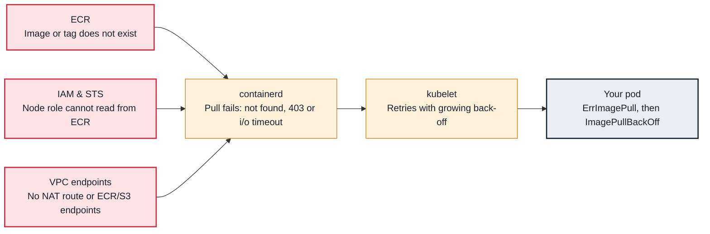

<!-- Generated from data/failures/workload.js by `node scripts/atlas.mjs docs`. Edit the data, then regenerate. -->

# ImagePullBackOff / ErrImagePull

The node cannot pull the image: the name or tag is wrong, the node has no permission, or there is no network path to the registry.

| Kind | Layer | Scope | Interactive |
|---|---|---|---|
| Symptom | Workload | Any Kubernetes cluster | [Open in the atlas](../../index.html#/failures/imagepullbackoff) |

## How it propagates



## Symptom

The pod stays in `ErrImagePull`, then `ImagePullBackOff`, and never starts. Events on the pod say
`Failed to pull image` followed by the registry's answer. Other pods using images already cached on the
node keep working, which can make the problem look node-specific.

## Affected component

The **kubelet** asks the **container runtime** to pull; the failure is between the node and the
**registry**: the reference itself, credentials (**IAM** for ECR, image pull secrets elsewhere), rate
limits, or the network path (**VPC** routing, NAT, endpoints).

## Root cause

The error after `Failed to pull image` tells you which link failed:

| Message contains | Cause |
|---|---|
| `not found`, `manifest unknown` | the tag or digest does not exist (typo, not pushed yet, wrong repository or region) |
| `401 Unauthorized`, `403 Forbidden`, `no basic auth credentials`, `pull access denied` | no or wrong credentials: node role lacks ECR pull permissions, cross-account repository policy, missing `imagePullSecrets` |
| `429 Too Many Requests`, `toomanyrequests` | registry rate limit (Docker Hub anonymous pulls from shared NAT IPs) |
| `i/o timeout`, `dial tcp ... connect: connection timed out` | no network path: private subnet without NAT or without ECR and S3 endpoints, or a security group blocking 443 |
| `no match for platform in manifest` | the image index lacks the node's architecture |

ECR pulls need three things: `ecr:GetAuthorizationToken` and pull permissions on the node role (managed
policy `AmazonEC2ContainerRegistryPullOnly` or `ReadOnly`), a route to the `ecr.api` and `ecr.dkr`
endpoints, and a route to S3, where the layers live.

## Investigation

1. **Read the exact pull error**

   ```sh
   kubectl describe pod dispatch-worker-5d4b7c9f6-kq8zt -n fulfilment | sed -n '/Events/,$p'
   ```

   Look for: The text after `Failed to pull image`. Match it to the table above before anything else.

2. **Verify the reference exists**

   ```sh
   aws ecr describe-images --repository-name orders-api --image-ids imageTag=1.4.2 --region eu-west-1
   ```

   Look for: `ImageNotFoundException` means the tag was never pushed, or was pushed to another account or region.

3. **Check the node's identity and permissions**

   ```sh
   aws eks describe-nodegroup --cluster-name larder-prod --nodegroup-name system --query nodegroup.nodeRole
   aws iam list-attached-role-policies --role-name <node-role-name>
   aws ecr get-repository-policy --repository-name orders-api   # for cross-account pulls
   ```

   Look for: No ECR policy on the node role, or a repository policy that does not allow the cluster's account.

4. **Test the network path from the node**

   ```sh
   kubectl debug node/<node-name> -it --image=public.ecr.aws/amazonlinux/amazonlinux:2023 -- \
     curl -sS -m 5 -o /dev/null -w '%{http_code}\n' https://api.ecr.eu-west-1.amazonaws.com/
   aws ec2 describe-vpc-endpoints --filters Name=vpc-id,Values=<vpc-id> \
     --query 'VpcEndpoints[].ServiceName'
   ```

   Look for: A timeout, and no `ecr.api`, `ecr.dkr` and `s3` endpoints in a VPC without NAT.

## Resolution

- **Not found:** fix the tag, or push it; prefer immutable tags or digests so a reference never changes meaning.
- **Unauthorized:** attach `AmazonEC2ContainerRegistryPullOnly` to the node role, add the cluster's
  account to the repository policy for cross-account pulls, or create an `imagePullSecret` for
  third-party registries.
- **Rate limited:** mirror public images into ECR with a pull-through cache rule and reference the ECR
  path; authenticate to Docker Hub if you must pull from it.
- **Timeout:** add NAT, or interface endpoints for `ecr.api` and `ecr.dkr` plus the S3 gateway endpoint,
  and allow 443 from nodes to the endpoint security group.

## Prevention

- Use ECR pull-through cache for every public image; never depend on anonymous Docker Hub pulls in production.
- Promote images by digest across environments, and enable ECR tag immutability.
- Deploy only tags that CI has verified exist (`aws ecr describe-images`) before updating manifests.
- Alert on `kube_pod_container_status_waiting_reason{reason=~"ImagePullBackOff|ErrImagePull"}` for more than 5 minutes.

Alerts that lead here: `KubeImagePullFailing` (ticket).

## Related

- [exec format error](exec-format-error.md)
- [AccessDenied from a pod calling AWS](pod-aws-access-denied.md)
- [CrashLoopBackOff](crashloopbackoff.md)

## Reproduce it locally

```sh
make kind-up
make lab LAB=imagepullbackoff
make lab-clean LAB=imagepullbackoff
```

The lab is [labs/imagepullbackoff.yaml](../../labs/imagepullbackoff.yaml).
