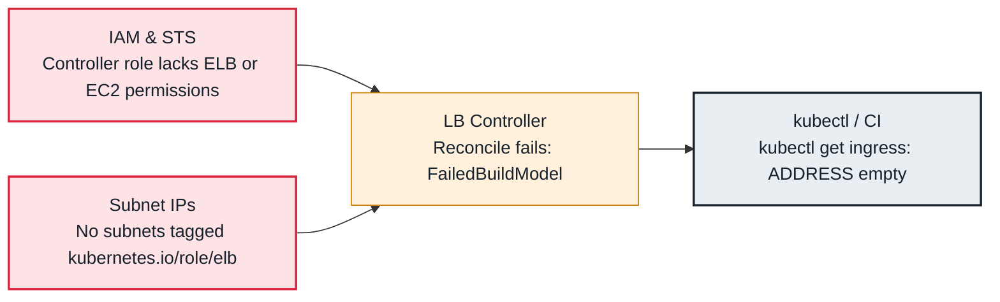

<!-- Generated from data/failures/load-balancing.js by `node scripts/atlas.mjs docs`. Edit the data, then regenerate. -->

# Ingress has no ADDRESS (ALB not provisioned)

The AWS Load Balancer Controller cannot build the ALB, so the Ingress never gets an address.

| Kind | Layer | Scope | Interactive |
|---|---|---|---|
| Symptom | Load balancing | Amazon EKS | [Open in the atlas](../../index.html#/failures/ingress-no-address) |

## How it propagates



## Symptom

`kubectl get ingress` shows an empty `ADDRESS` column; DNS for the host has nothing to point at, and no
ALB exists. Sometimes there are no events at all, which is itself the clue.

## Affected component

The **AWS Load Balancer Controller** reconciles Ingresses of its class into ALBs. The cause is that it is
not handling this Ingress, or fails at building or deploying the ALB (subnets, **IAM**, certificates,
annotations).

## Root cause

- **No class:** `CLASS <none>` and no default IngressClass, or a class of another controller. Without
  `ingressClassName: alb` (or a default IngressClass), the controller ignores the Ingress and nothing
  records any event.
- **Build failures:** subnets not discoverable, an invalid annotation, two Ingresses in one IngressGroup
  with conflicting settings (one bad member blocks the whole group).
- **Deploy failures:** IAM denies an action, an HTTPS listener without `certificate-arn` (or no ACM
  certificate matching the host for discovery), a WAF or security group reference that does not exist.
- **Backend Service type:** with `target-type: instance` the backend Service must be `NodePort` or
  `LoadBalancer`; `ip` targets work with `ClusterIP`.

## Investigation

1. **Check the class and events**

   ```sh
   kubectl get ingress storefront -n shop -o jsonpath='{.spec.ingressClassName}'; echo
   kubectl get ingressclass
   kubectl describe ingress storefront -n shop | sed -n '/Events/,$p'
   ```

   Look for: No class (no events), `FailedBuildModel` or `FailedDeployModel` with the reason.

2. **If it is part of a group, check every member**

   ```sh
   kubectl get ingress -A -o jsonpath='{range .items[*]}{.metadata.namespace}/{.metadata.name}{"\t"}{.metadata.annotations.alb\.ingress\.kubernetes\.io/group\.name}{"\n"}{end}'
   ```

   Look for: Another Ingress in the same group with an error; fix that one.

3. **Read the controller logs**

   ```sh
   kubectl logs -n kube-system deploy/aws-load-balancer-controller --tail=200 | grep -i -E "error|storefront"
   ```

   Look for: The exact AWS API error.

## Resolution

Set `ingressClassName: alb`, then fix what the event names: tag public subnets with
`kubernetes.io/role/elb=1`, attach the current controller IAM policy, add
`alb.ingress.kubernetes.io/certificate-arn` or issue an ACM certificate for the host, or correct the
annotation. The controller retries automatically.

## Prevention

- Mark one IngressClass as default, and validate Ingress annotations in CI.
- Keep IngressGroups owned by one team, or give each team its own group, so one bad Ingress cannot block others.
- Alert on Ingresses without an address for more than 10 minutes.

## Related

- [Service type LoadBalancer stuck in <pending>](loadbalancer-pending.md)
- [ALB targets unhealthy](alb-targets-unhealthy.md)
- [x509 certificate errors](x509-certificate-errors.md)

## Runbooks

- [Load balancer 5xx](../runbooks/load-balancer-5xx.md)
