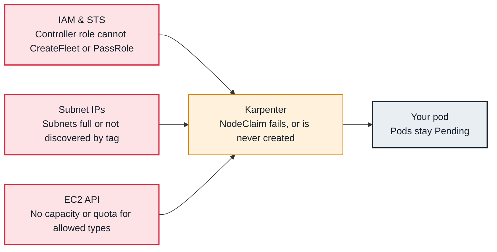

<!-- Generated from data/failures/autoscaling.js by `node scripts/atlas.mjs docs`. Edit the data, then regenerate. -->

# Karpenter does not launch nodes

Pods are Pending but Karpenter launches nothing: NodePool limits or requirements, IAM, subnets or EC2 capacity stop it.

| Kind | Layer | Scope | Interactive |
|---|---|---|---|
| Symptom | Autoscaling | Amazon EKS | [Open in the atlas](../../index.html#/failures/karpenter-not-provisioning) |

## How it propagates



## Symptom

Pods stay `Pending` and no NodeClaims are created, or NodeClaims are created and then deleted without
ever becoming nodes. Karpenter's logs show `could not schedule pod`, `incompatible with nodepool`, or EC2
launch errors.

## Affected component

**Karpenter** matches pending pods to NodePools, picks instance types, and launches through **EC2
Fleet** using its **IAM** role, into subnets and security groups discovered by its EC2NodeClass in the
**VPC**.

## Root cause

Karpenter launches a node only if some NodePool can produce an instance that satisfies the pod. It
fails when:

- **No NodePool fits:** the pod's requirements (arch, capacity type, zone, labels, taints) exclude every
  NodePool, or the pod is larger than any allowed instance type (`no instance type satisfied resources`).
- **Limits:** the NodePool's `spec.limits` for CPU or memory is reached.
- **The EC2NodeClass is not ready:** subnet, security group or AMI selectors match nothing, or the
  instance profile cannot be created. Check its status conditions.
- **EC2 says no:** insufficient capacity for every allowed type in the allowed zones, vCPU quota, or a
  subnet out of addresses.
- **Permissions:** the controller role cannot `ec2:RunInstances`, `ec2:CreateFleet` or `iam:PassRole`
  the node role, or a service control policy denies it.
- **Launched but never registered:** the node cannot join (see eks-node-join-failure); the NodeClaim is
  deleted after its registration timeout.

## Investigation

1. **Read Karpenter's decision for the pod**

   ```sh
   kubectl logs -n kube-system -l app.kubernetes.io/name=karpenter --tail=300 | grep -i -E "could not schedule|incompatible|error"
   kubectl get events -n shop --field-selector involvedObject.name=<pod>
   ```

   Look for: Which NodePool rejected the pod and why, or the EC2 error.

2. **Check NodePools, limits and NodeClass readiness**

   ```sh
   kubectl get nodepools
   kubectl describe nodepool general | sed -n '/Limits/,/Events/p'
   kubectl get ec2nodeclass general -o jsonpath='{range .status.conditions[*]}{.type}{"="}{.status}{" "}{.message}{"\n"}{end}'
   ```

   Look for: Resources at limits, or `Ready=False` with subnets, security groups or AMIs not found.

3. **Follow NodeClaims through their lifecycle**

   ```sh
   kubectl get nodeclaims -o wide
   kubectl describe nodeclaim <name> | sed -n '/Conditions/,$p'
   ```

   Look for: `Launched=False` (EC2 or IAM), or `Launched=True` but `Registered=False` (node join).

## Resolution

Widen the NodePool (more instance families and sizes, more zones, Spot and On-Demand), raise limits, fix
the EC2NodeClass selectors (tag subnets and security groups with `karpenter.sh/discovery`), fix the
controller's IAM, or create the node role's access entry. Very large pods may need a dedicated NodePool.

## Prevention

- Allow broad instance diversity in NodePools; narrow requirements are the main cause of capacity errors.
- Alert on pods Pending more than 10 minutes, on EC2NodeClass `Ready=False`, and on NodeClaims that fail to register.
- Keep Karpenter on a small managed node group or Fargate, never on nodes it manages.

## Related

- [Pending — Insufficient cpu, memory or pods](pending-insufficient-resources.md)
- [EKS nodes fail to join the cluster](eks-node-join-failure.md)
- [Pod IP exhaustion](pod-ip-exhaustion.md)
- [exec format error](exec-format-error.md)
- [volume node affinity conflict](volume-node-affinity-conflict.md)

## Runbooks

- [Pods pending, capacity not arriving](../runbooks/pending-pods-capacity.md)
