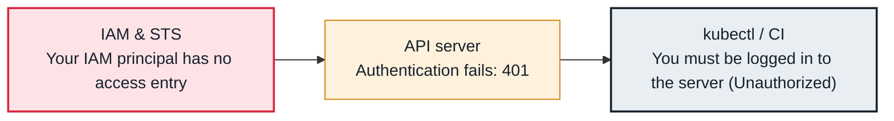

<!-- Generated from data/failures/identity.js by `node scripts/atlas.mjs docs`. Edit the data, then regenerate. -->

# You must be logged in to the server (Unauthorized)

The API server does not recognize your credentials: the wrong IAM identity, no access entry, or an expired token.

| Kind | Layer | Scope | Interactive |
|---|---|---|---|
| Cause | Identity | Amazon EKS | [Open in the atlas](../../index.html#/failures/kubectl-unauthorized) |

## How it propagates



## Symptom

Every `kubectl` command fails with `You must be logged in to the server (Unauthorized)`, or `the server
has asked for the client to provide credentials`. A CI pipeline that worked yesterday fails to deploy.

## Affected component

**Authentication** in the **API server** rejected the request: the credentials **kubectl** sent are not
valid for this cluster or map to no known identity. On EKS, the identity is an **IAM** principal.

## Root cause

On EKS, `kubectl` runs `aws eks get-token`, which signs a token as your current IAM principal. The API
server verifies it and maps the principal to a Kubernetes identity through **access entries** (or the
legacy `aws-auth` ConfigMap). `Unauthorized` (401) means one of:

- the principal has **no access entry** (or `aws-auth` mapping): a new role, a renamed SSO permission
  set, a CI role, or the cluster creator's access removed;
- you are **someone else** than you think: wrong `AWS_PROFILE`, an assumed role, expired SSO session
  falling back to other credentials;
- the kubeconfig points at **another cluster** or region;
- a stale or manually pasted token expired (tokens live 15 minutes).

Compare with `Forbidden` (403): you were recognised, but RBAC denies the action.

## Investigation

1. **Confirm who you are to AWS**

   ```sh
   aws sts get-caller-identity
   kubectl config current-context
   kubectl config view --minify -o jsonpath='{.users[0].user.exec.args}'; echo
   ```

   Look for: The account, role and cluster you expect. An `assumed-role` ARN maps to its role.

2. **Check the cluster knows that principal**

   ```sh
   aws eks list-access-entries --cluster-name larder-prod --region eu-west-1
   aws eks describe-cluster --name larder-prod --query 'cluster.accessConfig.authenticationMode'
   ```

   Look for: No entry for your role ARN, or `CONFIG_MAP` mode where only `aws-auth` applies.

3. **Regenerate kubeconfig for the right cluster and profile**

   ```sh
   aws eks update-kubeconfig --name larder-prod --region eu-west-1 --profile larder-prod-admin
   kubectl auth whoami
   ```

   Look for: `kubectl auth whoami` printing your mapped username and groups.

## Resolution

Add an access entry for the principal and associate a policy (or map it to Kubernetes groups bound by
RBAC), using a principal that already has access:

```sh
aws eks create-access-entry --cluster-name larder-prod \
  --principal-arn arn:aws:iam::111122223333:role/platform-oncall
aws eks associate-access-policy --cluster-name larder-prod \
  --principal-arn arn:aws:iam::111122223333:role/platform-oncall \
  --policy-arn arn:aws:eks::aws:cluster-access-policy/AmazonEKSAdminViewPolicy \
  --access-scope type=cluster
```

If no one can authenticate any more, any IAM principal with `eks:CreateAccessEntry` in the account can
restore access through the EKS API; this is why access entries beat `aws-auth`, which can lock everyone
out with one bad edit.

## Prevention

- Manage access entries as code, with at least two break-glass roles.
- Use the `API` authentication mode; migrate away from `aws-auth`.
- Give CI its own role with a scoped access policy, and alert on authentication failures in the authenticator logs.

## Related

- [Forbidden — RBAC denies the action](rbac-forbidden.md)
- [x509 certificate errors](x509-certificate-errors.md)
- [EKS nodes fail to join the cluster](eks-node-join-failure.md)

## Runbooks

- [API server degraded](../runbooks/api-server-degraded.md)
