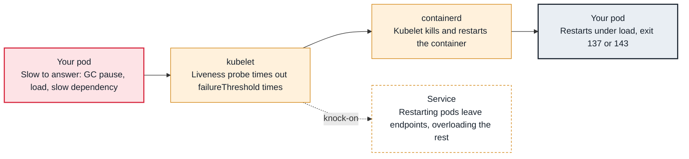

<!-- Generated from data/failures/workload.js by `node scripts/atlas.mjs docs`. Edit the data, then regenerate. -->

# Liveness probe restarts healthy containers

A liveness probe that is stricter than the app's real response time kills containers that were only slow.

| Kind | Layer | Scope | Interactive |
|---|---|---|---|
| Cause | Workload | Any Kubernetes cluster | [Open in the atlas](../../index.html#/failures/liveness-probe-restarts) |

## How it propagates



## Symptom

Containers restart under load, usually several replicas at once, and latency or errors spike because the
remaining replicas absorb the traffic and then fail their probes too. Exit codes are 143 or 137, and
events show `Liveness probe failed` followed by `will be restarted`.

## Affected component

The **kubelet** kills the container after `failureThreshold` consecutive failures. The cause is the
**probe's design**: it measures something other than "this process is irrecoverably stuck".

## Root cause

A liveness failure is a death sentence: the kubelet kills and restarts the container. That is right for
deadlocks, and wrong for anything a restart does not fix:

- **Slowness under load:** the probe shares the request thread pool or event loop, times out after the
  default one second, and the kubelet kills a busy but healthy process. Restarting it removes capacity and
  makes the overload worse, so the restarts cascade across replicas.
- **Dependency checks:** a liveness endpoint that checks the database restarts every replica when the
  database blips.
- **Slow start:** without a `startupProbe`, liveness begins before the app is ready and kills it during
  boot, which shows up as a crash loop.
- **GC pauses or CPU throttling** longer than `timeoutSeconds × failureThreshold`.

## Investigation

1. **Confirm the kubelet is killing the container**

   ```sh
   kubectl get events -n shop --field-selector reason=Killing --sort-by=.lastTimestamp
   kubectl describe pod <pod> -n shop | grep -A2 -E "Liveness|Last State"
   ```

   Look for: `failed liveness probe, will be restarted`, and exit code 143 or 137 rather than an application error.

2. **Correlate restarts with load and throttling**

   ```sh
   # PromQL
   # sum by (pod) (increase(kube_pod_container_status_restarts_total{namespace="shop"}[10m]))
   # sum by (pod) (rate(container_cpu_cfs_throttled_periods_total{namespace="shop"}[5m]))
   #   / sum by (pod) (rate(container_cpu_cfs_periods_total{namespace="shop"}[5m]))
   ```

   Look for: Restarts that line up with traffic peaks or high throttling.

3. **Read the probe configuration**

   ```sh
   kubectl get deploy orders-api -n shop -o jsonpath='{.spec.template.spec.containers[0].livenessProbe}' | jq
   ```

   Look for: `timeoutSeconds: 1`, a low `failureThreshold`, the same path as readiness, or no `startupProbe`.

## Resolution

Make liveness cheap, local and tolerant. It should answer from a path that does not wait on the request
queue or on dependencies, and only fail when a restart would help:

```yaml
livenessProbe:
  httpGet: { path: /healthz, port: http }
  periodSeconds: 10
  timeoutSeconds: 3
  failureThreshold: 6        # a minute of consecutive failures before a restart
```

If you cannot point to a failure mode that a restart fixes, remove the liveness probe; readiness alone
keeps traffic away from a struggling pod without killing it.

## Prevention

- Review every liveness probe against the question "what stuck state does this detect?".
- Pair every slow-starting container with a `startupProbe`.
- Load-test with probes enabled; probe-induced cascades only appear near saturation.

## Related

- [CrashLoopBackOff](crashloopbackoff.md)
- [Readiness probe failing](readiness-probe-failing.md)
- [CPU throttling](cpu-throttling.md)

## Reproduce it locally

```sh
make kind-up
make lab LAB=liveness-probe-restarts
make lab-clean LAB=liveness-probe-restarts
```

The lab is [labs/liveness-probe-restarts.yaml](../../labs/liveness-probe-restarts.yaml).
