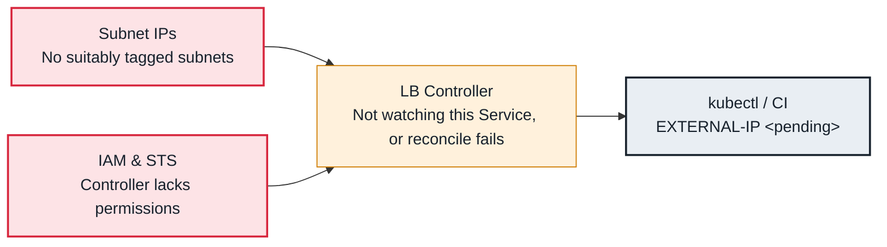

<!-- Generated from data/failures/load-balancing.js by `node scripts/atlas.mjs docs`. Edit the data, then regenerate. -->

# Service type LoadBalancer stuck in <pending>

Nothing provisions a load balancer for the type LoadBalancer Service, so its EXTERNAL-IP stays <pending>.

| Kind | Layer | Scope | Interactive |
|---|---|---|---|
| Symptom | Load balancing | Amazon EKS | [Open in the atlas](../../index.html#/failures/loadbalancer-pending) |

## How it propagates



## Symptom

`kubectl get svc` shows `EXTERNAL-IP <pending>` indefinitely. No load balancer appears in the EC2 console,
or one appears with no healthy targets. Events on the Service, if any, name the failure.

## Affected component

Whichever controller owns the Service: the **AWS Load Balancer Controller** (Services with
`loadBalancerClass: service.k8s.aws/nlb`, which recent controller versions set by default) or the legacy
service controller in the **cloud controller manager**. They need tagged **subnets**, **IAM**
permissions and **ELB** quota.

## Root cause

`<pending>` means no controller has written an address to the Service's status. Either no controller is
handling it, or the one handling it fails:

- **No controller:** `loadBalancerClass: service.k8s.aws/nlb` is set but the AWS Load Balancer Controller
  is not installed or not running, so nobody claims the Service.
- **Subnet discovery:** without explicit subnets, controllers look for subnets tagged
  `kubernetes.io/role/elb=1` (internet-facing) or `kubernetes.io/role/internal-elb=1` (internal), one per
  AZ, with enough free addresses.
- **IAM:** the controller's role lacks Elastic Load Balancing or EC2 permissions (an outdated policy for
  a newer controller version is common).
- **Quotas and conflicts:** load balancer or target group quota reached, a security group limit, or an
  annotation combination the controller rejects.

## Investigation

1. **Read the Service's events and class**

   ```sh
   kubectl describe svc orders-grpc -n shop | sed -n '/Annotations/,/Session/p;/Events/,$p'
   kubectl get svc orders-grpc -n shop -o jsonpath='{.spec.loadBalancerClass}'; echo
   ```

   Look for: `FailedBuildModel` or `FailedDeployModel` from the controller, `SyncLoadBalancerFailed` from the legacy controller, or no events at all.

2. **Check the controller is running and read its logs**

   ```sh
   kubectl get deploy aws-load-balancer-controller -n kube-system
   kubectl logs -n kube-system deploy/aws-load-balancer-controller --tail=100 | grep -i -E "error|orders-grpc"
   ```

   Look for: Not installed, crash looping, or the AWS error for this Service.

3. **Check subnet tags per AZ**

   ```sh
   aws ec2 describe-subnets --filters Name=vpc-id,Values=<vpc-id> \
     --query 'Subnets[].[SubnetId,AvailabilityZone,AvailableIpAddressCount,Tags[?Key==`kubernetes.io/role/elb`]|[0].Value,Tags[?Key==`kubernetes.io/role/internal-elb`]|[0].Value]' --output table
   ```

   Look for: No subnet with the role tag for the requested scheme, or subnets almost out of addresses.

## Resolution

Install the AWS Load Balancer Controller with a role that has the policy matching its version, tag the
subnets for the scheme you need, or name subnets explicitly with the
`service.beta.kubernetes.io/aws-load-balancer-subnets` annotation. Be explicit about intent on every
Service:

```yaml
metadata:
  annotations:
    service.beta.kubernetes.io/aws-load-balancer-scheme: internet-facing
    service.beta.kubernetes.io/aws-load-balancer-nlb-target-type: ip
spec:
  type: LoadBalancer
  loadBalancerClass: service.k8s.aws/nlb
```

## Prevention

- Tag subnets for load balancer discovery in the VPC code, per AZ, from day one.
- Upgrade the controller's IAM policy with every controller upgrade.
- Alert on Services of type LoadBalancer without an ingress address for more than 10 minutes.

## Related

- [Ingress has no ADDRESS](ingress-no-address.md)
- [failed calling webhook](webhook-unavailable.md)
- [ALB targets unhealthy](alb-targets-unhealthy.md)
- [AccessDenied from a pod calling AWS](pod-aws-access-denied.md)

## Runbooks

- [Load balancer 5xx](../runbooks/load-balancer-5xx.md)
