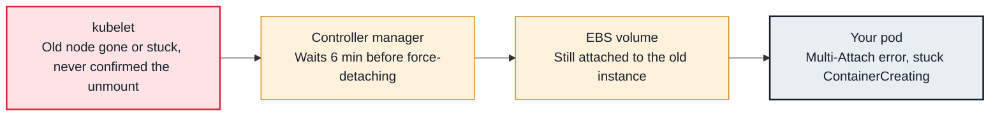

<!-- Generated from data/failures/storage.js by `node scripts/atlas.mjs docs`. Edit the data, then regenerate. -->

# Multi-Attach error (volume still attached to another node)

An EBS volume can be attached to one node at a time, and the old node still holds it.

| Kind | Layer | Scope | Interactive |
|---|---|---|---|
| Cause | Storage | Any Kubernetes cluster | [Open in the atlas](../../index.html#/failures/multi-attach-error) |

## How it propagates



## Symptom

A replacement pod of a single-replica workload stays in `ContainerCreating` with a `Multi-Attach error`
event. Typical moments: a node failure, a Deployment rollout of a pod with an EBS volume, or a drain.
It often resolves by itself after about six minutes, which is the clue.

## Affected component

The **attach-detach controller** in the controller manager will not attach a `ReadWriteOnce` **EBS**
volume to a new node while the volume is still attached to the old one.

## Root cause

EBS volumes (with rare io2 exceptions) attach to one instance at a time. When a pod moves:

- **Rolling update of a Deployment with an RWO volume:** the default strategy starts the new pod before
  stopping the old one, so both want the volume. Single-replica, volume-owning workloads need
  `strategy: Recreate` or a StatefulSet.
- **Node failure:** the old node cannot confirm the volume is unmounted. The controller waits
  `maxWaitForUnmountDuration` (six minutes) before force detaching, to avoid two writers.
- **Stuck detach:** the EC2 detach does not complete (the instance is impaired), which shows in
  `VolumeAttachment` objects and EC2 volume state `detaching`.

## Investigation

1. **Find where the volume is attached**

   ```sh
   kubectl get volumeattachments -o custom-columns=PV:.spec.source.persistentVolumeName,NODE:.spec.nodeName,ATTACHED:.status.attached | grep <pv-name>
   aws ec2 describe-volumes --volume-ids <vol-id> --query 'Volumes[].Attachments'
   ```

   Look for: An attachment to the old node, and its EC2 state.

2. **Check the old node and the workload strategy**

   ```sh
   kubectl get node <old-node>
   kubectl get deploy <name> -n <ns> -o jsonpath='{.spec.strategy}'
   ```

   Look for: A NotReady or deleted node, or a `RollingUpdate` strategy on a single-replica Deployment with an RWO volume.

## Resolution

For rollouts, switch to `strategy: type: Recreate` or a StatefulSet. For a failed node that will not
return, confirm it is shut down, then mark it out of service so the volume detaches immediately:

```sh
kubectl taint node <old-node> node.kubernetes.io/out-of-service=nodeshutdown:NoExecute
```

Remove the taint once the node object is gone or the node is healthy again.

## Prevention

- Use StatefulSets (or `Recreate`) for anything that owns an RWO volume.
- Prefer RWX storage (EFS) or application-level replication where moving fast between nodes matters.
- Let the node termination handling (Karpenter, managed node groups) drain nodes before they stop.

## Related

- [AttachVolume or MountVolume failed](volume-attach-failed.md)
- [volume node affinity conflict](volume-node-affinity-conflict.md)
- [Node NotReady](node-not-ready.md)
- [Pod stuck in Terminating](pod-stuck-terminating.md)
