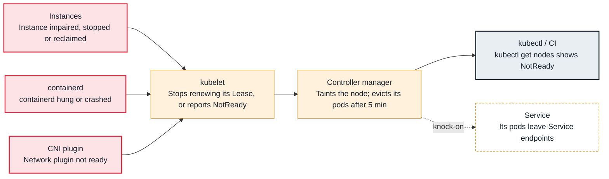

<!-- Generated from data/failures/node.js by `node scripts/atlas.mjs docs`. Edit the data, then regenerate. -->

# Node NotReady

The node stopped reporting healthy: the kubelet, the container runtime, the network plugin or the instance itself failed.

| Kind | Layer | Scope | Interactive |
|---|---|---|---|
| Symptom | Node | Any Kubernetes cluster | [Open in the atlas](../../index.html#/failures/node-not-ready) |

## How it propagates



## Symptom

`kubectl get nodes` shows `NotReady`. New pods are not scheduled there. After about five minutes, pods on
the node are marked for eviction and recreated elsewhere (Deployments), while StatefulSet pods wait.
Pods may show `Terminating` or `Unknown`.

## Affected component

The **node lifecycle controller** sets the condition when the **kubelet** stops renewing its heartbeat
(`Unknown`) or reports itself unhealthy (`False`). The cause is on the node: the kubelet, the
**container runtime**, the **CNI**, resources, or the **EC2 instance** itself.

## Root cause

The kubelet renews a Lease every 10 seconds and posts node status. Two very different situations both
show `NotReady`:

- **`Unknown` — "Kubelet stopped posting node status":** the control plane cannot hear the kubelet.
  The instance crashed or was terminated, the kubelet process died, the node is frozen by memory
  exhaustion, or the network between node and control plane broke (security group, route, endpoint).
- **`False` — the kubelet reports a problem:** `container runtime is down`, `PLEG is not healthy`
  (the runtime is too slow to report container states, often due to disk I/O or too many containers),
  or `container runtime network not ready` (the CNI is not initialized; see cni-not-ready).

After the grace period the node gets the `node.kubernetes.io/unreachable` or `not-ready` taint with
`NoExecute`; pods tolerate it for 300 seconds by default and are then evicted.

## Investigation

1. **Read the Ready condition's status, reason and message**

   ```sh
   kubectl describe node ip-10-20-44-17.eu-west-1.compute.internal | sed -n '/Conditions/,/Addresses/p'
   ```

   Look for: `Unknown` (cannot hear the node) versus `False` with a reason (the node reports a fault).

2. **Check the instance from AWS**

   ```sh
   aws ec2 describe-instance-status --instance-ids i-0abc123def4567890 --include-all-instances
   aws ec2 get-console-output --instance-id i-0abc123def4567890 --latest --output text | tail -50
   ```

   Look for: Failed status checks, `stopping` or `terminated` (Spot interruption, scale-in), kernel OOM or panics in the console.

3. **Get onto the node and read kubelet and runtime logs**

   ```sh
   aws ssm start-session --target i-0abc123def4567890
   sudo journalctl -u kubelet --since "30 min ago" --no-pager | tail -100
   sudo systemctl status containerd kubelet
   df -h / /var/lib/containerd; free -m
   ```

   Look for: Certificate or authentication errors, runtime timeouts, a full disk, memory exhaustion.

4. **Check node-to-control-plane connectivity**

   ```sh
   curl -sk -m 5 "$(aws eks describe-cluster --name larder-prod --query cluster.endpoint --output text)/healthz"
   ```

   Look for: A timeout points to security groups, routes or the endpoint access configuration.

## Resolution

- **Instance gone or impaired:** let the node group or Karpenter replace it; delete the Node object if it
  lingers so pods move immediately.
- **kubelet or runtime crashed:** restart them (`systemctl restart containerd kubelet`) to restore
  service, then find out why (logs, disk, memory) before the next node does the same.
- **Resource exhaustion:** set `kubeReserved`/`systemReserved` and eviction thresholds so the kubelet
  keeps headroom, and fix the workload that consumed it.
- For many nodes at once, suspect a shared cause: a bad AMI, a DaemonSet rollout, a security group or
  network ACL change, or an expired credential.

## Prevention

- Run nodes from managed node groups or Karpenter with health-based replacement, and enable the EC2 auto-recovery or node repair features available to you.
- Alert on `kube_node_status_condition{condition="Ready",status="true"} == 0` for 5 minutes, and page when more than one node is affected.
- Roll DaemonSet and AMI changes through a canary node pool first.

## Related

- [Network plugin not ready](cni-not-ready.md)
- [Evicted — node low on memory, disk or PIDs](node-pressure-eviction.md)
- [EKS nodes fail to join the cluster](eks-node-join-failure.md)
- [Pod stuck in Terminating](pod-stuck-terminating.md)

## Runbooks

- [Node NotReady](../runbooks/node-not-ready.md)
