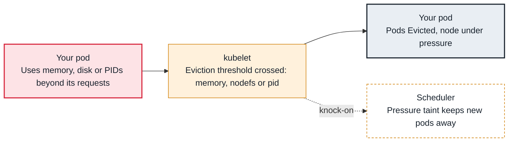

<!-- Generated from data/failures/node.js by `node scripts/atlas.mjs docs`. Edit the data, then regenerate. -->

# Evicted — node low on memory, disk or PIDs

The node ran low on memory, disk or process IDs, so the kubelet evicted pods to keep the node alive.

| Kind | Layer | Scope | Interactive |
|---|---|---|---|
| Cause | Node | Any Kubernetes cluster | [Open in the atlas](../../index.html#/failures/node-pressure-eviction) |

## How it propagates



## Symptom

Pods end up in `Failed` with reason `Evicted` and a message naming memory, ephemeral storage or PIDs. The
node shows `MemoryPressure`, `DiskPressure` or `PIDPressure`, carries a matching `NoSchedule` taint, and
other pods may become Pending because of that taint. Evicted pod objects pile up in `kubectl get pods`.

## Affected component

The **kubelet**'s eviction manager reclaims node resources when a signal crosses its threshold. The
cause is usually a **workload** using more than it requested, or node sizing and reservations.

## Root cause

The kubelet watches node-level signals against eviction thresholds (Linux defaults: `memory.available
< 100Mi`, `nodefs.available < 10%`, `imagefs.available < 15%`, `nodefs.inodesFree < 5%`). When one is
crossed, it first reclaims node resources (deletes unused images and dead containers), then evicts pods.
It ranks victims by whether they exceed their **requests**, then by priority, then by usage above
requests. So BestEffort pods and pods using far more than they requested go first.

Typical causes:

- **Memory:** pods with requests far below their real use, overcommitting the node.
- **Disk:** container logs written to files instead of stdout, apps writing to the container filesystem
  or `emptyDir`, images that are very large, or a small root volume.
- **PIDs:** a process that forks without reaping, or a thread explosion.

## Investigation

1. **Read the eviction message**

   ```sh
   kubectl get pods -A --field-selector status.phase=Failed -o custom-columns=NS:.metadata.namespace,POD:.metadata.name,REASON:.status.reason,MSG:.status.message | grep Evicted
   ```

   Look for: Which resource, the threshold, and which container used the most relative to its request.

2. **Check node conditions and pressure taints**

   ```sh
   kubectl describe node <node-name> | sed -n '/Conditions/,/Addresses/p;/Taints/p'
   ```

   Look for: Pressure conditions currently `True`, and `node.kubernetes.io/*-pressure` taints.

3. **For disk, find what fills it**

   ```sh
   kubectl debug node/<node-name> -it --image=busybox:1.36 -- sh -c \
     'chroot /host sh -c "df -h / /var/lib/containerd; du -xsh /var/log/pods/* 2>/dev/null | sort -h | tail; du -xsh /var/lib/kubelet/pods/*/volumes/kubernetes.io~empty-dir/* 2>/dev/null | sort -h | tail"'
   ```

   Look for: A pod's log directory or `emptyDir` growing without bound.

4. **For memory, compare usage with requests**

   ```sh
   kubectl top pods -A --sort-by=memory | head -20
   ```

   Look for: Pods using several times their request.

## Resolution

Raise requests of the pods that overcommit (so the scheduler stops overpacking), cap `emptyDir` with
`sizeLimit` and set `ephemeral-storage` requests and limits, log to stdout, and give nodes enough root
volume. Clean up evicted pod objects once understood:

```sh
kubectl delete pods -A --field-selector status.phase=Failed
```

## Prevention

- Requests close to real usage for memory; never run critical workloads as BestEffort.
- Set `ephemeral-storage` requests and limits and `emptyDir.sizeLimit`.
- Alert on node conditions and on node filesystem usage above 80%.
- Reserve resources for the system (`kubeReserved`, `systemReserved`) in node configuration.

Alerts that lead here: `KubeNodePressure` (ticket), `NodeFilesystemAlmostFull` (ticket).

## Related

- [OOMKilled](oomkilled.md)
- [Node NotReady](node-not-ready.md)
- [Pending — untolerated taint, affinity or topology spread](pending-taint-affinity.md)

## Runbooks

- [Node NotReady](../runbooks/node-not-ready.md)
