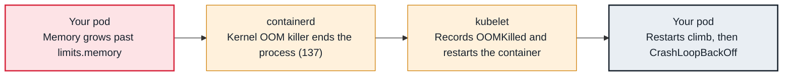

<!-- Generated from data/failures/workload.js by `node scripts/atlas.mjs docs`. Edit the data, then regenerate. -->

# OOMKilled (container exceeded its memory limit)

The container used more memory than its limit, so the kernel killed it with SIGKILL (exit code 137).

| Kind | Layer | Scope | Interactive |
|---|---|---|---|
| Cause | Workload | Any Kubernetes cluster | [Open in the atlas](../../index.html#/failures/oomkilled) |

## How it propagates



## Symptom

The container restarts with `Last State: Terminated, Reason: OOMKilled, Exit Code: 137`. Often seen as
`CrashLoopBackOff` if it happens repeatedly, or as sporadic restarts under load. The application's own
logs simply stop: the kernel gives it no chance to write anything.

## Affected component

The **kernel** enforces the memory limit through the container's cgroup; the **kubelet** and
**container runtime** report it. The cause is the **application**'s memory use relative to the limit
you set.

## Root cause

`resources.limits.memory` becomes the cgroup's `memory.max`. When the container's processes need more
than that and the kernel cannot reclaim page cache, the kernel's OOM killer kills them with SIGKILL
(exit 137). On cgroup v2 nodes, recent kubelets kill the whole container rather than one process.

Common reasons:

- The limit is below the real working set (the request and limit were guessed, not measured).
- A runtime ignores the container limit: an old JVM sizing its heap from host memory, or a heap sized
  to the full limit with no room for off-heap memory, threads and native buffers.
- A leak: memory grows steadily until the limit, and restarts appear at regular intervals.
- A traffic- or data-dependent spike: one large request, batch or cache fill.

This is different from **eviction** (the node ran low on memory and the kubelet chose victims) and
from a **node-level OOM** (the node itself ran out because limits were overcommitted).

## Investigation

1. **Confirm it is the container limit, not eviction**

   ```sh
   kubectl get pod orders-api-6f7c9d8b5-x2xlq -n shop \
     -o jsonpath='{.status.containerStatuses[*].lastState.terminated}'
   kubectl get pod orders-api-6f7c9d8b5-x2xlq -n shop -o jsonpath='{.status.reason}'
   ```

   Look for: `reason: OOMKilled` on the container is a limit kill. `Evicted` on the pod is node pressure (see node-pressure-eviction).

2. **Compare the limit with actual usage over time**

   ```sh
   kubectl get pod orders-api-6f7c9d8b5-x2xlq -n shop -o jsonpath='{.spec.containers[*].resources}'
   kubectl top pod -n shop -l app=orders-api --containers
   # PromQL: working set against limit, per container
   # max by (pod, container) (container_memory_working_set_bytes{namespace="shop", container="api"})
   #   / on (pod, container) kube_pod_container_resource_limits{resource="memory", namespace="shop"}
   ```

   Look for: A sawtooth that climbs to the limit (leak or cache), or flat usage with sudden spikes (request-driven).

3. **Check how the runtime sizes its heap**

   ```sh
   kubectl exec deploy/orders-api -n shop -c api -- sh -c 'cat /sys/fs/cgroup/memory.max; env | grep -i -E "java|heap|node_options|gomemlimit"'
   ```

   Look for: A JVM without `-XX:MaxRAMPercentage`, Node.js without `--max-old-space-size`, Go without `GOMEMLIMIT` sized below the limit.

4. **Check whether the node killed it instead**

   ```sh
   kubectl describe node <node-name> | grep -A5 -i -E "SystemOOM|MemoryPressure"
   kubectl get events -A --field-selector reason=SystemOOM
   ```

   Look for: `SystemOOM` events mean the node ran out; requests were too low and limits overcommitted.

## Resolution

If usage is legitimate, raise the limit to the measured peak plus headroom, and set the request to the
typical working set (or equal to the limit for Guaranteed QoS on critical services):

```yaml
resources:
  requests: { cpu: 250m, memory: 768Mi }
  limits:   { memory: 1Gi }
```

Size language runtimes inside the limit: `-XX:MaxRAMPercentage=75` for the JVM, `GOMEMLIMIT` at about
90% of the limit for Go, `--max-old-space-size` for Node.js. If it is a leak, roll back and fix the code;
raising the limit only stretches the interval between kills.

## Prevention

- Set memory requests and limits from observed p99 working set, and revisit them after big releases (VPA in recommendation mode helps).
- Alert when working set exceeds 90% of the limit for 15 minutes, before the kill.
- Alert on `increase(kube_pod_container_status_restarts_total[1h]) > 3` combined with `kube_pod_container_status_last_terminated_reason{reason="OOMKilled"}`.
- Load-test with production-sized payloads; many OOMs only appear with the largest customers.

Alerts that lead here: `KubeContainerOOMKilled` (ticket), `KubeContainerMemoryNearLimit` (ticket).

## Related

- [CrashLoopBackOff](crashloopbackoff.md)
- [Evicted — node low on memory, disk or PIDs](node-pressure-eviction.md)
- [CPU throttling](cpu-throttling.md)

## Reproduce it locally

```sh
make kind-up
make lab LAB=oomkilled
make lab-clean LAB=oomkilled
```

The lab is [labs/oomkilled.yaml](../../labs/oomkilled.yaml).
