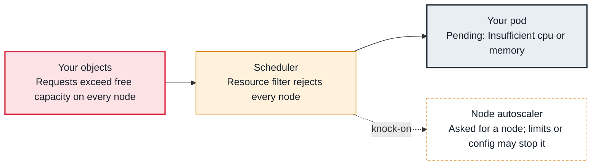

<!-- Generated from data/failures/scheduling.js by `node scripts/atlas.mjs docs`. Edit the data, then regenerate. -->

# Pending — Insufficient cpu, memory or pods

No node has enough unrequested CPU, memory or pod slots for the pod's requests, and no new node arrives in time.

| Kind | Layer | Scope | Interactive |
|---|---|---|---|
| Cause | Scheduling | Any Kubernetes cluster | [Open in the atlas](../../index.html#/failures/pending-insufficient-resources) |

## How it propagates



## Symptom

Pods stay `Pending` with a `FailedScheduling` event whose message lists `Insufficient cpu`,
`Insufficient memory` or `Too many pods`. If an autoscaler is installed, it may or may not be adding
nodes, and the pods may wait minutes before scheduling.

## Affected component

The **scheduler**'s `NodeResourcesFit` filter found no node with enough **allocatable** capacity for the
pod's **requests**. Whether that is a problem depends on the **autoscaler** (Karpenter or Cluster
Autoscaler) and on the requests in your **workload**.

## Root cause

The scheduler places pods by **requests**, never by actual usage. A node fits when the sum of requests of
the pods already on it, plus this pod's requests, stays within the node's allocatable (capacity minus
system and kubelet reservations). So a cluster can look idle in `kubectl top` and still have no room.

`Too many pods` is the per-node pod limit (`max-pods`). On EKS with the VPC CNI that limit derives from
how many IPs the instance's ENIs can hold, so small instances run out of pod slots long before CPU.

Common causes: requests inflated far beyond use; one huge pod that fits no instance type; a burst
(deploy surge, HPA scale-out) larger than headroom; an autoscaler that cannot or will not add nodes.

## Investigation

1. **Read the scheduler's full message**

   ```sh
   kubectl get events -n shop --field-selector reason=FailedScheduling --sort-by=.lastTimestamp | tail -5
   ```

   Look for: The breakdown: `3 Insufficient cpu` means three nodes failed on CPU. Every node is accounted for exactly once across the reasons.

2. **Compare the pod's requests with node allocatable**

   ```sh
   kubectl get pod <pod> -n shop -o jsonpath='{range .spec.containers[*]}{.name}{" "}{.resources.requests}{"\n"}{end}'
   kubectl describe nodes | grep -A8 "Allocated resources"
   ```

   Look for: Requests larger than any node's free allocatable, or nodes at 95% requested and 30% used.

3. **Check whether the autoscaler is responding**

   ```sh
   kubectl get events -n shop --field-selector involvedObject.name=<pod> | grep -i -E "karpenter|TriggeredScaleUp|NotTriggerScaleUp|Nominated"
   kubectl get nodeclaims
   ```

   Look for: No autoscaler event at all (see karpenter-not-provisioning or cluster-autoscaler-no-scale-up).

4. **For Too many pods, check max-pods**

   ```sh
   kubectl get nodes -o custom-columns=NAME:.metadata.name,TYPE:.metadata.labels.node\\.kubernetes\\.io/instance-type,PODS:.status.allocatable.pods
   ```

   Look for: Low pod limits (an `m5.large` allows 29 without prefix delegation).

## Resolution

- Right-size requests from observed usage; that is the cheapest capacity you will ever add.
- Make sure an autoscaler can add the right kind of node (instance types big enough for the largest pod,
  limits not exhausted, quotas available).
- For `Too many pods`, enable VPC CNI prefix delegation or use larger instances.
- Use PriorityClasses so critical pods preempt batch work instead of waiting.

## Prevention

- Alert on pods `Pending` for more than 10 minutes (`kube_pod_status_phase{phase="Pending"}`), not on single scheduling failures.
- Track requested versus allocatable per node pool, and requested versus used per workload.
- Keep a small capacity buffer of low-priority placeholder pods for fast scale-out.

Alerts that lead here: `KubeHPAMaxedOut` (ticket).

## Related

- [Karpenter does not launch nodes](karpenter-not-provisioning.md)
- [Cluster Autoscaler does not scale up](cluster-autoscaler-no-scale-up.md)
- [Pending — untolerated taint, affinity or topology spread](pending-taint-affinity.md)
- [Pod IP exhaustion](pod-ip-exhaustion.md)
- [Pods never created — exceeded quota or LimitRange](resource-quota-exceeded.md)

## Runbooks

- [Pods pending, capacity not arriving](../runbooks/pending-pods-capacity.md)

## Reproduce it locally

```sh
make kind-up
make lab LAB=pending-insufficient-resources
make lab-clean LAB=pending-insufficient-resources
```

The lab is [labs/pending-insufficient-resources.yaml](../../labs/pending-insufficient-resources.yaml).
