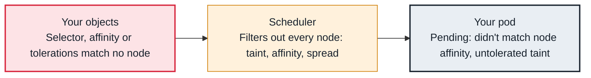

<!-- Generated from data/failures/scheduling.js by `node scripts/atlas.mjs docs`. Edit the data, then regenerate. -->

# Pending — untolerated taint, affinity or topology spread

Nodes with room exist, but the pod's tolerations, node affinity or spread rules exclude every one of them.

| Kind | Layer | Scope | Interactive |
|---|---|---|---|
| Cause | Scheduling | Any Kubernetes cluster | [Open in the atlas](../../index.html#/failures/pending-taint-affinity) |

## How it propagates



## Symptom

Pods stay `Pending` although nodes have free capacity. The `FailedScheduling` message names taints,
node affinity or selectors, pod (anti-)affinity or topology spread constraints rather than resources.

## Affected component

The **scheduler**'s `TaintToleration`, `NodeAffinity`, `InterPodAffinity` and `PodTopologySpread`
filters. The cause is the **workload's** placement rules disagreeing with the nodes that exist.

## Root cause

Each filter removes nodes for a reason that has nothing to do with capacity:

- **Taints:** a node tainted `NoSchedule` accepts only pods that tolerate it. Node pressure also taints
  nodes automatically (`node.kubernetes.io/disk-pressure`), so a node can become untolerated by itself.
- **Node affinity and `nodeSelector`:** the pod requires a label no node has (a typo, a label that only
  exists on a node pool that is scaled to zero, or an AZ with no nodes).
- **Required pod anti-affinity:** "never two replicas on the same node" with more replicas than nodes.
- **Topology spread with `whenUnsatisfiable: DoNotSchedule`:** placing the pod would exceed `maxSkew`,
  typically because one AZ has no eligible nodes.
- `Preemption is not helpful` means evicting lower-priority pods would not fix it, which confirms a rule,
  not capacity, blocks it.

## Investigation

1. **Read which filter excluded which nodes**

   ```sh
   kubectl describe pod <pod> -n shop | sed -n '/Events/,$p'
   ```

   Look for: Counts per reason; they add up to the number of nodes.

2. **Compare the pod's rules with node labels and taints**

   ```sh
   kubectl get pod <pod> -n shop -o jsonpath='{.spec.nodeSelector}{"\n"}{.spec.affinity}{"\n"}{.spec.tolerations}{"\n"}{.spec.topologySpreadConstraints}{"\n"}'
   kubectl get nodes -L topology.kubernetes.io/zone,karpenter.sh/nodepool,larder.example/pool
   kubectl get nodes -o custom-columns=NAME:.metadata.name,TAINTS:.spec.taints
   ```

   Look for: The label the pod needs, missing from every node; a taint without a matching toleration; one zone without nodes.

3. **For topology spread, count pods per zone**

   ```sh
   kubectl get pods -n shop -l app=orders-api -o custom-columns=NODE:.spec.nodeName --no-headers | \
     xargs -I{} kubectl get node {} -o jsonpath='{.metadata.labels.topology\.kubernetes\.io/zone}{"\n"}' | sort | uniq -c
   ```

   Look for: A zone at zero because no node pool covers it.

## Resolution

Fix whichever side is wrong: add the toleration or label, correct the selector, or make sure the node pool
(and its subnets) covers every zone the spread constraint expects. Use `whenUnsatisfiable:
ScheduleAnyway` for best-effort spreading and preferred (not required) anti-affinity unless co-location
is truly unacceptable.

## Prevention

- Keep placement rules in shared templates, not hand-written per service.
- Ensure each NodePool or node group spans every AZ your workloads spread across.
- Alert on pods Pending for more than 10 minutes, and inspect taints added by node pressure.

## Related

- [Pending — Insufficient cpu, memory or pods](pending-insufficient-resources.md)
- [volume node affinity conflict](volume-node-affinity-conflict.md)
- [Evicted — node low on memory, disk or PIDs](node-pressure-eviction.md)
- [Karpenter does not launch nodes](karpenter-not-provisioning.md)

## Runbooks

- [Pods pending, capacity not arriving](../runbooks/pending-pods-capacity.md)

## Reproduce it locally

```sh
make kind-up
make lab LAB=pending-taint-affinity
make lab-clean LAB=pending-taint-affinity
```

The lab is [labs/pending-taint-affinity.yaml](../../labs/pending-taint-affinity.yaml).
