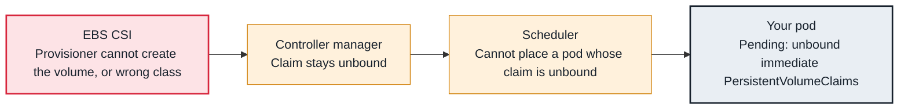

<!-- Generated from data/failures/scheduling.js by `node scripts/atlas.mjs docs`. Edit the data, then regenerate. -->

# Pending — pod has unbound immediate PersistentVolumeClaims

The pod is waiting for a PersistentVolumeClaim that has no volume yet, so the scheduler cannot place it.

| Kind | Layer | Scope | Interactive |
|---|---|---|---|
| Symptom | Scheduling | Any Kubernetes cluster | [Open in the atlas](../../index.html#/failures/pending-unbound-pvc) |

## How it propagates



## Symptom

A pod that mounts a PVC stays `Pending`. The scheduler says the pod has unbound immediate
PersistentVolumeClaims, and the PVC itself is `Pending`.

## Affected component

The **scheduler** refuses to place a pod whose claim is not bound, when the claim's StorageClass uses
`Immediate` binding (or names a class that does not exist). The cause lies with the **PVC** and its
provisioner.

## Root cause

With `volumeBindingMode: Immediate`, a PVC must be bound to a PV before its pod can be scheduled. If the
claim cannot be bound, the scheduler waits. That happens when the StorageClass does not exist, the
provisioner fails to create a volume, or no pre-created PV matches the claim's size, access mode and
class. A claim that names a non-existent class is treated as immediate, so the pod waits forever.

With `WaitForFirstConsumer` (recommended for EBS), the scheduler picks the node first and the volume is
created in that node's zone; you would instead see the PVC waiting for the consumer, which is normal.

## Investigation

1. **Look at the claim, not the pod**

   ```sh
   kubectl get pvc -n catalog
   kubectl describe pvc search-data-search-indexer-0 -n catalog | sed -n '/Events/,$p'
   ```

   Look for: The PVC's own events say why it is unbound (see pvc-pending-provisioning).

2. **Check the class it asks for**

   ```sh
   kubectl get pvc search-data-search-indexer-0 -n catalog -o jsonpath='{.spec.storageClassName}'; echo
   kubectl get storageclass
   ```

   Look for: A class that does not exist, or no default class when the claim names none.

## Resolution

Fix the claim's class (claims are immutable in that field, so recreate the PVC, or edit the
StatefulSet's `volumeClaimTemplates` and recreate its pods), or fix provisioning as described in
pvc-pending-provisioning. Prefer StorageClasses with `WaitForFirstConsumer` for zonal storage.

## Prevention

- Define a default StorageClass explicitly; on EKS 1.30 and later, new clusters no longer mark `gp2` as default.
- Alert on `kube_persistentvolumeclaim_status_phase{phase="Pending"}` for more than 5 minutes.

## Related

- [PVC Pending — volume not provisioned](pvc-pending-provisioning.md)
- [volume node affinity conflict](volume-node-affinity-conflict.md)

## Runbooks

- [Pods pending, capacity not arriving](../runbooks/pending-pods-capacity.md)

## Reproduce it locally

```sh
make kind-up
make lab LAB=pending-unbound-pvc
make lab-clean LAB=pending-unbound-pvc
```

The lab is [labs/pending-unbound-pvc.yaml](../../labs/pending-unbound-pvc.yaml).
