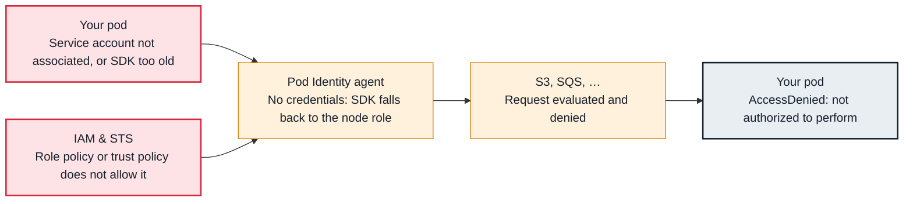

<!-- Generated from data/failures/identity.js by `node scripts/atlas.mjs docs`. Edit the data, then regenerate. -->

# AccessDenied from a pod calling AWS (IRSA or Pod Identity)

The pod calls AWS with the wrong identity (often the node role) or with a role whose policy does not allow the action.

| Kind | Layer | Scope | Interactive |
|---|---|---|---|
| Cause | Identity | Amazon EKS | [Open in the atlas](../../index.html#/failures/pod-aws-access-denied) |

## How it propagates



## Symptom

An application's AWS SDK calls fail with `AccessDenied`, `InvalidIdentityToken`, or credential lookup
errors. The pod runs, but every S3, SQS, DynamoDB or Secrets Manager call fails. The ARN in the message
is the most important clue.

## Affected component

The chain that gives a pod an **IAM** identity: the service account, either the IRSA webhook and the
cluster's OIDC provider or the **Pod Identity agent** and its association, the role's trust policy, and
the role's permissions.

## Root cause

Read the principal in the error first:

- **The node role** (`assumed-role/<node-role>/i-...`): the pod did not get its own identity and the SDK
  fell back to the instance profile. The service account has no `eks.amazonaws.com/role-arn` annotation
  and no Pod Identity association, the pod started before the annotation or association existed
  (credentials are injected at pod creation), or the pod uses a different service account than you
  configured. If IMDS is limited to one hop, the fallback fails instead with `no EC2 IMDS role found`.
- **Your role, but `AssumeRoleWithWebIdentity` denied** (IRSA): the trust policy's `sub` condition does
  not match `system:serviceaccount:<namespace>:<name>`, or the audience is not `sts.amazonaws.com`.
- **`No OpenID Connect provider found`** (IRSA): the cluster's OIDC issuer was never registered as an IAM
  identity provider in this account (common in a new account or for a recreated cluster).
- **Your role, action denied:** the role is assumed correctly but its policy lacks the action or
  resource, or a KMS key policy, bucket policy, permissions boundary or SCP denies it.

## Investigation

1. **See what identity the pod actually receives**

   ```sh
   kubectl get pod <pod> -n fulfilment -o jsonpath='{.spec.serviceAccountName}'; echo
   kubectl exec <pod> -n fulfilment -- env | grep -E '^AWS_(ROLE_ARN|WEB_IDENTITY_TOKEN_FILE|CONTAINER_CREDENTIALS_FULL_URI)'
   kubectl exec <pod> -n fulfilment -- aws sts get-caller-identity   # if the image has the CLI
   ```

   Look for: No AWS_* variables means no IRSA or Pod Identity injection; the caller identity shows the role in use.

2. **Check the service account and association**

   ```sh
   kubectl get sa dispatch-worker -n fulfilment -o jsonpath='{.metadata.annotations}'; echo
   aws eks list-pod-identity-associations --cluster-name larder-prod --namespace fulfilment
   kubectl get pods -n kube-system -l app.kubernetes.io/name=eks-pod-identity-agent
   ```

   Look for: Neither an annotation nor an association, or the agent not running on the pod's node.

3. **For IRSA, check the OIDC provider and trust policy**

   ```sh
   aws eks describe-cluster --name larder-prod --query 'cluster.identity.oidc.issuer' --output text
   aws iam list-open-id-connect-providers
   aws iam get-role --role-name dispatch-worker --query 'Role.AssumeRolePolicyDocument'
   ```

   Look for: A missing provider for the issuer, or a `sub` condition for another namespace or service account name.

4. **Simulate the permission**

   ```sh
   aws iam simulate-principal-policy --policy-source-arn arn:aws:iam::111122223333:role/dispatch-worker \
     --action-names sqs:ReceiveMessage --resource-arns arn:aws:sqs:eu-west-1:111122223333:dispatch-jobs
   ```

   Look for: `implicitDeny` or `explicitDeny`, and which policy decides.

## Resolution

With Pod Identity (preferred for new workloads), create the association and restart the pods:

```sh
aws eks create-pod-identity-association --cluster-name larder-prod \
  --namespace fulfilment --service-account dispatch-worker \
  --role-arn arn:aws:iam::111122223333:role/dispatch-worker
kubectl rollout restart deployment/dispatch-worker -n fulfilment
```

The role's trust policy must allow `pods.eks.amazonaws.com` to `sts:AssumeRole` and `sts:TagSession`.
With IRSA, register the OIDC provider, fix the trust policy's `sub`, annotate the service account and
restart. In both cases, add the missing action to the role's policy if the role itself is denied.

## Prevention

- Set the IMDS hop limit to 1 so pods cannot silently fall back to the node role; failures become explicit and early.
- Manage roles, trust policies and associations with the workload's infrastructure code, keyed by namespace and service account.
- Use Pod Identity session tags (namespace, service account) for attribute-based policies instead of one role per tiny variation.

## Related

- [Forbidden — RBAC denies the action](rbac-forbidden.md)
- [CreateContainerConfigError](createcontainerconfigerror.md)
- [PVC Pending — volume not provisioned](pvc-pending-provisioning.md)
- [Network plugin not ready](cni-not-ready.md)
