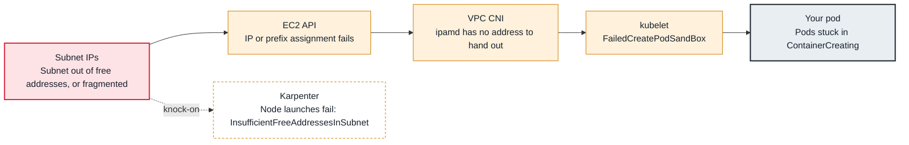

<!-- Generated from data/failures/networking.js by `node scripts/atlas.mjs docs`. Edit the data, then regenerate. -->

# Pod IP exhaustion (failed to assign an IP address to container)

The subnet has no free addresses (or no contiguous /28 prefixes), so the VPC CNI cannot give new pods an IP.

| Kind | Layer | Scope | Interactive |
|---|---|---|---|
| Cause | Networking | Amazon EKS | [Open in the atlas](../../index.html#/failures/pod-ip-exhaustion) |

## How it propagates



## Symptom

Pods are scheduled but stay in `ContainerCreating` with `FailedCreatePodSandBox` and `failed to assign
an IP address to container`. Karpenter may fail to launch nodes with `InsufficientFreeAddressesInSubnet`.
It often starts during a scale-out or deploy and affects one AZ first.

## Affected component

The **VPC CNI** (`ipamd` on each node) cannot obtain another IP or prefix from the **subnet**, or the
node has used all the ENI slots its **instance type** allows.

## Root cause

With the VPC CNI every pod gets a real VPC address from the node's subnet. `ipamd` keeps a warm pool of
addresses on attached ENIs. Two different limits run out:

- **The subnet:** a `/24` has 251 usable addresses. Nodes, pods, warm pools (by default a whole spare
  ENI's worth per node), load balancers and endpoints all draw on it. With prefix delegation, each
  allocation is a contiguous `/28`, so a fragmented subnet can fail (`InsufficientCidrBlocks`) while
  still showing free addresses.
- **The instance:** each instance type has a maximum number of ENIs and addresses per ENI. When the
  node is full, the CNI cannot add more, and pods beyond that fail (normally the scheduler prevents
  this through `max-pods`, unless `max-pods` was set higher than the ENI capacity).

## Investigation

1. **Confirm the sandbox error on the pod**

   ```sh
   kubectl describe pod <pod> -n shop | sed -n '/Events/,$p'
   ```

   Look for: `failed to assign an IP address to container`.

2. **Check free addresses in the cluster subnets**

   ```sh
   aws ec2 describe-subnets --filters Name=tag:karpenter.sh/discovery,Values=larder-prod \
     --query 'Subnets[].[SubnetId,AvailabilityZone,CidrBlock,AvailableIpAddressCount]' --output table
   ```

   Look for: Subnets with tens of addresses left, often one AZ lower than the others.

3. **Read ipamd's view on the node**

   ```sh
   kubectl logs -n kube-system <aws-node-pod-on-node> -c aws-node | grep -i -E "insufficient|cidr|no available"
   kubectl get ds aws-node -n kube-system -o jsonpath='{.spec.template.spec.containers[0].env}' | jq '.[] | select(.name|test("WARM|MINIMUM|PREFIX|CUSTOM"))'
   ```

   Look for: Subnet exhaustion versus ENI limits, and warm pool settings that hoard addresses.

## Resolution

Short term: reduce hoarding by setting `WARM_IP_TARGET` and `MINIMUM_IP_TARGET` instead of the default
warm ENI, and spread new capacity to subnets that still have room.

Durable fixes:

- add a secondary VPC CIDR (for example from `100.64.0.0/16`) and use VPC CNI custom networking so pods
  draw from large dedicated subnets;
- enable prefix delegation for density, with subnet CIDR reservations to keep `/28` blocks contiguous;
- move to IPv6 for clusters where that is an option.

## Prevention

- Size pod subnets for peak pods plus warm pools plus surge, per AZ (a `/19` per AZ is a common starting point).
- Alert when any cluster subnet falls below 20% free addresses.
- Include IP capacity in capacity reviews alongside CPU and memory.

## Related

- [Pending — Insufficient cpu, memory or pods](pending-insufficient-resources.md)
- [Network plugin not ready](cni-not-ready.md)
- [Karpenter does not launch nodes](karpenter-not-provisioning.md)

## Runbooks

- [Pod IP exhaustion](../runbooks/pod-ip-exhaustion.md)
