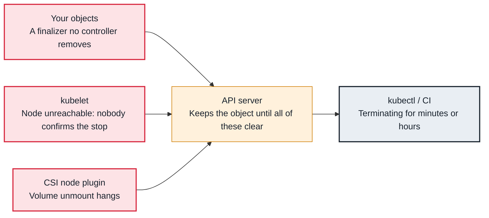

<!-- Generated from data/failures/workload.js by `node scripts/atlas.mjs docs`. Edit the data, then regenerate. -->

# Pod stuck in Terminating

The pod was deleted but something still holds it: a finalizer nobody removes, a node that cannot confirm the stop, or a volume that will not unmount.

| Kind | Layer | Scope | Interactive |
|---|---|---|---|
| Symptom | Workload | Any Kubernetes cluster | [Open in the atlas](../../index.html#/failures/pod-stuck-terminating) |

## How it propagates



## Symptom

A deleted pod stays `Terminating` long after its grace period. A StatefulSet will not create its
replacement (same name), a node drain hangs, or a namespace cannot finish deleting.

## Affected component

Deletion is a cooperation between the **API server** (which only removes the object when its
finalizers are empty and the kubelet confirms), the **kubelet** on the pod's node, and sometimes the
**CSI node plugin** unmounting volumes.

## Root cause

Deleting a pod sets `deletionTimestamp`. The kubelet then runs `preStop`, sends SIGTERM, waits up to
`terminationGracePeriodSeconds`, sends SIGKILL, cleans up, and tells the API server the pod is gone.
The object disappears only when that has happened **and** `metadata.finalizers` is empty. It gets stuck
when:

- **a finalizer remains**: the controller responsible for removing it is gone, broken or lacks permission;
- **the node is unreachable**: no kubelet is left to confirm, so the object waits forever (by design: the
  pod may still be running on a partitioned node);
- **unmount hangs**: a stuck NFS (EFS) mount or a volume detach that does not complete;
- **the grace period is huge**: someone set `terminationGracePeriodSeconds: 3600`.

## Investigation

1. **Check finalizers and the deletion timestamp**

   ```sh
   kubectl get pod search-indexer-0 -n catalog -o jsonpath='{.metadata.deletionTimestamp}{"\n"}{.metadata.finalizers}{"\n"}'
   ```

   Look for: Any finalizer, and which controller owns it.

2. **Check the node the pod was on**

   ```sh
   kubectl get pod search-indexer-0 -n catalog -o jsonpath='{.spec.nodeName}'; echo
   kubectl get node <node-name>
   ```

   Look for: `NotReady` or a node that no longer exists (an instance terminated by Spot or by hand).

3. **Check for stuck volumes on that node**

   ```sh
   kubectl describe pod search-indexer-0 -n catalog | sed -n '/Events/,$p'
   kubectl get volumeattachments | grep <node-name>
   ```

   Look for: `UnmountVolume.TearDown failed` or attachments that never go away.

## Resolution

Fix the owner of the finalizer if you can (restart or repair its controller). Remove a finalizer by hand
only when you know what cleanup it guarded and that it is safe to skip:

```sh
kubectl patch pod search-indexer-0 -n catalog --type=json -p='[{"op":"remove","path":"/metadata/finalizers"}]'
```

For a node that is truly gone, delete the Node object (the pods are then garbage collected), or apply
the `node.kubernetes.io/out-of-service=nodeshutdown:NoExecute` taint so volumes detach. Force deletion
(`--grace-period=0 --force`) removes only the API object; for StatefulSet pods on a partitioned node it
can leave two copies running with the same identity.

## Prevention

- Every controller that adds finalizers must be highly available and have a documented removal procedure.
- Keep `terminationGracePeriodSeconds` close to real shutdown time.
- Let Karpenter, Cluster Autoscaler or the node termination handler drain nodes before instances disappear.

## Related

- [Node NotReady](node-not-ready.md)
- [EFS mount timeout](efs-mount-timeout.md)
- [Node drain blocked by a PodDisruptionBudget](drain-blocked-by-pdb.md)
- [APIService unavailable (metrics.k8s.io and others), namespaces stuck Terminating](apiservice-unavailable.md)

## Runbooks

- [Node NotReady](../runbooks/node-not-ready.md)

## Reproduce it locally

```sh
make kind-up
make lab LAB=pod-stuck-terminating
make lab-clean LAB=pod-stuck-terminating
```

The lab is [labs/pod-stuck-terminating.yaml](../../labs/pod-stuck-terminating.yaml).
