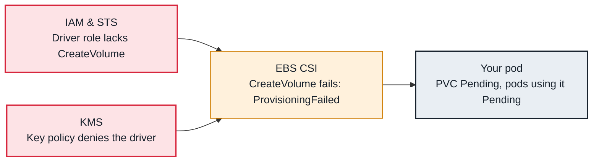

<!-- Generated from data/failures/storage.js by `node scripts/atlas.mjs docs`. Edit the data, then regenerate. -->

# PVC Pending — volume not provisioned

The PersistentVolumeClaim waits for a volume that the CSI driver cannot create: driver missing, permissions, KMS key policy or StorageClass.

| Kind | Layer | Scope | Interactive |
|---|---|---|---|
| Symptom | Storage | Amazon EKS | [Open in the atlas](../../index.html#/failures/pvc-pending-provisioning) |

## How it propagates



## Symptom

A PVC stays `Pending`, and so does the pod that mounts it. Events on the PVC say it is waiting for an
external provisioner, that no storage class is set, or that provisioning failed.

## Affected component

The **CSI controller** (EBS or EFS driver) creates volumes on request of the **PV controller**. The
cause is a missing default StorageClass, a driver that is not installed or not running, or the driver's
**IAM** or **KMS** permissions.

## Root cause

Dynamic provisioning needs a StorageClass naming a provisioner, a running controller for that
provisioner, and permission for the controller to create the volume.

- **No class:** the PVC has no `storageClassName` and no class is marked default. New EKS clusters on
  1.30 and later no longer mark `gp2` as default.
- **No provisioner:** `Waiting for a volume to be created ... by the external provisioner
  'ebs.csi.aws.com'` that never ends means nothing is serving that name: the EBS CSI driver add-on is not
  installed, its controller is not running, or the class names a different provisioner than the one
  installed (for example `ebs.csi.eks.amazonaws.com` in EKS Auto Mode).
- **No permission:** the controller's IAM role lacks `ec2:CreateVolume` (managed policy
  `AmazonEBSCSIDriverPolicy`), or the class requests a customer-managed KMS key the role cannot use.
- **Normal:** with `WaitForFirstConsumer`, the PVC waits until a pod using it is scheduled. That is
  expected, not a fault.

## Investigation

1. **Read the PVC's events**

   ```sh
   kubectl describe pvc <pvc> -n catalog | sed -n '/Events/,$p'
   ```

   Look for: Which of the four cases above applies.

2. **Check the StorageClass and the installed drivers**

   ```sh
   kubectl get storageclass
   kubectl get csidrivers
   kubectl get pods -n kube-system -l app=ebs-csi-controller
   ```

   Look for: No default class, a provisioner name with no matching CSIDriver, or a controller not running.

3. **Read the CSI controller logs**

   ```sh
   kubectl logs -n kube-system deploy/ebs-csi-controller -c csi-provisioner --tail=50
   kubectl logs -n kube-system deploy/ebs-csi-controller -c ebs-plugin --tail=50
   ```

   Look for: `UnauthorizedOperation`, `AccessDenied` on `kms:CreateGrant`, or credential errors.

4. **Check the driver's IAM role**

   ```sh
   aws eks describe-addon --cluster-name larder-prod --addon-name aws-ebs-csi-driver --query 'addon.[status,serviceAccountRoleArn]'
   aws eks list-pod-identity-associations --cluster-name larder-prod --namespace kube-system
   ```

   Look for: No role at all, or a role without `AmazonEBSCSIDriverPolicy` and KMS permissions.

## Resolution

Install the driver as an EKS add-on with a role (IRSA or Pod Identity) that has
`AmazonEBSCSIDriverPolicy`, plus KMS permissions for encrypted volumes with your own key. Define a
default class explicitly:

```yaml
apiVersion: storage.k8s.io/v1
kind: StorageClass
metadata:
  name: gp3
  annotations: { storageclass.kubernetes.io/is-default-class: "true" }
provisioner: ebs.csi.aws.com
volumeBindingMode: WaitForFirstConsumer
allowVolumeExpansion: true
parameters: { type: gp3, encrypted: "true" }
```

## Prevention

- Ship StorageClasses and the CSI driver with the cluster baseline, never by hand.
- Alert on PVCs Pending for more than 5 minutes.
- Test a PVC end to end in the cluster's smoke tests after every add-on or IAM change.

Alerts that lead here: `KubePVCPending` (ticket).

## Related

- [Pending — pod has unbound immediate PersistentVolumeClaims](pending-unbound-pvc.md)
- [AttachVolume or MountVolume failed](volume-attach-failed.md)
- [volume node affinity conflict](volume-node-affinity-conflict.md)
- [AccessDenied from a pod calling AWS](pod-aws-access-denied.md)

## Reproduce it locally

```sh
make kind-up
make lab LAB=pending-unbound-pvc
make lab-clean LAB=pending-unbound-pvc
```

The lab is [labs/pending-unbound-pvc.yaml](../../labs/pending-unbound-pvc.yaml).
