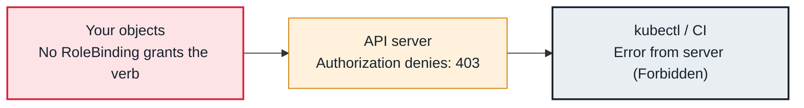

<!-- Generated from data/failures/identity.js by `node scripts/atlas.mjs docs`. Edit the data, then regenerate. -->

# Forbidden — RBAC denies the action

You are authenticated, but no Role or ClusterRole bound to you grants this verb on this resource.

| Kind | Layer | Scope | Interactive |
|---|---|---|---|
| Cause | Identity | Any Kubernetes cluster | [Open in the atlas](../../index.html#/failures/rbac-forbidden) |

## How it propagates



## Symptom

A request fails with `Forbidden` and a sentence naming the user, the verb, the resource, the API group
and the namespace. For a controller or operator, its logs repeat the error and it stops reconciling.

## Affected component

**Authorization** in the **API server** (RBAC, plus EKS access policies) recognised the identity but
found no rule allowing that verb on that resource in that scope.

## Root cause

RBAC is additive and default-deny: an identity can do only what some Role or ClusterRole bound to it (or
to one of its groups) allows. The message tells you exactly what was missing: the **verb**, the
**resource** (and subresource such as `pods/log` or `pods/exec`), the **API group** and the
**namespace**. Common gaps:

- a RoleBinding in one namespace when the workload acts in another;
- a ClusterRole bound with a RoleBinding (namespace-scoped) when cluster-wide access was needed;
- a missing subresource (`pods/exec`, `deployments/scale`);
- an access policy associated with a namespace scope rather than the cluster.

## Investigation

1. **Ask the API server what the identity may do**

   ```sh
   kubectl auth can-i list secrets -n fulfilment --as=system:serviceaccount:fulfilment:dispatch-worker
   kubectl auth can-i --list -n payments --as=arn:aws:sts::111122223333:assumed-role/developer/alice
   ```

   Look for: `no` for the exact verb and resource in the message.

2. **Find the bindings for the subject**

   ```sh
   kubectl get rolebindings,clusterrolebindings -A -o json | \
     jq -r '.items[] | select(.subjects[]? | .name=="dispatch-worker") | "\(.kind) \(.metadata.namespace // "-")/\(.metadata.name) -> \(.roleRef.name)"'
   aws eks list-associated-access-policies --cluster-name larder-prod --principal-arn arn:aws:iam::111122223333:role/developer
   ```

   Look for: Bindings in the wrong namespace, or a role missing the resource.

## Resolution

Grant the narrowest rule that covers the message, in the namespace where the action happens:

```yaml
apiVersion: rbac.authorization.k8s.io/v1
kind: Role
metadata: { name: dispatch-worker, namespace: fulfilment }
rules:
  - apiGroups: [""]
    resources: ["configmaps"]
    verbs: ["get", "list", "watch"]
```

Bind it with a RoleBinding to the service account. Question requests for `secrets` list access; reading
one named Secret (`resourceNames`) is usually enough.

## Prevention

- Keep RBAC in the same chart as the workload that needs it, and test controllers with their real service account.
- Review ClusterRoleBindings regularly; alert on new bindings to `cluster-admin` from the audit log.

## Related

- [You must be logged in to the server](kubectl-unauthorized.md)
- [AccessDenied from a pod calling AWS](pod-aws-access-denied.md)
