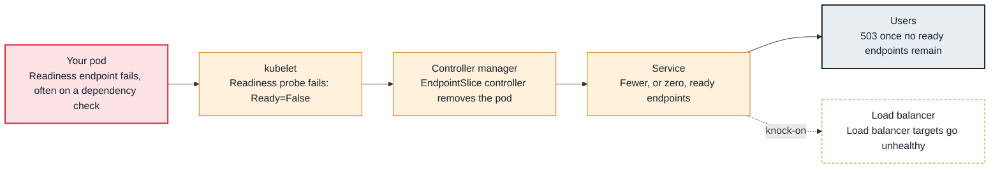

<!-- Generated from data/failures/workload.js by `node scripts/atlas.mjs docs`. Edit the data, then regenerate. -->

# Readiness probe failing (pods Running but not Ready)

The container runs, but its readiness check fails, so it is taken out of Service endpoints and receives no traffic.

| Kind | Layer | Scope | Interactive |
|---|---|---|---|
| Symptom | Workload | Any Kubernetes cluster | [Open in the atlas](../../index.html#/failures/readiness-probe-failing) |

## How it propagates



## Symptom

Pods are `Running` with `READY 0/1` and few or no restarts. The Service has no ready endpoints, so
callers get connection refused, and an ALB in front returns `503`. A rollout using these pods stalls,
because new pods never become available.

## Affected component

The **kubelet** runs the probe and marks the container unready; the **EndpointSlice controller** removes
the pod from the Service; **kube-proxy** and the load balancer stop sending it traffic. The cause is the
**application**'s readiness endpoint or something it checks.

## Root cause

Readiness answers "should this pod receive traffic now?". A failing readiness probe never restarts the
container; it only takes the pod out of rotation. It fails when:

- the probe targets the wrong port or path (`connection refused`, `404`);
- the app is still starting and the probe has no `startupProbe` or tolerance for it;
- the readiness handler checks a dependency (database, cache, another service) that is down or
  unreachable, so **every** replica goes unready at once and the outage spreads upwards;
- the probe's `timeoutSeconds` (default 1s) is shorter than the endpoint's latency under load.

The third case is the dangerous one: a dependency blip removes all capacity even though the pods could
serve cached or partial responses.

## Investigation

1. **See which pods are unready and why**

   ```sh
   kubectl get pods -n shop -l app=orders-api -o wide
   kubectl describe pod <pod> -n shop | grep -A3 -E "Readiness|Conditions"
   ```

   Look for: `connection refused` (nothing listening on that port yet), a status code (the handler answered "no"), or `context deadline exceeded` (too slow).

2. **Call the readiness endpoint yourself**

   ```sh
   kubectl port-forward pod/<pod> -n shop 8080:8080 &
   curl -sv http://127.0.0.1:8080/ready
   ```

   Look for: The body usually says which check failed (`db: timeout`).

3. **Check the endpoints the Service actually has**

   ```sh
   kubectl get endpointslices -n shop -l kubernetes.io/service-name=orders-api -o wide
   ```

   Look for: Addresses with `ready=false`, or none at all.

4. **If all replicas are unready, test the dependency**

   ```sh
   kubectl debug -it <pod> -n shop --image=nicolaka/netshoot --target=api -- \
     nc -vz -w 3 orders-db.cluster-abc123.eu-west-1.rds.amazonaws.com 5432
   ```

   Look for: A timeout points to network or security groups (see connection-timeouts); a refusal points to the dependency itself.

## Resolution

Point the probe at a cheap endpoint that reflects whether *this process* can serve. Keep deep dependency
checks out of readiness, or make them tolerate short outages. Use a `startupProbe` for slow starts and a
realistic `timeoutSeconds`:

```yaml
startupProbe:   { httpGet: { path: /ready, port: http }, periodSeconds: 5, failureThreshold: 30 }
readinessProbe: { httpGet: { path: /ready, port: http }, periodSeconds: 5, timeoutSeconds: 2, failureThreshold: 3 }
```

## Prevention

- Separate liveness (process is alive), readiness (can serve now) and startup (finished booting) endpoints.
- Never make readiness fail on a dependency that every replica shares, unless removing all replicas is truly better than serving errors.
- Alert on Services whose ready endpoint count drops to zero, and on Deployments with `kube_deployment_status_replicas_available` below desired.

Alerts that lead here: `KubeDeploymentReplicasMissing` (ticket).

## Related

- [Service has no endpoints](service-no-endpoints.md)
- [ALB targets unhealthy](alb-targets-unhealthy.md)
- [Liveness probe restarts healthy containers](liveness-probe-restarts.md)
- [Rollout stuck](rollout-stuck.md)
- [Connection timeouts between pods or to AWS services](connection-timeouts.md)

## Runbooks

- [Load balancer 5xx](../runbooks/load-balancer-5xx.md)

## Reproduce it locally

```sh
make kind-up
make lab LAB=readiness-probe-failing
make lab-clean LAB=readiness-probe-failing
```

The lab is [labs/readiness-probe-failing.yaml](../../labs/readiness-probe-failing.yaml).
