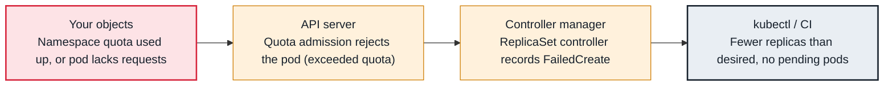

<!-- Generated from data/failures/scheduling.js by `node scripts/atlas.mjs docs`. Edit the data, then regenerate. -->

# Pods never created — exceeded quota or LimitRange

A ResourceQuota or LimitRange rejects pods at admission, so they are never created and there is nothing to describe.

| Kind | Layer | Scope | Interactive |
|---|---|---|---|
| Cause | Scheduling | Any Kubernetes cluster | [Open in the atlas](../../index.html#/failures/resource-quota-exceeded) |

## How it propagates



## Symptom

A Deployment shows `READY 2/5` but there are no Pending pods to inspect: the missing replicas do not
exist at all. `kubectl get pods` looks healthy, and the scheduler has nothing to say.

## Affected component

The **ResourceQuota** and **LimitRanger** admission plugins in the **API server** reject the pod at
creation, and the **ReplicaSet controller** records `FailedCreate` on the ReplicaSet, not on any pod.

## Root cause

A ResourceQuota caps the sum of requests, limits or object counts in a namespace. Once the namespace is
at its cap, every new pod is rejected at admission. When a quota covers `limits.memory` (or any compute
resource), every pod must also declare that resource, so a pod without limits is rejected even if the
namespace has room. A LimitRange rejects pods outside its min and max.

Because the rejection happens before the pod exists, the evidence lives on the ReplicaSet (or Job,
StatefulSet) events.

## Investigation

1. **Read the owner's events, not the pods'**

   ```sh
   kubectl describe rs -n shop -l app=orders-api | sed -n '/Events/,$p'
   ```

   Look for: `FailedCreate ... is forbidden: exceeded quota` or `must specify`.

2. **Compare quota usage with the hard limits**

   ```sh
   kubectl describe resourcequota -n shop
   kubectl describe limitrange -n shop
   ```

   Look for: `Used` equal to `Hard` for the resource named in the event.

## Resolution

Free quota (scale down something else, right-size requests) or raise the quota through whatever process
owns it. If the error is `must specify`, add the missing requests or limits to the pod template, or add a
LimitRange that supplies defaults.

## Prevention

- Alert when quota usage exceeds 85% (`kube_resourcequota{type="used"} / kube_resourcequota{type="hard"}`).
- Ship a LimitRange with defaults alongside every ResourceQuota.
- Size quotas for rollouts: `maxSurge` pods need room during every deploy.

Alerts that lead here: `KubeQuotaAlmostFull` (ticket).

## Related

- [Rollout stuck](rollout-stuck.md)
- [Pending — Insufficient cpu, memory or pods](pending-insufficient-resources.md)
- [failed calling webhook](webhook-unavailable.md)

## Runbooks

- [Pods pending, capacity not arriving](../runbooks/pending-pods-capacity.md)

## Reproduce it locally

```sh
make kind-up
make lab LAB=resource-quota-exceeded
make lab-clean LAB=resource-quota-exceeded
```

The lab is [labs/resource-quota-exceeded.yaml](../../labs/resource-quota-exceeded.yaml).
