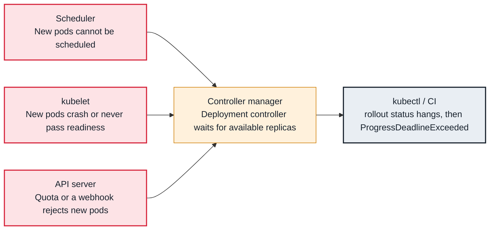

<!-- Generated from data/failures/workload.js by `node scripts/atlas.mjs docs`. Edit the data, then regenerate. -->

# Rollout stuck (ProgressDeadlineExceeded)

New pods never become available, so the Deployment stops progressing and reports ProgressDeadlineExceeded.

| Kind | Layer | Scope | Interactive |
|---|---|---|---|
| Symptom | Workload | Any Kubernetes cluster | [Open in the atlas](../../index.html#/failures/rollout-stuck) |

## How it propagates



## Symptom

`kubectl rollout status` hangs and then fails with `exceeded its progress deadline`; a CD pipeline times
out. The Deployment shows old and new ReplicaSets side by side, with the new one never reaching its
desired count. Traffic is usually still served by the old pods.

## Affected component

The **deployment controller** sets `Progressing=False` after `progressDeadlineSeconds` (600 by default)
without progress. The real failure is in whatever stops new pods becoming available: the **scheduler**,
the **kubelet**, the image, the probes, or a quota.

## Root cause

A rolling update creates new pods and removes old ones only as new ones become **available** (Ready for
`minReadySeconds`). The rollout stops progressing when new pods cannot get there:

- they are `Pending` (no capacity, taints, PVC zone, quota exhausted);
- they crash or cannot pull their image;
- they run but never pass readiness;
- the ReplicaSet cannot create them at all (`FailedCreate` from a quota or admission webhook).

The condition is a symptom aggregator: it tells you the rollout stopped, never why.

## Investigation

1. **Find the new ReplicaSet and its pods**

   ```sh
   kubectl rollout status deployment/orders-api -n shop --timeout=10s
   kubectl get rs -n shop -l app=orders-api
   kubectl get pods -n shop -l app=orders-api -o wide
   ```

   Look for: The newest ReplicaSet with fewer ready pods than desired, and the status of its pods.

2. **Check whether the ReplicaSet could create pods**

   ```sh
   kubectl describe rs <new-replicaset> -n shop | sed -n '/Events/,$p'
   ```

   Look for: `FailedCreate` with `exceeded quota` or a webhook denial: no pods exist to inspect (see resource-quota-exceeded, webhook-unavailable).

3. **Follow the pod status to its own entry**

   ```sh
   kubectl describe pod <new-pod> -n shop | sed -n '/Events/,$p'
   ```

   Look for: `Pending` with a scheduler message, `ImagePullBackOff`, `CrashLoopBackOff`, or `Readiness probe failed`.

## Resolution

Roll back to restore the previous ReplicaSet as the target while you fix the cause:

```sh
kubectl rollout undo deployment/orders-api -n shop
```

Then fix the underlying pod failure and roll forward. If the cause was capacity, check that `maxSurge`
pods can be scheduled: a rollout of a large Deployment needs headroom for the surge.

## Prevention

- Use `maxUnavailable: 0` with a modest `maxSurge` so stuck rollouts never reduce capacity.
- Let CD fail on `kubectl rollout status --timeout` and roll back automatically (or use progressive delivery with analysis).
- Alert on `kube_deployment_status_condition{condition="Progressing",status="false"}`.

Alerts that lead here: `KubeDeploymentRolloutStuck` (ticket).

## Related

- [Pending — Insufficient cpu, memory or pods](pending-insufficient-resources.md)
- [ImagePullBackOff / ErrImagePull](imagepullbackoff.md)
- [CrashLoopBackOff](crashloopbackoff.md)
- [Readiness probe failing](readiness-probe-failing.md)
- [Pods never created — exceeded quota or LimitRange](resource-quota-exceeded.md)

## Reproduce it locally

```sh
make kind-up
make lab LAB=rollout-stuck
make lab-clean LAB=rollout-stuck
```

The lab is [labs/rollout-stuck.yaml](../../labs/rollout-stuck.yaml).
