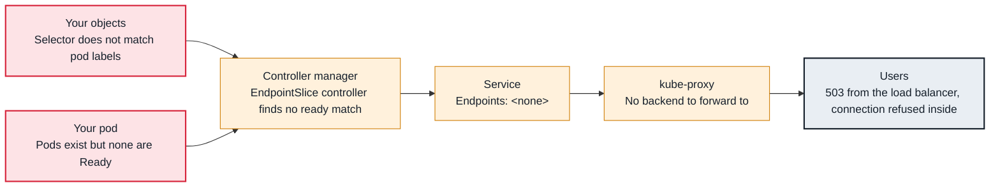

<!-- Generated from data/failures/networking.js by `node scripts/atlas.mjs docs`. Edit the data, then regenerate. -->

# Service has no endpoints

The Service selects no ready pods, so there is nowhere to send its traffic.

| Kind | Layer | Scope | Interactive |
|---|---|---|---|
| Symptom | Networking | Any Kubernetes cluster | [Open in the atlas](../../index.html#/failures/service-no-endpoints) |

## How it propagates



## Symptom

Calls to the Service fail with `connection refused` (from kube-proxy's reject rule) or time out; an
ingress returns 503; `kubectl describe svc` shows `Endpoints: <none>`. The pods themselves may be
perfectly healthy.

## Affected component

The **EndpointSlice controller** builds the Service's endpoints from pods that match its selector and are
Ready; **kube-proxy** programs only those. The cause is a mismatch between the **Service** and the
**pods**, or pods that are not Ready.

## Root cause

A Service is a selector plus ports. It has endpoints only if pods exist that:

1. carry **every** label in the selector (a Service selecting `tier: backend` excludes pods without it);
2. are in the **same namespace**;
3. are **Ready** (unready pods are listed as not ready and get no traffic);
4. expose the **targetPort**: a named targetPort must match a `containerPort` name in the pod.

A rename of labels in the Deployment, or a selector copied from another service, is the usual cause.

## Investigation

1. **Compare the Service selector with pod labels**

   ```sh
   kubectl get svc orders-api -n shop -o jsonpath='{.spec.selector}'; echo
   kubectl get pods -n shop --show-labels | grep orders-api
   kubectl get pods -n shop -l app=orders-api,tier=backend
   ```

   Look for: An empty result for the full selector while pods exist with a subset of the labels.

2. **Check readiness and ports in the EndpointSlices**

   ```sh
   kubectl get endpointslices -n shop -l kubernetes.io/service-name=orders-api -o yaml | grep -E "ready:|port:|name:"
   kubectl get pods -n shop -l app=orders-api -o jsonpath='{.items[0].spec.containers[0].ports}'
   ```

   Look for: `ready: false` endpoints (see readiness-probe-failing), or a targetPort name absent from the pod.

## Resolution

Make the selector match the pod template's labels (selectors on Deployments are immutable, so change the
Service), correct the targetPort, or fix readiness. Endpoints appear within seconds once pods match.

## Prevention

- Generate Services and Deployments from one template so selectors and labels cannot drift.
- Alert on Services with zero ready endpoints (`kube_endpoint_address{ready="true"}` absent, or blackbox probes through the Service).

## Related

- [Readiness probe failing](readiness-probe-failing.md)
- [ALB targets unhealthy](alb-targets-unhealthy.md)
- [DNS — no such host](dns-nxdomain.md)

## Runbooks

- [Load balancer 5xx](../runbooks/load-balancer-5xx.md)

## Reproduce it locally

```sh
make kind-up
make lab LAB=service-no-endpoints
make lab-clean LAB=service-no-endpoints
```

The lab is [labs/service-no-endpoints.yaml](../../labs/service-no-endpoints.yaml).
