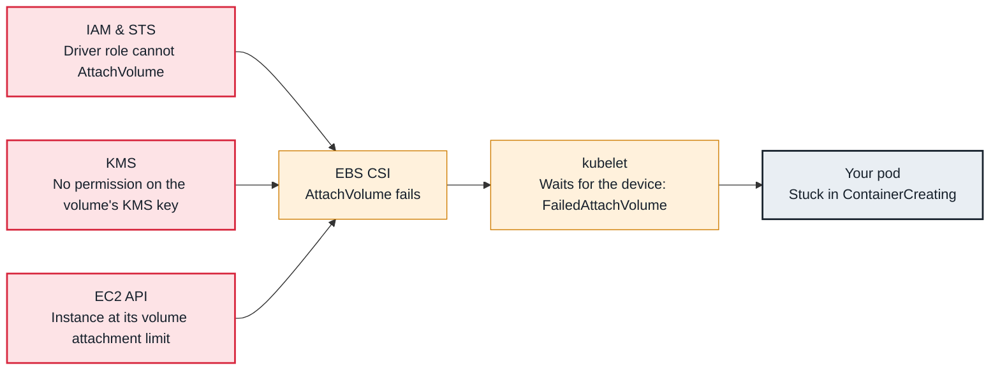

<!-- Generated from data/failures/storage.js by `node scripts/atlas.mjs docs`. Edit the data, then regenerate. -->

# AttachVolume or MountVolume failed (EBS)

The EBS CSI driver cannot attach or mount the volume: missing permissions, no access to the KMS key, the instance's attachment limit, or a stuck attachment.

| Kind | Layer | Scope | Interactive |
|---|---|---|---|
| Cause | Storage | Amazon EKS | [Open in the atlas](../../index.html#/failures/volume-attach-failed) |

## How it propagates



## Symptom

A pod with an EBS-backed PVC is scheduled but stays in `ContainerCreating`. Events show `AttachVolume.
Attach failed` or `MountVolume.MountDevice failed`; or the scheduler reports nodes that `exceed max
volume count`.

## Affected component

The **EBS CSI controller** attaches volumes through EC2 using its **IAM** role; the **CSI node plugin**
formats and mounts them. Encryption keys in **KMS** and **EC2** attachment limits are frequent causes.

## Root cause

- **Permissions:** the controller role lacks `ec2:AttachVolume`, or the volume is encrypted with a
  customer-managed KMS key whose key policy does not allow the role (`kms:CreateGrant`, `kms:Decrypt`).
- **Attachment limits:** each instance supports a limited number of EBS attachments; on many Nitro types
  ENIs and NVMe devices share the slots, so dense nodes with many ENIs run out. The scheduler respects
  the limit the CSI node plugin reports (`exceed max volume count`), unless that count is wrong.
- **Mount failures:** a file system that needs repair, or `fsGroup` ownership changes on volumes with
  millions of files that take longer than the mount timeout.
- **Zone mismatch:** the volume and instance are in different zones (prevented by node affinity unless a
  PV was created by hand without it).

## Investigation

1. **Read attach and mount events**

   ```sh
   kubectl describe pod <pod> -n <ns> | sed -n '/Events/,$p'
   kubectl get volumeattachment | grep <pv-name>
   ```

   Look for: The EC2 or KMS error text inside the CSI message.

2. **Read the controller and node plugin logs**

   ```sh
   kubectl logs -n kube-system deploy/ebs-csi-controller -c csi-attacher --tail=50
   kubectl logs -n kube-system -l app=ebs-csi-node -c ebs-plugin --tail=50 --prefix | grep <pv-name>
   ```

   Look for: `UnauthorizedOperation`, `KMS key is not in a valid state`, `AttachmentLimitExceeded`, mount or fsck errors.

3. **Check the node's attachment capacity**

   ```sh
   kubectl get csinode <node-name> -o jsonpath='{.spec.drivers[?(@.name=="ebs.csi.aws.com")].allocatable.count}'; echo
   kubectl get volumeattachments -o json | jq --arg n <node-name> '[.items[] | select(.spec.nodeName==$n)] | length'
   ```

   Look for: Attachments at the allocatable count.

## Resolution

Grant the controller role `AmazonEBSCSIDriverPolicy` and add it to the KMS key policy (or grant the
KMS actions in IAM). For attachment limits, spread volume-heavy pods (topology spread on
`kubernetes.io/hostname`) or use instance types with more attachment slots. For slow `fsGroup` changes,
set `fsGroupChangePolicy: OnRootMismatch`.

## Prevention

- Test encrypted volume provisioning and attachment whenever KMS keys or IAM change.
- Spread stateful pods across nodes, and keep volume-heavy workloads on a dedicated NodePool.

Alerts that lead here: `KubePersistentVolumeFillingUp` (ticket).

## Related

- [PVC Pending — volume not provisioned](pvc-pending-provisioning.md)
- [Multi-Attach error](multi-attach-error.md)
- [AccessDenied from a pod calling AWS](pod-aws-access-denied.md)
