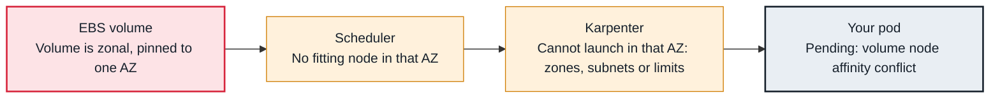

<!-- Generated from data/failures/storage.js by `node scripts/atlas.mjs docs`. Edit the data, then regenerate. -->

# volume node affinity conflict (EBS volume in another AZ)

The pod's EBS volume lives in one Availability Zone, but the only nodes that can take the pod are in another.

| Kind | Layer | Scope | Interactive |
|---|---|---|---|
| Cause | Storage | Amazon EKS | [Open in the atlas](../../index.html#/failures/volume-node-affinity-conflict) |

## How it propagates



## Symptom

A stateful pod that used to run (often after its node was replaced or the node group was resized) stays
`Pending`. The scheduler reports `volume node affinity conflict` for most nodes, and the remaining
nodes, all in one zone, are full or tainted.

## Affected component

The **scheduler**'s `VolumeBinding` and `VolumeZone` filters keep the pod in the zone where its **EBS**
volume lives. The cause is node capacity in that zone, which depends on the **autoscaler** and node pool
layout.

## Root cause

An EBS volume exists in exactly one Availability Zone and can only attach to instances there. Its PV
carries node affinity for `topology.kubernetes.io/zone`. Once bound, the pod can only ever run in that
zone. It becomes unschedulable when:

- no node exists in that zone (node group scaled in, Spot capacity gone, a NodePool or ASG that does
  not include that zone's subnet);
- nodes exist but are full, tainted or the wrong type, and the autoscaler cannot add one there;
- a Cluster Autoscaler node group spans several AZs, so the autoscaler cannot target the zone the pod needs.

## Investigation

1. **Find the zone the volume requires**

   ```sh
   kubectl get pvc data-orders-db-0 -n shop -o jsonpath='{.spec.volumeName}'; echo
   kubectl get pv <pv-name> -o jsonpath='{.spec.nodeAffinity}' | jq
   ```

   Look for: The required `topology.kubernetes.io/zone` value.

2. **List nodes in that zone and their headroom**

   ```sh
   kubectl get nodes -l topology.kubernetes.io/zone=eu-west-1b
   kubectl describe nodes -l topology.kubernetes.io/zone=eu-west-1b | grep -A6 "Allocated resources"
   ```

   Look for: No nodes, or nodes full and tainted.

3. **Check the autoscaler can create capacity in that zone**

   ```sh
   kubectl get nodepool general -o jsonpath='{.spec.template.spec.requirements}' | jq '.[] | select(.key=="topology.kubernetes.io/zone")'
   kubectl get ec2nodeclass general -o jsonpath='{.status.subnets}' | jq
   ```

   Look for: Zone requirements or discovered subnets that exclude the needed zone.

## Resolution

Give the zone capacity: let Karpenter launch there (zone allowed, subnet discovered), or for Cluster
Autoscaler use one node group per AZ with `--balance-similar-node-groups`. If the data can be rebuilt,
delete the PVC so a new volume is created where capacity exists; to move data, snapshot the volume and
restore it in another zone.

## Prevention

- Use `WaitForFirstConsumer` StorageClasses so new volumes follow scheduling.
- Run stateful workloads with one replica per zone (topology spread) and keep capacity in every zone.
- With Cluster Autoscaler, use zonal node groups for workloads that use EBS.

## Related

- [Pending — Insufficient cpu, memory or pods](pending-insufficient-resources.md)
- [Pending — untolerated taint, affinity or topology spread](pending-taint-affinity.md)
- [Multi-Attach error](multi-attach-error.md)
- [Karpenter does not launch nodes](karpenter-not-provisioning.md)

## Runbooks

- [Pods pending, capacity not arriving](../runbooks/pending-pods-capacity.md)
