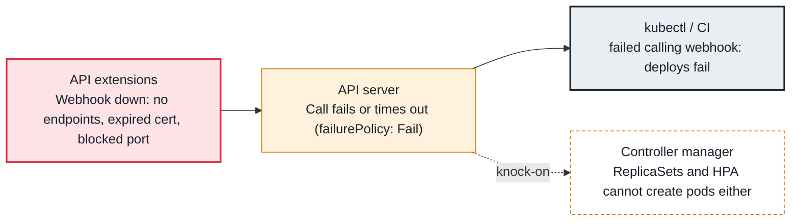

<!-- Generated from data/failures/networking.js by `node scripts/atlas.mjs docs`. Edit the data, then regenerate. -->

# failed calling webhook (admission webhook unavailable)

The API server calls a webhook for every matching request; when the webhook cannot answer, those requests fail.

| Kind | Layer | Scope | Interactive |
|---|---|---|---|
| Cause | Networking | Any Kubernetes cluster | [Open in the atlas](../../index.html#/failures/webhook-unavailable) |

## How it propagates



## Symptom

Creating or updating unrelated objects fails with `Internal error occurred: failed calling webhook`.
Deploys break across many teams at once; ReplicaSets cannot create pods (`FailedCreate`); controllers
log errors. Reads keep working.

## Affected component

The **API server** calls an **admission webhook** for every matching request. With `failurePolicy:
Fail`, when the webhook backend is down or unreachable, the API server rejects the request. The webhook
belongs to an add-on such as the **AWS Load Balancer Controller**, cert-manager or a policy engine.

## Root cause

Admission webhooks run in your cluster but sit in the control plane's request path. The request fails
when:

- **the webhook pods are not running or not ready:** `no endpoints available for service` (scaled to
  zero, crash looping, evicted, or scheduled on nodes that do not exist yet; a classic chicken-and-egg
  during cluster bootstrap);
- **the API server cannot reach them:** `context deadline exceeded`. On EKS the control plane reaches
  webhooks through ENIs in your VPC, governed by the **cluster security group**; a webhook listening on a
  port other than 443 needs an inbound rule for that port on the nodes;
- **TLS fails:** the `caBundle` does not match the serving certificate (expired, rotated by cert-manager
  without injection), seen as `x509` errors;
- the webhook matches far more than it needs (all namespaces including `kube-system`, all resources).

## Investigation

1. **Identify the webhook from the error**

   ```sh
   kubectl get mutatingwebhookconfigurations,validatingwebhookconfigurations
   kubectl get validatingwebhookconfiguration <name> -o jsonpath='{range .webhooks[*]}{.name}{"\t"}{.failurePolicy}{"\t"}{.clientConfig.service.namespace}/{.clientConfig.service.name}:{.clientConfig.service.port}{"\n"}{end}'
   ```

   Look for: The service behind the failing webhook name, its port, and `failurePolicy`.

2. **Check the backend pods and endpoints**

   ```sh
   kubectl get endpointslices -n kube-system -l kubernetes.io/service-name=aws-load-balancer-webhook-service
   kubectl get pods -n kube-system -l app.kubernetes.io/name=aws-load-balancer-controller -o wide
   ```

   Look for: No ready endpoints, crash loops, Pending pods.

3. **For timeouts on EKS, check the security group path**

   ```sh
   aws eks describe-cluster --name larder-prod --query 'cluster.resourcesVpcConfig.clusterSecurityGroupId'
   aws ec2 describe-security-groups --group-ids <node-sg> --query 'SecurityGroups[].IpPermissions'
   ```

   Look for: No inbound rule from the cluster security group to the webhook's target port (for example 9443) on the nodes.

4. **Check the API server's view in the audit or API logs**

   ```sh
   aws logs filter-log-events --log-group-name /aws/eks/larder-prod/cluster \
     --filter-pattern '"failed calling webhook"' --max-items 20
   ```

   Look for: Which webhook, how often, and since when.

## Resolution

Restore the webhook backend: scale it up, fix its crash, give it capacity, or open the security group
port. If it cannot be restored quickly and the webhook is not security-critical, unblock the cluster by
setting `failurePolicy: Ignore` or deleting the webhook configuration temporarily, and restore it after.
Note what admission you skip meanwhile.

## Prevention

- Run webhook backends with at least two replicas, a PDB, a PriorityClass and topology spread.
- Scope webhooks with `namespaceSelector` and `objectSelector`; exclude `kube-system` and the webhook's own namespace.
- Keep `timeoutSeconds` short (2 to 5 seconds) so a slow webhook does not stall the API server.
- Alert on `apiserver_admission_webhook_admission_duration_seconds` p99 and on webhook rejection rates.

Alerts that lead here: `KubeSystemDeploymentUnavailable` (page), `AdmissionWebhookSlow` (ticket).

## Related

- [x509 certificate errors](x509-certificate-errors.md)
- [Pods never created — exceeded quota or LimitRange](resource-quota-exceeded.md)
- [Rollout stuck](rollout-stuck.md)
- [Connection timeouts between pods or to AWS services](connection-timeouts.md)
- [API server throttling (429 Too Many Requests) and slow API](api-throttling.md)

## Runbooks

- [Pods pending, capacity not arriving](../runbooks/pending-pods-capacity.md)
- [API server degraded](../runbooks/api-server-degraded.md)
