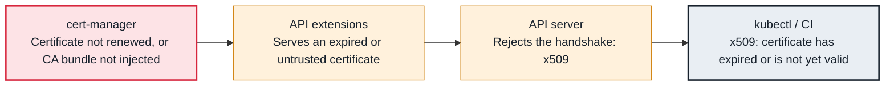

<!-- Generated from data/failures/identity.js by `node scripts/atlas.mjs docs`. Edit the data, then regenerate. -->

# x509 certificate errors (expired, unknown authority, wrong name)

A TLS handshake fails because a certificate is expired, signed by an authority the client does not trust, or issued for another name.

| Kind | Layer | Scope | Interactive |
|---|---|---|---|
| Cause | Identity | Any Kubernetes cluster | [Open in the atlas](../../index.html#/failures/x509-certificate-errors) |

## How it propagates



## Symptom

TLS handshakes fail with an `x509:` error: `kubectl` cannot connect, a webhook call fails, an ingress
serves a browser warning, or service-to-service calls with TLS break, often all at once at a specific
time (an expiry).

## Affected component

Whatever validates a certificate: **kubectl** validating the API server, the **API server** validating
a webhook's serving certificate against its `caBundle`, the **kubelet**, or applications. Issuance and
renewal usually belong to **cert-manager** (in-cluster) or ACM (load balancers).

## Root cause

Three distinct failures share the prefix:

- **Expired or not yet valid:** a certificate was not renewed (cert-manager failing its challenges or
  lacking permissions, a manually created certificate forgotten, a self-managed cluster's control plane
  certificates after one year), or the client clock is wrong.
- **Unknown authority:** the client does not trust the issuer. A corporate TLS-inspection proxy
  re-signing traffic to the API server; a kubeconfig `certificate-authority-data` from another cluster
  (a recreated cluster has a new CA); a webhook `caBundle` that was not updated after rotation.
- **Wrong name:** the certificate's subject alternative names do not include the name the client used
  (a Service DNS name missing from a webhook certificate, an ingress host not on the certificate).

## Investigation

1. **Inspect the certificate actually presented**

   ```sh
   openssl s_client -connect api.larder.example:443 -servername api.larder.example </dev/null 2>/dev/null | \
     openssl x509 -noout -subject -issuer -dates -ext subjectAltName
   ```

   Look for: `notAfter` in the past, an unexpected issuer (a proxy), or SANs without the requested name.

2. **For webhooks, compare caBundle with the serving certificate**

   ```sh
   kubectl get validatingwebhookconfiguration cert-manager-webhook -o jsonpath='{.webhooks[0].clientConfig.caBundle}' | base64 -d | openssl x509 -noout -subject -dates
   kubectl get secret cert-manager-webhook-ca -n cert-manager -o jsonpath='{.data.ca\.crt}' | base64 -d | openssl x509 -noout -subject -dates
   ```

   Look for: Different subjects or dates between the bundle and the CA that signed the serving certificate.

3. **For cert-manager certificates, follow the issuance chain**

   ```sh
   kubectl get certificate,certificaterequest,order,challenge -A
   kubectl describe certificate orders-tls -n shop | sed -n '/Status/,$p'
   ```

   Look for: `Ready=False` and the failing step: a challenge that cannot be reached, a DNS01 permission error, a rate limit.

4. **For kubectl, check which CA you trust**

   ```sh
   kubectl config view --minify --raw -o jsonpath='{.clusters[0].cluster.certificate-authority-data}' | base64 -d | openssl x509 -noout -subject -dates
   aws eks describe-cluster --name larder-prod --query 'cluster.certificateAuthority.data' --output text | base64 -d | openssl x509 -noout -subject -dates
   ```

   Look for: A kubeconfig CA that differs from the cluster's current CA.

## Resolution

Renew or reissue the certificate (fix the cert-manager issuer and trigger renewal with `cmctl renew`),
update the trust (regenerate kubeconfig with `aws eks update-kubeconfig`, re-inject the webhook
`caBundle` with cert-manager's CA injector), or add the missing SANs. Behind a TLS-inspection proxy,
exempt the EKS endpoint from inspection rather than disabling verification.

## Prevention

- Alert 21 days before expiry on every certificate (`certmanager_certificate_expiration_timestamp_seconds - time()`), and probe external endpoints with blackbox checks.
- Use cert-manager's CA injector for every webhook and APIService that it serves.
- Never use `insecure-skip-tls-verify`; it hides the next real problem.

Alerts that lead here: `CertificateNotReady` (ticket).

## Related

- [failed calling webhook](webhook-unavailable.md)
- [You must be logged in to the server](kubectl-unauthorized.md)
- [Ingress has no ADDRESS](ingress-no-address.md)

## Runbooks

- [Certificate expiry](../runbooks/certificate-expiry.md)
