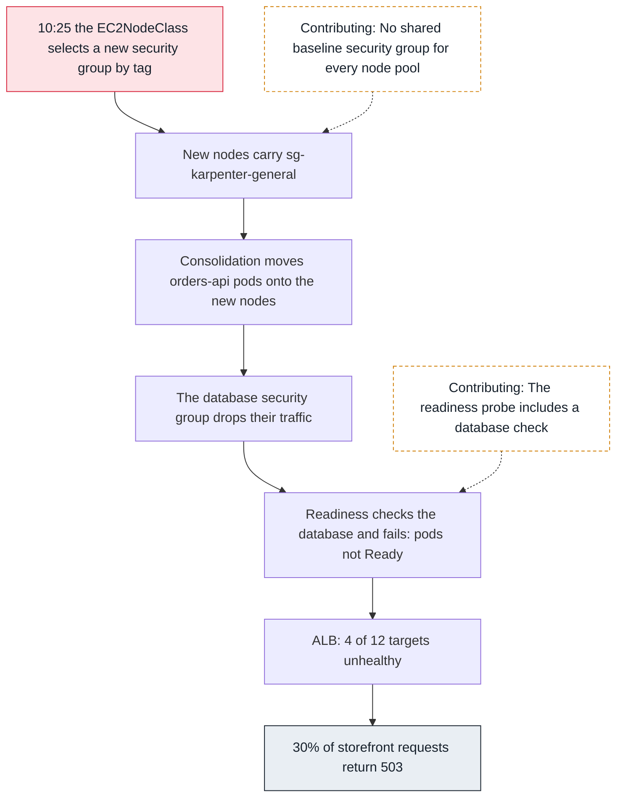
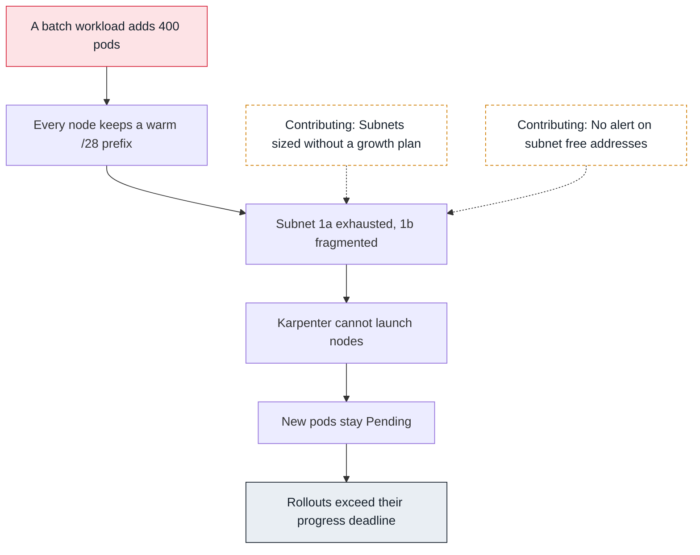
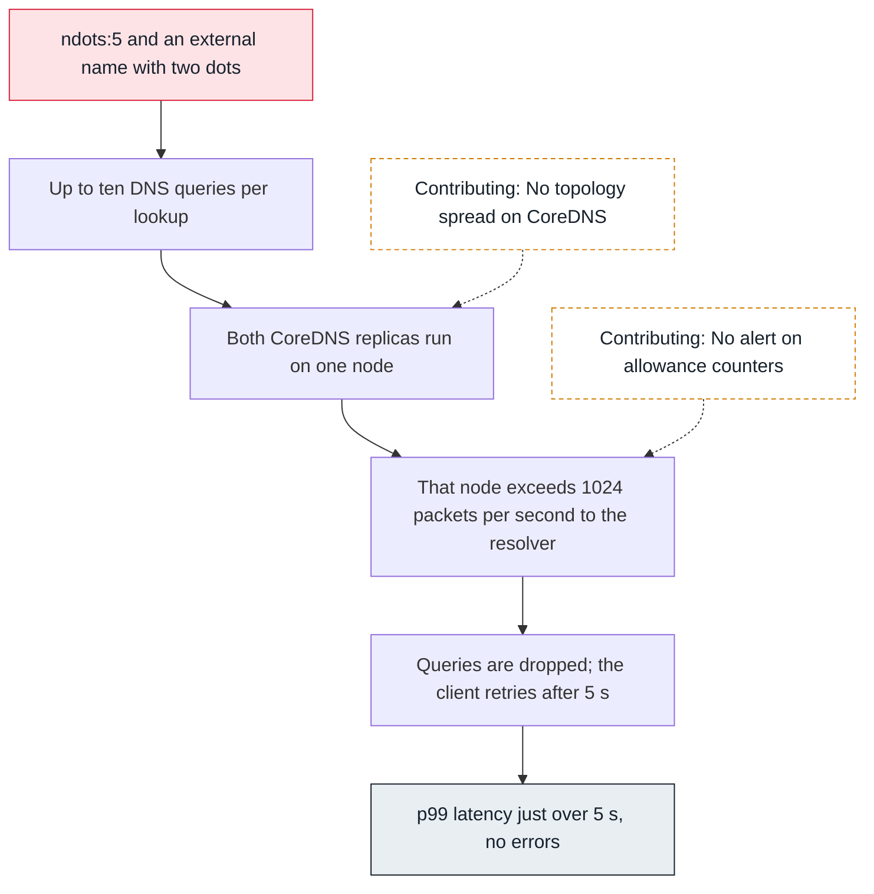
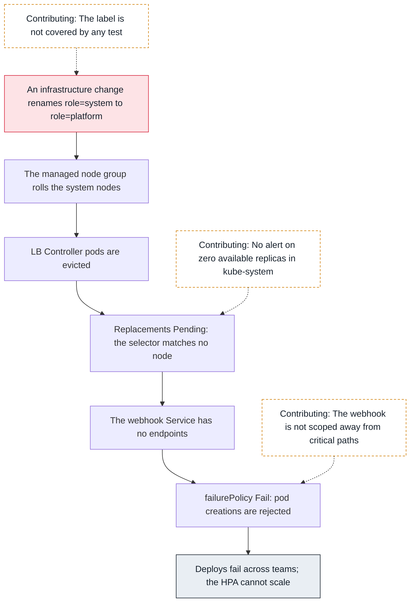

<!-- Generated from data/incidents.js by `node scripts/atlas.mjs docs`. Edit the data, then regenerate. -->

# Incidents

Each investigation starts from what someone noticed and follows dependencies, one hop at a time, until it reaches the change that caused it. [Replay them on the map](../index.html#/incidents).

## 503s that began in a database security group

SEV2, Tuesday 10:40, eu-west-1. 30% of storefront requests return 503. The ALB's unhealthy host count for orders-api rose from 0 to 4 of 12.

### Hop 1: Start where users feel it (Load balancer)

```sh
aws elbv2 describe-target-health --target-group-arn "$TG_ORDERS" \
  --query 'TargetHealthDescriptions[?TargetHealth.State!=`healthy`].[Target.Id,TargetHealth.Reason]' --output text
```

```text
10.20.41.17   Target.ResponseCodeMismatch
10.20.44.203  Target.ResponseCodeMismatch
10.20.52.9    Target.ResponseCodeMismatch
10.20.53.120  Target.ResponseCodeMismatch
```

The ALB reaches the targets, and four of twelve answer its health check with 503. The load balancer is reporting a problem, not causing one. Next hop: those pods.

### Hop 2: Which pods, and where do they run? (Your pod)

```sh
kubectl get pods -n shop -l app=orders-api -o wide
```

```text
NAME                     READY  STATUS   NODE
orders-api-7d9f8-2kq5w   0/1    Running  ip-10-20-41-8    (created 10:31)
orders-api-7d9f8-8hx2c   0/1    Running  ip-10-20-52-31   (created 10:33)
orders-api-7d9f8-b7m4n   1/1    Running  ip-10-20-33-14
...
```

The four unready pods all run on nodes created after 10:30. The eight healthy ones run on older nodes. Scope: new nodes only.

### Hop 3: Why are they not Ready? (kubelet)

```sh
kubectl describe pod orders-api-7d9f8-2kq5w -n shop | grep -A1 Unhealthy
```

```text
Warning  Unhealthy  kubelet  Readiness probe failed: HTTP probe failed with statuscode: 503
         body: {"db":"timeout"}
```

Readiness fails on a dependency check: the app says the database times out.

### Hop 4: Test the dependency from both sides (RDS)

```sh
kubectl exec -n shop orders-api-7d9f8-2kq5w -- nc -vz -w3 orders-db.larder.internal 5432
kubectl exec -n shop orders-api-7d9f8-b7m4n -- nc -vz -w3 orders-db.larder.internal 5432
```

```text
nc: orders-db.larder.internal (10.20.80.12:5432): Connection timed out
orders-db.larder.internal (10.20.80.12:5432) open
```

From a new node the connection times out; from an old node it opens. A timeout is a silent drop, not a refusal.

### Hop 5: Find what drops the packets (Security groups)

```sh
aws ec2 describe-security-groups --group-ids "$DB_SG" \
  --query 'SecurityGroups[].IpPermissions[].UserIdGroupPairs[].GroupId'
kubectl get ec2nodeclass general -o jsonpath='{.spec.securityGroupSelectorTerms}'
```

```text
["sg-0nodes-legacy"]
[{"tags":{"karpenter.sh/discovery":"larder-prod-general"}}]
```

The database allows only the legacy node group. A change at 10:25 made the EC2NodeClass select a new group by tag, so new nodes carry sg-karpenter-general.

### Hop 6: Why did the pods move to new nodes? (Karpenter)

```sh
kubectl logs -n kube-system -l app.kubernetes.io/name=karpenter --since=1h | grep -i disrupting
```

```text
disrupting nodeclaim(s) via replace, terminating 2 nodes and replacing with 1 node (reason: underutilized)
```

Consolidation replaced old nodes from 10:30 onwards, so pods kept landing behind the new security group.

**Root cause.** A security group selector change in the EC2NodeClass gave new nodes a group the database does not allow. Karpenter consolidation moved pods onto those nodes, and a readiness check on the database turned a partial network problem into lost capacity.



- **Mitigate:** Allow sg-karpenter-general on the database.
- **Fix:** Give every node pool the same baseline security group, and reference that group from the database.
- **Resilience:** Take the database check out of readiness; report it as a metric instead.

## Deploys hang because a subnet ran out

SEV3, Thursday 14:05, eu-west-1. Argo CD shows orders-api Progressing for 12 minutes, then the pipeline fails: exceeded its progress deadline.

### Hop 1: The rollout is stuck (Controller manager)

```sh
kubectl rollout status deploy/orders-api -n shop --timeout=10s
kubectl get rs -n shop -l app=orders-api
```

```text
error: deployment "orders-api" exceeded its progress deadline
NAME                   DESIRED  CURRENT  READY
orders-api-5c8d7f9b6   2        2        0
orders-api-7d9f8c4d5   12       12       12
```

The new ReplicaSet has two pods and neither is ready. Next hop: why those pods are not running.

### Hop 2: Why are the new pods Pending? (Scheduler)

```sh
kubectl describe pod -n shop -l pod-template-hash=5c8d7f9b6 | grep -A1 FailedScheduling
```

```text
Warning  FailedScheduling  default-scheduler  0/14 nodes are available: 14 Insufficient cpu.
```

No room on existing nodes. That should make Karpenter launch one, so why has it not?

### Hop 3: Karpenter tries, and fails (Karpenter)

```sh
kubectl get nodeclaims
kubectl logs -n kube-system -l app.kubernetes.io/name=karpenter --since=30m | grep -i -E 'insufficient|error' | tail -2
```

```text
NAME            TYPE       ZONE        READY
general-x8k2p   m6i.large  eu-west-1a  False
... InsufficientFreeAddressesInSubnet: subnet-0a1c (eu-west-1a)
... InsufficientCidrBlocks: subnet-0b2d (eu-west-1b)
```

NodeClaims are created and deleted in a loop: EC2 refuses to place instances in the subnets.

### Hop 4: Look at the subnets (Subnet IPs)

```sh
aws ec2 describe-subnets --filters Name=tag:karpenter.sh/discovery,Values=larder-prod \
  --query 'Subnets[].[SubnetId,AvailabilityZone,AvailableIpAddressCount]' --output text
```

```text
subnet-0a1c  eu-west-1a   11
subnet-0b2d  eu-west-1b  140
subnet-0c3e  eu-west-1c   96
```

1a is exhausted. 1b still has addresses, but prefix delegation needs contiguous /28 blocks and none remain.

### Hop 5: Why now? (VPC CNI)

```sh
kubectl get ds aws-node -n kube-system -o yaml | grep -A1 -E 'name: (ENABLE_PREFIX_DELEGATION|WARM_PREFIX_TARGET)'
```

```text
- name: ENABLE_PREFIX_DELEGATION
  value: "true"
- name: WARM_PREFIX_TARGET
  value: "1"
```

A batch workload added 400 pods last week, and every node holds a spare /28 prefix. Together they consumed the subnets.

**Root cause.** Pod subnets sized for last year's workload were consumed by a new batch tenant plus warm prefixes on every node, and fragmented by /28 allocation. Every component on the way reported faithfully that something below it was missing.



- **Mitigate:** Lower the warm targets so nodes release spare prefixes.
- **Fix:** Add a secondary CIDR with large pod subnets, and subnet CIDR reservations for /28 blocks.
- **Prevent:** Alert when any cluster subnet falls below 20% free.

## Five-second latency spikes with no errors

SEV3, Weekdays at peak, eu-west-1. p99 latency of dispatch-worker's calls to a mapping API jumps to just over 5 s several times a minute. p50 is unchanged and nothing logs an error.

### Hop 1: Read the shape of the latency (Your pod)

```sh
# PromQL: p99 of outbound calls from dispatch-worker
histogram_quantile(0.99, sum by (le) (rate(http_client_request_duration_seconds_bucket{service="dispatch-worker"}[5m])))
```

```text
p50 0.21 s   p99 5.04 s   errors 0
```

Just over five seconds, again and again. Five seconds is the resolver's default retry timeout: suspect DNS before the mapping API.

### Hop 2: Ask CoreDNS (CoreDNS)

```sh
kubectl logs -n kube-system -l k8s-app=kube-dns --since=15m | grep -i timeout | tail -1
```

```text
[ERROR] plugin/errors: 2 maps.example-provider.com. A: read udp 10.20.33.4:51234->10.20.0.2:53: i/o timeout
```

CoreDNS's upstream, the VPC resolver, is timing out.

### Hop 3: Where do the replicas run? (CoreDNS)

```sh
kubectl get pods -n kube-system -l k8s-app=kube-dns -o wide
```

```text
coredns-6d4b7c9f8-k2x7p  1/1  Running  ip-10-20-33-4
coredns-6d4b7c9f8-q9m2d  1/1  Running  ip-10-20-33-4
```

Both replicas share one node, so they share one network interface's packet allowance.

### Hop 4: Is that node over its allowance? (VPC DNS (.2))

```sh
# on ip-10-20-33-4, through an SSM session
ethtool -S eth0 | grep linklocal_allowance_exceeded
```

```text
linklocal_allowance_exceeded: 18342   (climbing)
```

Packets to the VPC resolver are dropped at the interface: more than 1024 per second.

### Hop 5: Why so many queries? (Your pod)

```sh
kubectl exec -n fulfilment deploy/dispatch-worker -- cat /etc/resolv.conf
```

```text
search fulfilment.svc.cluster.local svc.cluster.local cluster.local eu-west-1.compute.internal
nameserver 172.20.0.10
options ndots:5
```

maps.example-provider.com has two dots, fewer than five, so each lookup tries four search domains first, for A and AAAA: up to ten queries per call.

**Root cause.** DNS amplification from ndots:5, concentrated by two CoreDNS replicas on one node, exceeded that node's per-interface packet allowance to the VPC resolver.



- **Mitigate:** Delete one CoreDNS pod so its replacement lands on another node.
- **Fix:** Spread CoreDNS with topology constraints, autoscale it, and add NodeLocal DNSCache.
- **Prevent:** Use FQDNs with a trailing dot for external hosts; alert on CoreDNS upstream errors and allowance counters.

## The Tuesday deploys stopped

SEV2, Tuesday 10:58, eu-west-1. CI reports that three teams' deploys failed in ten minutes. Running pods are fine and traffic is normal, but no new pod can be created.

### Hop 1: 10:58: CI fails for three teams (kubectl / CI)

```sh
# from the CI log
```

```text
Internal error occurred: failed calling webhook "mpod.elbv2.k8s.aws": failed to call webhook:
Post "https://aws-load-balancer-webhook-service.kube-system.svc:443/mutate-v1-pod?timeout=10s":
no endpoints available for service "aws-load-balancer-webhook-service"
```

The message names the mechanism: the API server cannot reach the LB Controller's pod webhook. SEV2 declared at 11:01, because the HPA cannot add pods before the evening peak either.

### Hop 2: How wide is the blast radius? (API server)

```sh
kubectl get mutatingwebhookconfiguration aws-load-balancer-webhook \
  -o jsonpath='{range .webhooks[*]}{.name}{" "}{.failurePolicy}{"\n"}{end}'
```

```text
mpod.elbv2.k8s.aws Fail
mservice.elbv2.k8s.aws Fail
```

failurePolicy Fail: every pod creation in namespaces with readiness gate injection is rejected, including HPA scale-outs.

### Hop 3: Why does the webhook have no endpoints? (LB Controller)

```sh
kubectl get pods -n kube-system -l app.kubernetes.io/name=aws-load-balancer-controller
```

```text
NAME                                           READY  STATUS
aws-load-balancer-controller-6b8d9f7c5d-4kqzt  0/1    Pending
aws-load-balancer-controller-6b8d9f7c5d-9wlmx  0/1    Pending
```

Both replicas are Pending, so the webhook Service has nothing behind it.

### Hop 4: Why can they not be scheduled? (Scheduler)

```sh
kubectl describe pod -n kube-system aws-load-balancer-controller-6b8d9f7c5d-4kqzt | grep -A1 FailedScheduling
```

```text
0/3 nodes are available: 3 node(s) didn't match Pod's node affinity/selector.
```

The controller selects role: system, and no node carries that label any more.

### Hop 5: What changed on the nodes? (kubelet)

```sh
kubectl get nodes -L role
```

```text
NAME                          STATUS  ROLE
ip-10-20-30-11.eu-west-1...   Ready   platform
ip-10-20-46-90.eu-west-1...   Ready   platform
ip-10-20-58-23.eu-west-1...   Ready   platform
```

An infrastructure change merged at 10:40 renamed the label to role: platform. The managed node group rolled its nodes, evicting the controller, and the replacements matched no node.

### Hop 6: 11:11: mitigate (LB Controller)

```sh
helm upgrade aws-load-balancer-controller eks/aws-load-balancer-controller -n kube-system \
  --reuse-values --set nodeSelector.role=platform
```

```text
Release "aws-load-balancer-controller" has been upgraded. Happy Helming!
```

11:14: pods Running, endpoints back, CI reruns pass. Sixteen minutes of blocked deploys and no customer impact.

**Root cause.** A node group label rename rolled the system nodes. The LB Controller's replacements matched no node, its webhook lost every endpoint, and failurePolicy: Fail turned that into rejected pod creations for every team.



- **Mitigate:** Point the controller's node selector at the new label.
- **Prevent:** Test in CI that every platform component's selectors match a node pool.
- **Detect:** Alert on any kube-system Deployment with zero available replicas.
- **Reduce impact:** Review every webhook's failurePolicy, namespaceSelector and timeout.
